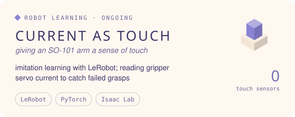

<p align="center">
  
</p>

<p align="center">
  <a href="https://ziyuefang.dev"></a>
  <a href="https://collegepilot.app"></a>
  <a href="mailto:ziyue.fang@columbia.edu"></a>
</p>

<p align="center">
  Hi, I'm <b>Toby</b> (Ziyue Fang), a CS junior at Columbia Engineering who likes building things people actually use.<br />
  I founded <a href="https://collegepilot.app">CollegePilot</a>, an AI college counselor with 5K+ weekly users, was a product engineer intern at Claim (~700K MAU),<br />
  and did LLM research at Vanderbilt. Lately I'm teaching a robot arm to feel through servo current.
</p>

<p align="center">
  
</p>


<p align="center">
  <a href="https://collegepilot.app"></a>
  <a href="https://github.com/Tobbs2005?tab=repositories"></a>
  <a href="https://movie-match-ten-zeta.vercel.app"></a>
  <a href="https://github.com/Tobbs2005?tab=repositories"></a>
</p>


<p align="center">
  
</p>


<p align="center">
  <a href="https://tobbs2005.github.io/Tobbs2005/">
    
  </a>
  <br />
  <sub>my last year of commits as a tiny 3D world. <a href="https://tobbs2005.github.io/Tobbs2005/">click to walk the duck around</a> and collect the busiest days.</sub>
</p>

<p align="center">
  
  
</p>


<sub>every tower is a day of commits. drag to spin it, scroll to zoom.</sub>

<!-- skyline:start -->
```stl
solid contributions
facet normal 0 0 1
outer loop
vertex -1 -1 0
vertex 40.15 -1 0
vertex 40.15 7.15 0
endloop
endfacet
facet normal 0 0 1
outer loop
vertex -1 -1 0
vertex 40.15 7.15 0
vertex -1 7.15 0
endloop
endfacet
facet normal 0 -1 0
outer loop
vertex -1 -1 -1.5
vertex 40.15 -1 -1.5
vertex 40.15 -1 0
endloop
endfacet
facet normal 0 -1 0
outer loop
vertex -1 -1 -1.5
vertex 40.15 -1 0
vertex -1 -1 0
endloop
endfacet
facet normal 0 1 0
outer loop
vertex 40.15 7.15 -1.5
vertex -1 7.15 -1.5
vertex -1 7.15 0
endloop
endfacet
facet normal 0 1 0
outer loop
vertex 40.15 7.15 -1.5
vertex -1 7.15 0
vertex 40.15 7.15 0
endloop
endfacet
facet normal -1 0 0
outer loop
vertex -1 7.15 -1.5
vertex -1 -1 -1.5
vertex -1 -1 0
endloop
endfacet
facet normal -1 0 0
outer loop
vertex -1 7.15 -1.5
vertex -1 -1 0
vertex -1 7.15 0
endloop
endfacet
facet normal 1 0 0
outer loop
vertex 40.15 -1 -1.5
vertex 40.15 7.15 -1.5
vertex 40.15 7.15 0
endloop
endfacet
facet normal 1 0 0
outer loop
vertex 40.15 -1 -1.5
vertex 40.15 7.15 0
vertex 40.15 -1 0
endloop
endfacet
facet normal 0 0 -1
outer loop
vertex -1 7.15 -1.5
vertex 40.15 7.15 -1.5
vertex 40.15 -1 -1.5
endloop
endfacet
facet normal 0 0 -1
outer loop
vertex -1 7.15 -1.5
vertex 40.15 -1 -1.5
vertex -1 -1 -1.5
endloop
endfacet
facet normal 0 0 1
outer loop
vertex 0.08 4.08 0.84
vertex 0.92 4.08 0.84
vertex 0.92 4.92 0.84
endloop
endfacet
facet normal 0 0 1
outer loop
vertex 0.08 4.08 0.84
vertex 0.92 4.92 0.84
vertex 0.08 4.92 0.84
endloop
endfacet
facet normal 0 -1 0
outer loop
vertex 0.08 4.08 0
vertex 0.92 4.08 0
vertex 0.92 4.08 0.84
endloop
endfacet
facet normal 0 -1 0
outer loop
vertex 0.08 4.08 0
vertex 0.92 4.08 0.84
vertex 0.08 4.08 0.84
endloop
endfacet
facet normal 0 1 0
outer loop
vertex 0.92 4.92 0
vertex 0.08 4.92 0
vertex 0.08 4.92 0.84
endloop
endfacet
facet normal 0 1 0
outer loop
vertex 0.92 4.92 0
vertex 0.08 4.92 0.84
vertex 0.92 4.92 0.84
endloop
endfacet
facet normal -1 0 0
outer loop
vertex 0.08 4.92 0
vertex 0.08 4.08 0
vertex 0.08 4.08 0.84
endloop
endfacet
facet normal -1 0 0
outer loop
vertex 0.08 4.92 0
vertex 0.08 4.08 0.84
vertex 0.08 4.92 0.84
endloop
endfacet
facet normal 1 0 0
outer loop
vertex 0.92 4.08 0
vertex 0.92 4.92 0
vertex 0.92 4.92 0.84
endloop
endfacet
facet normal 1 0 0
outer loop
vertex 0.92 4.08 0
vertex 0.92 4.92 0.84
vertex 0.92 4.08 0.84
endloop
endfacet
facet normal 0 0 1
outer loop
vertex 0.08 1.08 0.84
vertex 0.92 1.08 0.84
vertex 0.92 1.92 0.84
endloop
endfacet
facet normal 0 0 1
outer loop
vertex 0.08 1.08 0.84
vertex 0.92 1.92 0.84
vertex 0.08 1.92 0.84
endloop
endfacet
facet normal 0 -1 0
outer loop
vertex 0.08 1.08 0
vertex 0.92 1.08 0
vertex 0.92 1.08 0.84
endloop
endfacet
facet normal 0 -1 0
outer loop
vertex 0.08 1.08 0
vertex 0.92 1.08 0.84
vertex 0.08 1.08 0.84
endloop
endfacet
facet normal 0 1 0
outer loop
vertex 0.92 1.92 0
vertex 0.08 1.92 0
vertex 0.08 1.92 0.84
endloop
endfacet
facet normal 0 1 0
outer loop
vertex 0.92 1.92 0
vertex 0.08 1.92 0.84
vertex 0.92 1.92 0.84
endloop
endfacet
facet normal -1 0 0
outer loop
vertex 0.08 1.92 0
vertex 0.08 1.08 0
vertex 0.08 1.08 0.84
endloop
endfacet
facet normal -1 0 0
outer loop
vertex 0.08 1.92 0
vertex 0.08 1.08 0.84
vertex 0.08 1.92 0.84
endloop
endfacet
facet normal 1 0 0
outer loop
vertex 0.92 1.08 0
vertex 0.92 1.92 0
vertex 0.92 1.92 0.84
endloop
endfacet
facet normal 1 0 0
outer loop
vertex 0.92 1.08 0
vertex 0.92 1.92 0.84
vertex 0.92 1.08 0.84
endloop
endfacet
facet normal 0 0 1
outer loop
vertex 0.08 0.08 1.88
vertex 0.92 0.08 1.88
vertex 0.92 0.92 1.88
endloop
endfacet
facet normal 0 0 1
outer loop
vertex 0.08 0.08 1.88
vertex 0.92 0.92 1.88
vertex 0.08 0.92 1.88
endloop
endfacet
facet normal 0 -1 0
outer loop
vertex 0.08 0.08 0
vertex 0.92 0.08 0
vertex 0.92 0.08 1.88
endloop
endfacet
facet normal 0 -1 0
outer loop
vertex 0.08 0.08 0
vertex 0.92 0.08 1.88
vertex 0.08 0.08 1.88
endloop
endfacet
facet normal 0 1 0
outer loop
vertex 0.92 0.92 0
vertex 0.08 0.92 0
vertex 0.08 0.92 1.88
endloop
endfacet
facet normal 0 1 0
outer loop
vertex 0.92 0.92 0
vertex 0.08 0.92 1.88
vertex 0.92 0.92 1.88
endloop
endfacet
facet normal -1 0 0
outer loop
vertex 0.08 0.92 0
vertex 0.08 0.08 0
vertex 0.08 0.08 1.88
endloop
endfacet
facet normal -1 0 0
outer loop
vertex 0.08 0.92 0
vertex 0.08 0.08 1.88
vertex 0.08 0.92 1.88
endloop
endfacet
facet normal 1 0 0
outer loop
vertex 0.92 0.08 0
vertex 0.92 0.92 0
vertex 0.92 0.92 1.88
endloop
endfacet
facet normal 1 0 0
outer loop
vertex 0.92 0.08 0
vertex 0.92 0.92 1.88
vertex 0.92 0.08 1.88
endloop
endfacet
facet normal 0 0 1
outer loop
vertex 1.08 5.08 1.19
vertex 1.92 5.08 1.19
vertex 1.92 5.92 1.19
endloop
endfacet
facet normal 0 0 1
outer loop
vertex 1.08 5.08 1.19
vertex 1.92 5.92 1.19
vertex 1.08 5.92 1.19
endloop
endfacet
facet normal 0 -1 0
outer loop
vertex 1.08 5.08 0
vertex 1.92 5.08 0
vertex 1.92 5.08 1.19
endloop
endfacet
facet normal 0 -1 0
outer loop
vertex 1.08 5.08 0
vertex 1.92 5.08 1.19
vertex 1.08 5.08 1.19
endloop
endfacet
facet normal 0 1 0
outer loop
vertex 1.92 5.92 0
vertex 1.08 5.92 0
vertex 1.08 5.92 1.19
endloop
endfacet
facet normal 0 1 0
outer loop
vertex 1.92 5.92 0
vertex 1.08 5.92 1.19
vertex 1.92 5.92 1.19
endloop
endfacet
facet normal -1 0 0
outer loop
vertex 1.08 5.92 0
vertex 1.08 5.08 0
vertex 1.08 5.08 1.19
endloop
endfacet
facet normal -1 0 0
outer loop
vertex 1.08 5.92 0
vertex 1.08 5.08 1.19
vertex 1.08 5.92 1.19
endloop
endfacet
facet normal 1 0 0
outer loop
vertex 1.92 5.08 0
vertex 1.92 5.92 0
vertex 1.92 5.92 1.19
endloop
endfacet
facet normal 1 0 0
outer loop
vertex 1.92 5.08 0
vertex 1.92 5.92 1.19
vertex 1.92 5.08 1.19
endloop
endfacet
facet normal 0 0 1
outer loop
vertex 1.08 3.08 6.34
vertex 1.92 3.08 6.34
vertex 1.92 3.92 6.34
endloop
endfacet
facet normal 0 0 1
outer loop
vertex 1.08 3.08 6.34
vertex 1.92 3.92 6.34
vertex 1.08 3.92 6.34
endloop
endfacet
facet normal 0 -1 0
outer loop
vertex 1.08 3.08 0
vertex 1.92 3.08 0
vertex 1.92 3.08 6.34
endloop
endfacet
facet normal 0 -1 0
outer loop
vertex 1.08 3.08 0
vertex 1.92 3.08 6.34
vertex 1.08 3.08 6.34
endloop
endfacet
facet normal 0 1 0
outer loop
vertex 1.92 3.92 0
vertex 1.08 3.92 0
vertex 1.08 3.92 6.34
endloop
endfacet
facet normal 0 1 0
outer loop
vertex 1.92 3.92 0
vertex 1.08 3.92 6.34
vertex 1.92 3.92 6.34
endloop
endfacet
facet normal -1 0 0
outer loop
vertex 1.08 3.92 0
vertex 1.08 3.08 0
vertex 1.08 3.08 6.34
endloop
endfacet
facet normal -1 0 0
outer loop
vertex 1.08 3.92 0
vertex 1.08 3.08 6.34
vertex 1.08 3.92 6.34
endloop
endfacet
facet normal 1 0 0
outer loop
vertex 1.92 3.08 0
vertex 1.92 3.92 0
vertex 1.92 3.92 6.34
endloop
endfacet
facet normal 1 0 0
outer loop
vertex 1.92 3.08 0
vertex 1.92 3.92 6.34
vertex 1.92 3.08 6.34
endloop
endfacet
facet normal 0 0 1
outer loop
vertex 1.08 0.08 4.97
vertex 1.92 0.08 4.97
vertex 1.92 0.92 4.97
endloop
endfacet
facet normal 0 0 1
outer loop
vertex 1.08 0.08 4.97
vertex 1.92 0.92 4.97
vertex 1.08 0.92 4.97
endloop
endfacet
facet normal 0 -1 0
outer loop
vertex 1.08 0.08 0
vertex 1.92 0.08 0
vertex 1.92 0.08 4.97
endloop
endfacet
facet normal 0 -1 0
outer loop
vertex 1.08 0.08 0
vertex 1.92 0.08 4.97
vertex 1.08 0.08 4.97
endloop
endfacet
facet normal 0 1 0
outer loop
vertex 1.92 0.92 0
vertex 1.08 0.92 0
vertex 1.08 0.92 4.97
endloop
endfacet
facet normal 0 1 0
outer loop
vertex 1.92 0.92 0
vertex 1.08 0.92 4.97
vertex 1.92 0.92 4.97
endloop
endfacet
facet normal -1 0 0
outer loop
vertex 1.08 0.92 0
vertex 1.08 0.08 0
vertex 1.08 0.08 4.97
endloop
endfacet
facet normal -1 0 0
outer loop
vertex 1.08 0.92 0
vertex 1.08 0.08 4.97
vertex 1.08 0.92 4.97
endloop
endfacet
facet normal 1 0 0
outer loop
vertex 1.92 0.08 0
vertex 1.92 0.92 0
vertex 1.92 0.92 4.97
endloop
endfacet
facet normal 1 0 0
outer loop
vertex 1.92 0.08 0
vertex 1.92 0.92 4.97
vertex 1.92 0.08 4.97
endloop
endfacet
facet normal 0 0 1
outer loop
vertex 2.08 6.08 1.88
vertex 2.92 6.08 1.88
vertex 2.92 6.92 1.88
endloop
endfacet
facet normal 0 0 1
outer loop
vertex 2.08 6.08 1.88
vertex 2.92 6.92 1.88
vertex 2.08 6.92 1.88
endloop
endfacet
facet normal 0 -1 0
outer loop
vertex 2.08 6.08 0
vertex 2.92 6.08 0
vertex 2.92 6.08 1.88
endloop
endfacet
facet normal 0 -1 0
outer loop
vertex 2.08 6.08 0
vertex 2.92 6.08 1.88
vertex 2.08 6.08 1.88
endloop
endfacet
facet normal 0 1 0
outer loop
vertex 2.92 6.92 0
vertex 2.08 6.92 0
vertex 2.08 6.92 1.88
endloop
endfacet
facet normal 0 1 0
outer loop
vertex 2.92 6.92 0
vertex 2.08 6.92 1.88
vertex 2.92 6.92 1.88
endloop
endfacet
facet normal -1 0 0
outer loop
vertex 2.08 6.92 0
vertex 2.08 6.08 0
vertex 2.08 6.08 1.88
endloop
endfacet
facet normal -1 0 0
outer loop
vertex 2.08 6.92 0
vertex 2.08 6.08 1.88
vertex 2.08 6.92 1.88
endloop
endfacet
facet normal 1 0 0
outer loop
vertex 2.92 6.08 0
vertex 2.92 6.92 0
vertex 2.92 6.92 1.88
endloop
endfacet
facet normal 1 0 0
outer loop
vertex 2.92 6.08 0
vertex 2.92 6.92 1.88
vertex 2.92 6.08 1.88
endloop
endfacet
facet normal 0 0 1
outer loop
vertex 2.08 4.08 2.56
vertex 2.92 4.08 2.56
vertex 2.92 4.92 2.56
endloop
endfacet
facet normal 0 0 1
outer loop
vertex 2.08 4.08 2.56
vertex 2.92 4.92 2.56
vertex 2.08 4.92 2.56
endloop
endfacet
facet normal 0 -1 0
outer loop
vertex 2.08 4.08 0
vertex 2.92 4.08 0
vertex 2.92 4.08 2.56
endloop
endfacet
facet normal 0 -1 0
outer loop
vertex 2.08 4.08 0
vertex 2.92 4.08 2.56
vertex 2.08 4.08 2.56
endloop
endfacet
facet normal 0 1 0
outer loop
vertex 2.92 4.92 0
vertex 2.08 4.92 0
vertex 2.08 4.92 2.56
endloop
endfacet
facet normal 0 1 0
outer loop
vertex 2.92 4.92 0
vertex 2.08 4.92 2.56
vertex 2.92 4.92 2.56
endloop
endfacet
facet normal -1 0 0
outer loop
vertex 2.08 4.92 0
vertex 2.08 4.08 0
vertex 2.08 4.08 2.56
endloop
endfacet
facet normal -1 0 0
outer loop
vertex 2.08 4.92 0
vertex 2.08 4.08 2.56
vertex 2.08 4.92 2.56
endloop
endfacet
facet normal 1 0 0
outer loop
vertex 2.92 4.08 0
vertex 2.92 4.92 0
vertex 2.92 4.92 2.56
endloop
endfacet
facet normal 1 0 0
outer loop
vertex 2.92 4.08 0
vertex 2.92 4.92 2.56
vertex 2.92 4.08 2.56
endloop
endfacet
facet normal 0 0 1
outer loop
vertex 2.08 1.08 1.19
vertex 2.92 1.08 1.19
vertex 2.92 1.92 1.19
endloop
endfacet
facet normal 0 0 1
outer loop
vertex 2.08 1.08 1.19
vertex 2.92 1.92 1.19
vertex 2.08 1.92 1.19
endloop
endfacet
facet normal 0 -1 0
outer loop
vertex 2.08 1.08 0
vertex 2.92 1.08 0
vertex 2.92 1.08 1.19
endloop
endfacet
facet normal 0 -1 0
outer loop
vertex 2.08 1.08 0
vertex 2.92 1.08 1.19
vertex 2.08 1.08 1.19
endloop
endfacet
facet normal 0 1 0
outer loop
vertex 2.92 1.92 0
vertex 2.08 1.92 0
vertex 2.08 1.92 1.19
endloop
endfacet
facet normal 0 1 0
outer loop
vertex 2.92 1.92 0
vertex 2.08 1.92 1.19
vertex 2.92 1.92 1.19
endloop
endfacet
facet normal -1 0 0
outer loop
vertex 2.08 1.92 0
vertex 2.08 1.08 0
vertex 2.08 1.08 1.19
endloop
endfacet
facet normal -1 0 0
outer loop
vertex 2.08 1.92 0
vertex 2.08 1.08 1.19
vertex 2.08 1.92 1.19
endloop
endfacet
facet normal 1 0 0
outer loop
vertex 2.92 1.08 0
vertex 2.92 1.92 0
vertex 2.92 1.92 1.19
endloop
endfacet
facet normal 1 0 0
outer loop
vertex 2.92 1.08 0
vertex 2.92 1.92 1.19
vertex 2.92 1.08 1.19
endloop
endfacet
facet normal 0 0 1
outer loop
vertex 3.08 4.08 0.84
vertex 3.92 4.08 0.84
vertex 3.92 4.92 0.84
endloop
endfacet
facet normal 0 0 1
outer loop
vertex 3.08 4.08 0.84
vertex 3.92 4.92 0.84
vertex 3.08 4.92 0.84
endloop
endfacet
facet normal 0 -1 0
outer loop
vertex 3.08 4.08 0
vertex 3.92 4.08 0
vertex 3.92 4.08 0.84
endloop
endfacet
facet normal 0 -1 0
outer loop
vertex 3.08 4.08 0
vertex 3.92 4.08 0.84
vertex 3.08 4.08 0.84
endloop
endfacet
facet normal 0 1 0
outer loop
vertex 3.92 4.92 0
vertex 3.08 4.92 0
vertex 3.08 4.92 0.84
endloop
endfacet
facet normal 0 1 0
outer loop
vertex 3.92 4.92 0
vertex 3.08 4.92 0.84
vertex 3.92 4.92 0.84
endloop
endfacet
facet normal -1 0 0
outer loop
vertex 3.08 4.92 0
vertex 3.08 4.08 0
vertex 3.08 4.08 0.84
endloop
endfacet
facet normal -1 0 0
outer loop
vertex 3.08 4.92 0
vertex 3.08 4.08 0.84
vertex 3.08 4.92 0.84
endloop
endfacet
facet normal 1 0 0
outer loop
vertex 3.92 4.08 0
vertex 3.92 4.92 0
vertex 3.92 4.92 0.84
endloop
endfacet
facet normal 1 0 0
outer loop
vertex 3.92 4.08 0
vertex 3.92 4.92 0.84
vertex 3.92 4.08 0.84
endloop
endfacet
facet normal 0 0 1
outer loop
vertex 3.08 3.08 1.19
vertex 3.92 3.08 1.19
vertex 3.92 3.92 1.19
endloop
endfacet
facet normal 0 0 1
outer loop
vertex 3.08 3.08 1.19
vertex 3.92 3.92 1.19
vertex 3.08 3.92 1.19
endloop
endfacet
facet normal 0 -1 0
outer loop
vertex 3.08 3.08 0
vertex 3.92 3.08 0
vertex 3.92 3.08 1.19
endloop
endfacet
facet normal 0 -1 0
outer loop
vertex 3.08 3.08 0
vertex 3.92 3.08 1.19
vertex 3.08 3.08 1.19
endloop
endfacet
facet normal 0 1 0
outer loop
vertex 3.92 3.92 0
vertex 3.08 3.92 0
vertex 3.08 3.92 1.19
endloop
endfacet
facet normal 0 1 0
outer loop
vertex 3.92 3.92 0
vertex 3.08 3.92 1.19
vertex 3.92 3.92 1.19
endloop
endfacet
facet normal -1 0 0
outer loop
vertex 3.08 3.92 0
vertex 3.08 3.08 0
vertex 3.08 3.08 1.19
endloop
endfacet
facet normal -1 0 0
outer loop
vertex 3.08 3.92 0
vertex 3.08 3.08 1.19
vertex 3.08 3.92 1.19
endloop
endfacet
facet normal 1 0 0
outer loop
vertex 3.92 3.08 0
vertex 3.92 3.92 0
vertex 3.92 3.92 1.19
endloop
endfacet
facet normal 1 0 0
outer loop
vertex 3.92 3.08 0
vertex 3.92 3.92 1.19
vertex 3.92 3.08 1.19
endloop
endfacet
facet normal 0 0 1
outer loop
vertex 3.08 1.08 0.84
vertex 3.92 1.08 0.84
vertex 3.92 1.92 0.84
endloop
endfacet
facet normal 0 0 1
outer loop
vertex 3.08 1.08 0.84
vertex 3.92 1.92 0.84
vertex 3.08 1.92 0.84
endloop
endfacet
facet normal 0 -1 0
outer loop
vertex 3.08 1.08 0
vertex 3.92 1.08 0
vertex 3.92 1.08 0.84
endloop
endfacet
facet normal 0 -1 0
outer loop
vertex 3.08 1.08 0
vertex 3.92 1.08 0.84
vertex 3.08 1.08 0.84
endloop
endfacet
facet normal 0 1 0
outer loop
vertex 3.92 1.92 0
vertex 3.08 1.92 0
vertex 3.08 1.92 0.84
endloop
endfacet
facet normal 0 1 0
outer loop
vertex 3.92 1.92 0
vertex 3.08 1.92 0.84
vertex 3.92 1.92 0.84
endloop
endfacet
facet normal -1 0 0
outer loop
vertex 3.08 1.92 0
vertex 3.08 1.08 0
vertex 3.08 1.08 0.84
endloop
endfacet
facet normal -1 0 0
outer loop
vertex 3.08 1.92 0
vertex 3.08 1.08 0.84
vertex 3.08 1.92 0.84
endloop
endfacet
facet normal 1 0 0
outer loop
vertex 3.92 1.08 0
vertex 3.92 1.92 0
vertex 3.92 1.92 0.84
endloop
endfacet
facet normal 1 0 0
outer loop
vertex 3.92 1.08 0
vertex 3.92 1.92 0.84
vertex 3.92 1.08 0.84
endloop
endfacet
facet normal 0 0 1
outer loop
vertex 4.08 1.08 1.53
vertex 4.92 1.08 1.53
vertex 4.92 1.92 1.53
endloop
endfacet
facet normal 0 0 1
outer loop
vertex 4.08 1.08 1.53
vertex 4.92 1.92 1.53
vertex 4.08 1.92 1.53
endloop
endfacet
facet normal 0 -1 0
outer loop
vertex 4.08 1.08 0
vertex 4.92 1.08 0
vertex 4.92 1.08 1.53
endloop
endfacet
facet normal 0 -1 0
outer loop
vertex 4.08 1.08 0
vertex 4.92 1.08 1.53
vertex 4.08 1.08 1.53
endloop
endfacet
facet normal 0 1 0
outer loop
vertex 4.92 1.92 0
vertex 4.08 1.92 0
vertex 4.08 1.92 1.53
endloop
endfacet
facet normal 0 1 0
outer loop
vertex 4.92 1.92 0
vertex 4.08 1.92 1.53
vertex 4.92 1.92 1.53
endloop
endfacet
facet normal -1 0 0
outer loop
vertex 4.08 1.92 0
vertex 4.08 1.08 0
vertex 4.08 1.08 1.53
endloop
endfacet
facet normal -1 0 0
outer loop
vertex 4.08 1.92 0
vertex 4.08 1.08 1.53
vertex 4.08 1.92 1.53
endloop
endfacet
facet normal 1 0 0
outer loop
vertex 4.92 1.08 0
vertex 4.92 1.92 0
vertex 4.92 1.92 1.53
endloop
endfacet
facet normal 1 0 0
outer loop
vertex 4.92 1.08 0
vertex 4.92 1.92 1.53
vertex 4.92 1.08 1.53
endloop
endfacet
facet normal 0 0 1
outer loop
vertex 5.08 4.08 2.56
vertex 5.92 4.08 2.56
vertex 5.92 4.92 2.56
endloop
endfacet
facet normal 0 0 1
outer loop
vertex 5.08 4.08 2.56
vertex 5.92 4.92 2.56
vertex 5.08 4.92 2.56
endloop
endfacet
facet normal 0 -1 0
outer loop
vertex 5.08 4.08 0
vertex 5.92 4.08 0
vertex 5.92 4.08 2.56
endloop
endfacet
facet normal 0 -1 0
outer loop
vertex 5.08 4.08 0
vertex 5.92 4.08 2.56
vertex 5.08 4.08 2.56
endloop
endfacet
facet normal 0 1 0
outer loop
vertex 5.92 4.92 0
vertex 5.08 4.92 0
vertex 5.08 4.92 2.56
endloop
endfacet
facet normal 0 1 0
outer loop
vertex 5.92 4.92 0
vertex 5.08 4.92 2.56
vertex 5.92 4.92 2.56
endloop
endfacet
facet normal -1 0 0
outer loop
vertex 5.08 4.92 0
vertex 5.08 4.08 0
vertex 5.08 4.08 2.56
endloop
endfacet
facet normal -1 0 0
outer loop
vertex 5.08 4.92 0
vertex 5.08 4.08 2.56
vertex 5.08 4.92 2.56
endloop
endfacet
facet normal 1 0 0
outer loop
vertex 5.92 4.08 0
vertex 5.92 4.92 0
vertex 5.92 4.92 2.56
endloop
endfacet
facet normal 1 0 0
outer loop
vertex 5.92 4.08 0
vertex 5.92 4.92 2.56
vertex 5.92 4.08 2.56
endloop
endfacet
facet normal 0 0 1
outer loop
vertex 5.08 2.08 1.19
vertex 5.92 2.08 1.19
vertex 5.92 2.92 1.19
endloop
endfacet
facet normal 0 0 1
outer loop
vertex 5.08 2.08 1.19
vertex 5.92 2.92 1.19
vertex 5.08 2.92 1.19
endloop
endfacet
facet normal 0 -1 0
outer loop
vertex 5.08 2.08 0
vertex 5.92 2.08 0
vertex 5.92 2.08 1.19
endloop
endfacet
facet normal 0 -1 0
outer loop
vertex 5.08 2.08 0
vertex 5.92 2.08 1.19
vertex 5.08 2.08 1.19
endloop
endfacet
facet normal 0 1 0
outer loop
vertex 5.92 2.92 0
vertex 5.08 2.92 0
vertex 5.08 2.92 1.19
endloop
endfacet
facet normal 0 1 0
outer loop
vertex 5.92 2.92 0
vertex 5.08 2.92 1.19
vertex 5.92 2.92 1.19
endloop
endfacet
facet normal -1 0 0
outer loop
vertex 5.08 2.92 0
vertex 5.08 2.08 0
vertex 5.08 2.08 1.19
endloop
endfacet
facet normal -1 0 0
outer loop
vertex 5.08 2.92 0
vertex 5.08 2.08 1.19
vertex 5.08 2.92 1.19
endloop
endfacet
facet normal 1 0 0
outer loop
vertex 5.92 2.08 0
vertex 5.92 2.92 0
vertex 5.92 2.92 1.19
endloop
endfacet
facet normal 1 0 0
outer loop
vertex 5.92 2.08 0
vertex 5.92 2.92 1.19
vertex 5.92 2.08 1.19
endloop
endfacet
facet normal 0 0 1
outer loop
vertex 7.08 5.08 3.94
vertex 7.92 5.08 3.94
vertex 7.92 5.92 3.94
endloop
endfacet
facet normal 0 0 1
outer loop
vertex 7.08 5.08 3.94
vertex 7.92 5.92 3.94
vertex 7.08 5.92 3.94
endloop
endfacet
facet normal 0 -1 0
outer loop
vertex 7.08 5.08 0
vertex 7.92 5.08 0
vertex 7.92 5.08 3.94
endloop
endfacet
facet normal 0 -1 0
outer loop
vertex 7.08 5.08 0
vertex 7.92 5.08 3.94
vertex 7.08 5.08 3.94
endloop
endfacet
facet normal 0 1 0
outer loop
vertex 7.92 5.92 0
vertex 7.08 5.92 0
vertex 7.08 5.92 3.94
endloop
endfacet
facet normal 0 1 0
outer loop
vertex 7.92 5.92 0
vertex 7.08 5.92 3.94
vertex 7.92 5.92 3.94
endloop
endfacet
facet normal -1 0 0
outer loop
vertex 7.08 5.92 0
vertex 7.08 5.08 0
vertex 7.08 5.08 3.94
endloop
endfacet
facet normal -1 0 0
outer loop
vertex 7.08 5.92 0
vertex 7.08 5.08 3.94
vertex 7.08 5.92 3.94
endloop
endfacet
facet normal 1 0 0
outer loop
vertex 7.92 5.08 0
vertex 7.92 5.92 0
vertex 7.92 5.92 3.94
endloop
endfacet
facet normal 1 0 0
outer loop
vertex 7.92 5.08 0
vertex 7.92 5.92 3.94
vertex 7.92 5.08 3.94
endloop
endfacet
facet normal 0 0 1
outer loop
vertex 7.08 4.08 1.88
vertex 7.92 4.08 1.88
vertex 7.92 4.92 1.88
endloop
endfacet
facet normal 0 0 1
outer loop
vertex 7.08 4.08 1.88
vertex 7.92 4.92 1.88
vertex 7.08 4.92 1.88
endloop
endfacet
facet normal 0 -1 0
outer loop
vertex 7.08 4.08 0
vertex 7.92 4.08 0
vertex 7.92 4.08 1.88
endloop
endfacet
facet normal 0 -1 0
outer loop
vertex 7.08 4.08 0
vertex 7.92 4.08 1.88
vertex 7.08 4.08 1.88
endloop
endfacet
facet normal 0 1 0
outer loop
vertex 7.92 4.92 0
vertex 7.08 4.92 0
vertex 7.08 4.92 1.88
endloop
endfacet
facet normal 0 1 0
outer loop
vertex 7.92 4.92 0
vertex 7.08 4.92 1.88
vertex 7.92 4.92 1.88
endloop
endfacet
facet normal -1 0 0
outer loop
vertex 7.08 4.92 0
vertex 7.08 4.08 0
vertex 7.08 4.08 1.88
endloop
endfacet
facet normal -1 0 0
outer loop
vertex 7.08 4.92 0
vertex 7.08 4.08 1.88
vertex 7.08 4.92 1.88
endloop
endfacet
facet normal 1 0 0
outer loop
vertex 7.92 4.08 0
vertex 7.92 4.92 0
vertex 7.92 4.92 1.88
endloop
endfacet
facet normal 1 0 0
outer loop
vertex 7.92 4.08 0
vertex 7.92 4.92 1.88
vertex 7.92 4.08 1.88
endloop
endfacet
facet normal 0 0 1
outer loop
vertex 7.08 2.08 1.53
vertex 7.92 2.08 1.53
vertex 7.92 2.92 1.53
endloop
endfacet
facet normal 0 0 1
outer loop
vertex 7.08 2.08 1.53
vertex 7.92 2.92 1.53
vertex 7.08 2.92 1.53
endloop
endfacet
facet normal 0 -1 0
outer loop
vertex 7.08 2.08 0
vertex 7.92 2.08 0
vertex 7.92 2.08 1.53
endloop
endfacet
facet normal 0 -1 0
outer loop
vertex 7.08 2.08 0
vertex 7.92 2.08 1.53
vertex 7.08 2.08 1.53
endloop
endfacet
facet normal 0 1 0
outer loop
vertex 7.92 2.92 0
vertex 7.08 2.92 0
vertex 7.08 2.92 1.53
endloop
endfacet
facet normal 0 1 0
outer loop
vertex 7.92 2.92 0
vertex 7.08 2.92 1.53
vertex 7.92 2.92 1.53
endloop
endfacet
facet normal -1 0 0
outer loop
vertex 7.08 2.92 0
vertex 7.08 2.08 0
vertex 7.08 2.08 1.53
endloop
endfacet
facet normal -1 0 0
outer loop
vertex 7.08 2.92 0
vertex 7.08 2.08 1.53
vertex 7.08 2.92 1.53
endloop
endfacet
facet normal 1 0 0
outer loop
vertex 7.92 2.08 0
vertex 7.92 2.92 0
vertex 7.92 2.92 1.53
endloop
endfacet
facet normal 1 0 0
outer loop
vertex 7.92 2.08 0
vertex 7.92 2.92 1.53
vertex 7.92 2.08 1.53
endloop
endfacet
facet normal 0 0 1
outer loop
vertex 7.08 1.08 4.28
vertex 7.92 1.08 4.28
vertex 7.92 1.92 4.28
endloop
endfacet
facet normal 0 0 1
outer loop
vertex 7.08 1.08 4.28
vertex 7.92 1.92 4.28
vertex 7.08 1.92 4.28
endloop
endfacet
facet normal 0 -1 0
outer loop
vertex 7.08 1.08 0
vertex 7.92 1.08 0
vertex 7.92 1.08 4.28
endloop
endfacet
facet normal 0 -1 0
outer loop
vertex 7.08 1.08 0
vertex 7.92 1.08 4.28
vertex 7.08 1.08 4.28
endloop
endfacet
facet normal 0 1 0
outer loop
vertex 7.92 1.92 0
vertex 7.08 1.92 0
vertex 7.08 1.92 4.28
endloop
endfacet
facet normal 0 1 0
outer loop
vertex 7.92 1.92 0
vertex 7.08 1.92 4.28
vertex 7.92 1.92 4.28
endloop
endfacet
facet normal -1 0 0
outer loop
vertex 7.08 1.92 0
vertex 7.08 1.08 0
vertex 7.08 1.08 4.28
endloop
endfacet
facet normal -1 0 0
outer loop
vertex 7.08 1.92 0
vertex 7.08 1.08 4.28
vertex 7.08 1.92 4.28
endloop
endfacet
facet normal 1 0 0
outer loop
vertex 7.92 1.08 0
vertex 7.92 1.92 0
vertex 7.92 1.92 4.28
endloop
endfacet
facet normal 1 0 0
outer loop
vertex 7.92 1.08 0
vertex 7.92 1.92 4.28
vertex 7.92 1.08 4.28
endloop
endfacet
facet normal 0 0 1
outer loop
vertex 7.08 0.08 2.91
vertex 7.92 0.08 2.91
vertex 7.92 0.92 2.91
endloop
endfacet
facet normal 0 0 1
outer loop
vertex 7.08 0.08 2.91
vertex 7.92 0.92 2.91
vertex 7.08 0.92 2.91
endloop
endfacet
facet normal 0 -1 0
outer loop
vertex 7.08 0.08 0
vertex 7.92 0.08 0
vertex 7.92 0.08 2.91
endloop
endfacet
facet normal 0 -1 0
outer loop
vertex 7.08 0.08 0
vertex 7.92 0.08 2.91
vertex 7.08 0.08 2.91
endloop
endfacet
facet normal 0 1 0
outer loop
vertex 7.92 0.92 0
vertex 7.08 0.92 0
vertex 7.08 0.92 2.91
endloop
endfacet
facet normal 0 1 0
outer loop
vertex 7.92 0.92 0
vertex 7.08 0.92 2.91
vertex 7.92 0.92 2.91
endloop
endfacet
facet normal -1 0 0
outer loop
vertex 7.08 0.92 0
vertex 7.08 0.08 0
vertex 7.08 0.08 2.91
endloop
endfacet
facet normal -1 0 0
outer loop
vertex 7.08 0.92 0
vertex 7.08 0.08 2.91
vertex 7.08 0.92 2.91
endloop
endfacet
facet normal 1 0 0
outer loop
vertex 7.92 0.08 0
vertex 7.92 0.92 0
vertex 7.92 0.92 2.91
endloop
endfacet
facet normal 1 0 0
outer loop
vertex 7.92 0.08 0
vertex 7.92 0.92 2.91
vertex 7.92 0.08 2.91
endloop
endfacet
facet normal 0 0 1
outer loop
vertex 8.08 4.08 1.19
vertex 8.92 4.08 1.19
vertex 8.92 4.92 1.19
endloop
endfacet
facet normal 0 0 1
outer loop
vertex 8.08 4.08 1.19
vertex 8.92 4.92 1.19
vertex 8.08 4.92 1.19
endloop
endfacet
facet normal 0 -1 0
outer loop
vertex 8.08 4.08 0
vertex 8.92 4.08 0
vertex 8.92 4.08 1.19
endloop
endfacet
facet normal 0 -1 0
outer loop
vertex 8.08 4.08 0
vertex 8.92 4.08 1.19
vertex 8.08 4.08 1.19
endloop
endfacet
facet normal 0 1 0
outer loop
vertex 8.92 4.92 0
vertex 8.08 4.92 0
vertex 8.08 4.92 1.19
endloop
endfacet
facet normal 0 1 0
outer loop
vertex 8.92 4.92 0
vertex 8.08 4.92 1.19
vertex 8.92 4.92 1.19
endloop
endfacet
facet normal -1 0 0
outer loop
vertex 8.08 4.92 0
vertex 8.08 4.08 0
vertex 8.08 4.08 1.19
endloop
endfacet
facet normal -1 0 0
outer loop
vertex 8.08 4.92 0
vertex 8.08 4.08 1.19
vertex 8.08 4.92 1.19
endloop
endfacet
facet normal 1 0 0
outer loop
vertex 8.92 4.08 0
vertex 8.92 4.92 0
vertex 8.92 4.92 1.19
endloop
endfacet
facet normal 1 0 0
outer loop
vertex 8.92 4.08 0
vertex 8.92 4.92 1.19
vertex 8.92 4.08 1.19
endloop
endfacet
facet normal 0 0 1
outer loop
vertex 8.08 3.08 3.25
vertex 8.92 3.08 3.25
vertex 8.92 3.92 3.25
endloop
endfacet
facet normal 0 0 1
outer loop
vertex 8.08 3.08 3.25
vertex 8.92 3.92 3.25
vertex 8.08 3.92 3.25
endloop
endfacet
facet normal 0 -1 0
outer loop
vertex 8.08 3.08 0
vertex 8.92 3.08 0
vertex 8.92 3.08 3.25
endloop
endfacet
facet normal 0 -1 0
outer loop
vertex 8.08 3.08 0
vertex 8.92 3.08 3.25
vertex 8.08 3.08 3.25
endloop
endfacet
facet normal 0 1 0
outer loop
vertex 8.92 3.92 0
vertex 8.08 3.92 0
vertex 8.08 3.92 3.25
endloop
endfacet
facet normal 0 1 0
outer loop
vertex 8.92 3.92 0
vertex 8.08 3.92 3.25
vertex 8.92 3.92 3.25
endloop
endfacet
facet normal -1 0 0
outer loop
vertex 8.08 3.92 0
vertex 8.08 3.08 0
vertex 8.08 3.08 3.25
endloop
endfacet
facet normal -1 0 0
outer loop
vertex 8.08 3.92 0
vertex 8.08 3.08 3.25
vertex 8.08 3.92 3.25
endloop
endfacet
facet normal 1 0 0
outer loop
vertex 8.92 3.08 0
vertex 8.92 3.92 0
vertex 8.92 3.92 3.25
endloop
endfacet
facet normal 1 0 0
outer loop
vertex 8.92 3.08 0
vertex 8.92 3.92 3.25
vertex 8.92 3.08 3.25
endloop
endfacet
facet normal 0 0 1
outer loop
vertex 8.08 2.08 5.31
vertex 8.92 2.08 5.31
vertex 8.92 2.92 5.31
endloop
endfacet
facet normal 0 0 1
outer loop
vertex 8.08 2.08 5.31
vertex 8.92 2.92 5.31
vertex 8.08 2.92 5.31
endloop
endfacet
facet normal 0 -1 0
outer loop
vertex 8.08 2.08 0
vertex 8.92 2.08 0
vertex 8.92 2.08 5.31
endloop
endfacet
facet normal 0 -1 0
outer loop
vertex 8.08 2.08 0
vertex 8.92 2.08 5.31
vertex 8.08 2.08 5.31
endloop
endfacet
facet normal 0 1 0
outer loop
vertex 8.92 2.92 0
vertex 8.08 2.92 0
vertex 8.08 2.92 5.31
endloop
endfacet
facet normal 0 1 0
outer loop
vertex 8.92 2.92 0
vertex 8.08 2.92 5.31
vertex 8.92 2.92 5.31
endloop
endfacet
facet normal -1 0 0
outer loop
vertex 8.08 2.92 0
vertex 8.08 2.08 0
vertex 8.08 2.08 5.31
endloop
endfacet
facet normal -1 0 0
outer loop
vertex 8.08 2.92 0
vertex 8.08 2.08 5.31
vertex 8.08 2.92 5.31
endloop
endfacet
facet normal 1 0 0
outer loop
vertex 8.92 2.08 0
vertex 8.92 2.92 0
vertex 8.92 2.92 5.31
endloop
endfacet
facet normal 1 0 0
outer loop
vertex 8.92 2.08 0
vertex 8.92 2.92 5.31
vertex 8.92 2.08 5.31
endloop
endfacet
facet normal 0 0 1
outer loop
vertex 8.08 1.08 7.72
vertex 8.92 1.08 7.72
vertex 8.92 1.92 7.72
endloop
endfacet
facet normal 0 0 1
outer loop
vertex 8.08 1.08 7.72
vertex 8.92 1.92 7.72
vertex 8.08 1.92 7.72
endloop
endfacet
facet normal 0 -1 0
outer loop
vertex 8.08 1.08 0
vertex 8.92 1.08 0
vertex 8.92 1.08 7.72
endloop
endfacet
facet normal 0 -1 0
outer loop
vertex 8.08 1.08 0
vertex 8.92 1.08 7.72
vertex 8.08 1.08 7.72
endloop
endfacet
facet normal 0 1 0
outer loop
vertex 8.92 1.92 0
vertex 8.08 1.92 0
vertex 8.08 1.92 7.72
endloop
endfacet
facet normal 0 1 0
outer loop
vertex 8.92 1.92 0
vertex 8.08 1.92 7.72
vertex 8.92 1.92 7.72
endloop
endfacet
facet normal -1 0 0
outer loop
vertex 8.08 1.92 0
vertex 8.08 1.08 0
vertex 8.08 1.08 7.72
endloop
endfacet
facet normal -1 0 0
outer loop
vertex 8.08 1.92 0
vertex 8.08 1.08 7.72
vertex 8.08 1.92 7.72
endloop
endfacet
facet normal 1 0 0
outer loop
vertex 8.92 1.08 0
vertex 8.92 1.92 0
vertex 8.92 1.92 7.72
endloop
endfacet
facet normal 1 0 0
outer loop
vertex 8.92 1.08 0
vertex 8.92 1.92 7.72
vertex 8.92 1.08 7.72
endloop
endfacet
facet normal 0 0 1
outer loop
vertex 8.08 0.08 6
vertex 8.92 0.08 6
vertex 8.92 0.92 6
endloop
endfacet
facet normal 0 0 1
outer loop
vertex 8.08 0.08 6
vertex 8.92 0.92 6
vertex 8.08 0.92 6
endloop
endfacet
facet normal 0 -1 0
outer loop
vertex 8.08 0.08 0
vertex 8.92 0.08 0
vertex 8.92 0.08 6
endloop
endfacet
facet normal 0 -1 0
outer loop
vertex 8.08 0.08 0
vertex 8.92 0.08 6
vertex 8.08 0.08 6
endloop
endfacet
facet normal 0 1 0
outer loop
vertex 8.92 0.92 0
vertex 8.08 0.92 0
vertex 8.08 0.92 6
endloop
endfacet
facet normal 0 1 0
outer loop
vertex 8.92 0.92 0
vertex 8.08 0.92 6
vertex 8.92 0.92 6
endloop
endfacet
facet normal -1 0 0
outer loop
vertex 8.08 0.92 0
vertex 8.08 0.08 0
vertex 8.08 0.08 6
endloop
endfacet
facet normal -1 0 0
outer loop
vertex 8.08 0.92 0
vertex 8.08 0.08 6
vertex 8.08 0.92 6
endloop
endfacet
facet normal 1 0 0
outer loop
vertex 8.92 0.08 0
vertex 8.92 0.92 0
vertex 8.92 0.92 6
endloop
endfacet
facet normal 1 0 0
outer loop
vertex 8.92 0.08 0
vertex 8.92 0.92 6
vertex 8.92 0.08 6
endloop
endfacet
facet normal 0 0 1
outer loop
vertex 9.08 6.08 9.44
vertex 9.92 6.08 9.44
vertex 9.92 6.92 9.44
endloop
endfacet
facet normal 0 0 1
outer loop
vertex 9.08 6.08 9.44
vertex 9.92 6.92 9.44
vertex 9.08 6.92 9.44
endloop
endfacet
facet normal 0 -1 0
outer loop
vertex 9.08 6.08 0
vertex 9.92 6.08 0
vertex 9.92 6.08 9.44
endloop
endfacet
facet normal 0 -1 0
outer loop
vertex 9.08 6.08 0
vertex 9.92 6.08 9.44
vertex 9.08 6.08 9.44
endloop
endfacet
facet normal 0 1 0
outer loop
vertex 9.92 6.92 0
vertex 9.08 6.92 0
vertex 9.08 6.92 9.44
endloop
endfacet
facet normal 0 1 0
outer loop
vertex 9.92 6.92 0
vertex 9.08 6.92 9.44
vertex 9.92 6.92 9.44
endloop
endfacet
facet normal -1 0 0
outer loop
vertex 9.08 6.92 0
vertex 9.08 6.08 0
vertex 9.08 6.08 9.44
endloop
endfacet
facet normal -1 0 0
outer loop
vertex 9.08 6.92 0
vertex 9.08 6.08 9.44
vertex 9.08 6.92 9.44
endloop
endfacet
facet normal 1 0 0
outer loop
vertex 9.92 6.08 0
vertex 9.92 6.92 0
vertex 9.92 6.92 9.44
endloop
endfacet
facet normal 1 0 0
outer loop
vertex 9.92 6.08 0
vertex 9.92 6.92 9.44
vertex 9.92 6.08 9.44
endloop
endfacet
facet normal 0 0 1
outer loop
vertex 9.08 5.08 2.22
vertex 9.92 5.08 2.22
vertex 9.92 5.92 2.22
endloop
endfacet
facet normal 0 0 1
outer loop
vertex 9.08 5.08 2.22
vertex 9.92 5.92 2.22
vertex 9.08 5.92 2.22
endloop
endfacet
facet normal 0 -1 0
outer loop
vertex 9.08 5.08 0
vertex 9.92 5.08 0
vertex 9.92 5.08 2.22
endloop
endfacet
facet normal 0 -1 0
outer loop
vertex 9.08 5.08 0
vertex 9.92 5.08 2.22
vertex 9.08 5.08 2.22
endloop
endfacet
facet normal 0 1 0
outer loop
vertex 9.92 5.92 0
vertex 9.08 5.92 0
vertex 9.08 5.92 2.22
endloop
endfacet
facet normal 0 1 0
outer loop
vertex 9.92 5.92 0
vertex 9.08 5.92 2.22
vertex 9.92 5.92 2.22
endloop
endfacet
facet normal -1 0 0
outer loop
vertex 9.08 5.92 0
vertex 9.08 5.08 0
vertex 9.08 5.08 2.22
endloop
endfacet
facet normal -1 0 0
outer loop
vertex 9.08 5.92 0
vertex 9.08 5.08 2.22
vertex 9.08 5.92 2.22
endloop
endfacet
facet normal 1 0 0
outer loop
vertex 9.92 5.08 0
vertex 9.92 5.92 0
vertex 9.92 5.92 2.22
endloop
endfacet
facet normal 1 0 0
outer loop
vertex 9.92 5.08 0
vertex 9.92 5.92 2.22
vertex 9.92 5.08 2.22
endloop
endfacet
facet normal 0 0 1
outer loop
vertex 9.08 4.08 1.19
vertex 9.92 4.08 1.19
vertex 9.92 4.92 1.19
endloop
endfacet
facet normal 0 0 1
outer loop
vertex 9.08 4.08 1.19
vertex 9.92 4.92 1.19
vertex 9.08 4.92 1.19
endloop
endfacet
facet normal 0 -1 0
outer loop
vertex 9.08 4.08 0
vertex 9.92 4.08 0
vertex 9.92 4.08 1.19
endloop
endfacet
facet normal 0 -1 0
outer loop
vertex 9.08 4.08 0
vertex 9.92 4.08 1.19
vertex 9.08 4.08 1.19
endloop
endfacet
facet normal 0 1 0
outer loop
vertex 9.92 4.92 0
vertex 9.08 4.92 0
vertex 9.08 4.92 1.19
endloop
endfacet
facet normal 0 1 0
outer loop
vertex 9.92 4.92 0
vertex 9.08 4.92 1.19
vertex 9.92 4.92 1.19
endloop
endfacet
facet normal -1 0 0
outer loop
vertex 9.08 4.92 0
vertex 9.08 4.08 0
vertex 9.08 4.08 1.19
endloop
endfacet
facet normal -1 0 0
outer loop
vertex 9.08 4.92 0
vertex 9.08 4.08 1.19
vertex 9.08 4.92 1.19
endloop
endfacet
facet normal 1 0 0
outer loop
vertex 9.92 4.08 0
vertex 9.92 4.92 0
vertex 9.92 4.92 1.19
endloop
endfacet
facet normal 1 0 0
outer loop
vertex 9.92 4.08 0
vertex 9.92 4.92 1.19
vertex 9.92 4.08 1.19
endloop
endfacet
facet normal 0 0 1
outer loop
vertex 9.08 3.08 4.28
vertex 9.92 3.08 4.28
vertex 9.92 3.92 4.28
endloop
endfacet
facet normal 0 0 1
outer loop
vertex 9.08 3.08 4.28
vertex 9.92 3.92 4.28
vertex 9.08 3.92 4.28
endloop
endfacet
facet normal 0 -1 0
outer loop
vertex 9.08 3.08 0
vertex 9.92 3.08 0
vertex 9.92 3.08 4.28
endloop
endfacet
facet normal 0 -1 0
outer loop
vertex 9.08 3.08 0
vertex 9.92 3.08 4.28
vertex 9.08 3.08 4.28
endloop
endfacet
facet normal 0 1 0
outer loop
vertex 9.92 3.92 0
vertex 9.08 3.92 0
vertex 9.08 3.92 4.28
endloop
endfacet
facet normal 0 1 0
outer loop
vertex 9.92 3.92 0
vertex 9.08 3.92 4.28
vertex 9.92 3.92 4.28
endloop
endfacet
facet normal -1 0 0
outer loop
vertex 9.08 3.92 0
vertex 9.08 3.08 0
vertex 9.08 3.08 4.28
endloop
endfacet
facet normal -1 0 0
outer loop
vertex 9.08 3.92 0
vertex 9.08 3.08 4.28
vertex 9.08 3.92 4.28
endloop
endfacet
facet normal 1 0 0
outer loop
vertex 9.92 3.08 0
vertex 9.92 3.92 0
vertex 9.92 3.92 4.28
endloop
endfacet
facet normal 1 0 0
outer loop
vertex 9.92 3.08 0
vertex 9.92 3.92 4.28
vertex 9.92 3.08 4.28
endloop
endfacet
facet normal 0 0 1
outer loop
vertex 9.08 2.08 4.97
vertex 9.92 2.08 4.97
vertex 9.92 2.92 4.97
endloop
endfacet
facet normal 0 0 1
outer loop
vertex 9.08 2.08 4.97
vertex 9.92 2.92 4.97
vertex 9.08 2.92 4.97
endloop
endfacet
facet normal 0 -1 0
outer loop
vertex 9.08 2.08 0
vertex 9.92 2.08 0
vertex 9.92 2.08 4.97
endloop
endfacet
facet normal 0 -1 0
outer loop
vertex 9.08 2.08 0
vertex 9.92 2.08 4.97
vertex 9.08 2.08 4.97
endloop
endfacet
facet normal 0 1 0
outer loop
vertex 9.92 2.92 0
vertex 9.08 2.92 0
vertex 9.08 2.92 4.97
endloop
endfacet
facet normal 0 1 0
outer loop
vertex 9.92 2.92 0
vertex 9.08 2.92 4.97
vertex 9.92 2.92 4.97
endloop
endfacet
facet normal -1 0 0
outer loop
vertex 9.08 2.92 0
vertex 9.08 2.08 0
vertex 9.08 2.08 4.97
endloop
endfacet
facet normal -1 0 0
outer loop
vertex 9.08 2.92 0
vertex 9.08 2.08 4.97
vertex 9.08 2.92 4.97
endloop
endfacet
facet normal 1 0 0
outer loop
vertex 9.92 2.08 0
vertex 9.92 2.92 0
vertex 9.92 2.92 4.97
endloop
endfacet
facet normal 1 0 0
outer loop
vertex 9.92 2.08 0
vertex 9.92 2.92 4.97
vertex 9.92 2.08 4.97
endloop
endfacet
facet normal 0 0 1
outer loop
vertex 9.08 1.08 1.88
vertex 9.92 1.08 1.88
vertex 9.92 1.92 1.88
endloop
endfacet
facet normal 0 0 1
outer loop
vertex 9.08 1.08 1.88
vertex 9.92 1.92 1.88
vertex 9.08 1.92 1.88
endloop
endfacet
facet normal 0 -1 0
outer loop
vertex 9.08 1.08 0
vertex 9.92 1.08 0
vertex 9.92 1.08 1.88
endloop
endfacet
facet normal 0 -1 0
outer loop
vertex 9.08 1.08 0
vertex 9.92 1.08 1.88
vertex 9.08 1.08 1.88
endloop
endfacet
facet normal 0 1 0
outer loop
vertex 9.92 1.92 0
vertex 9.08 1.92 0
vertex 9.08 1.92 1.88
endloop
endfacet
facet normal 0 1 0
outer loop
vertex 9.92 1.92 0
vertex 9.08 1.92 1.88
vertex 9.92 1.92 1.88
endloop
endfacet
facet normal -1 0 0
outer loop
vertex 9.08 1.92 0
vertex 9.08 1.08 0
vertex 9.08 1.08 1.88
endloop
endfacet
facet normal -1 0 0
outer loop
vertex 9.08 1.92 0
vertex 9.08 1.08 1.88
vertex 9.08 1.92 1.88
endloop
endfacet
facet normal 1 0 0
outer loop
vertex 9.92 1.08 0
vertex 9.92 1.92 0
vertex 9.92 1.92 1.88
endloop
endfacet
facet normal 1 0 0
outer loop
vertex 9.92 1.08 0
vertex 9.92 1.92 1.88
vertex 9.92 1.08 1.88
endloop
endfacet
facet normal 0 0 1
outer loop
vertex 9.08 0.08 0.84
vertex 9.92 0.08 0.84
vertex 9.92 0.92 0.84
endloop
endfacet
facet normal 0 0 1
outer loop
vertex 9.08 0.08 0.84
vertex 9.92 0.92 0.84
vertex 9.08 0.92 0.84
endloop
endfacet
facet normal 0 -1 0
outer loop
vertex 9.08 0.08 0
vertex 9.92 0.08 0
vertex 9.92 0.08 0.84
endloop
endfacet
facet normal 0 -1 0
outer loop
vertex 9.08 0.08 0
vertex 9.92 0.08 0.84
vertex 9.08 0.08 0.84
endloop
endfacet
facet normal 0 1 0
outer loop
vertex 9.92 0.92 0
vertex 9.08 0.92 0
vertex 9.08 0.92 0.84
endloop
endfacet
facet normal 0 1 0
outer loop
vertex 9.92 0.92 0
vertex 9.08 0.92 0.84
vertex 9.92 0.92 0.84
endloop
endfacet
facet normal -1 0 0
outer loop
vertex 9.08 0.92 0
vertex 9.08 0.08 0
vertex 9.08 0.08 0.84
endloop
endfacet
facet normal -1 0 0
outer loop
vertex 9.08 0.92 0
vertex 9.08 0.08 0.84
vertex 9.08 0.92 0.84
endloop
endfacet
facet normal 1 0 0
outer loop
vertex 9.92 0.08 0
vertex 9.92 0.92 0
vertex 9.92 0.92 0.84
endloop
endfacet
facet normal 1 0 0
outer loop
vertex 9.92 0.08 0
vertex 9.92 0.92 0.84
vertex 9.92 0.08 0.84
endloop
endfacet
facet normal 0 0 1
outer loop
vertex 10.08 6.08 4.28
vertex 10.92 6.08 4.28
vertex 10.92 6.92 4.28
endloop
endfacet
facet normal 0 0 1
outer loop
vertex 10.08 6.08 4.28
vertex 10.92 6.92 4.28
vertex 10.08 6.92 4.28
endloop
endfacet
facet normal 0 -1 0
outer loop
vertex 10.08 6.08 0
vertex 10.92 6.08 0
vertex 10.92 6.08 4.28
endloop
endfacet
facet normal 0 -1 0
outer loop
vertex 10.08 6.08 0
vertex 10.92 6.08 4.28
vertex 10.08 6.08 4.28
endloop
endfacet
facet normal 0 1 0
outer loop
vertex 10.92 6.92 0
vertex 10.08 6.92 0
vertex 10.08 6.92 4.28
endloop
endfacet
facet normal 0 1 0
outer loop
vertex 10.92 6.92 0
vertex 10.08 6.92 4.28
vertex 10.92 6.92 4.28
endloop
endfacet
facet normal -1 0 0
outer loop
vertex 10.08 6.92 0
vertex 10.08 6.08 0
vertex 10.08 6.08 4.28
endloop
endfacet
facet normal -1 0 0
outer loop
vertex 10.08 6.92 0
vertex 10.08 6.08 4.28
vertex 10.08 6.92 4.28
endloop
endfacet
facet normal 1 0 0
outer loop
vertex 10.92 6.08 0
vertex 10.92 6.92 0
vertex 10.92 6.92 4.28
endloop
endfacet
facet normal 1 0 0
outer loop
vertex 10.92 6.08 0
vertex 10.92 6.92 4.28
vertex 10.92 6.08 4.28
endloop
endfacet
facet normal 0 0 1
outer loop
vertex 10.08 5.08 0.84
vertex 10.92 5.08 0.84
vertex 10.92 5.92 0.84
endloop
endfacet
facet normal 0 0 1
outer loop
vertex 10.08 5.08 0.84
vertex 10.92 5.92 0.84
vertex 10.08 5.92 0.84
endloop
endfacet
facet normal 0 -1 0
outer loop
vertex 10.08 5.08 0
vertex 10.92 5.08 0
vertex 10.92 5.08 0.84
endloop
endfacet
facet normal 0 -1 0
outer loop
vertex 10.08 5.08 0
vertex 10.92 5.08 0.84
vertex 10.08 5.08 0.84
endloop
endfacet
facet normal 0 1 0
outer loop
vertex 10.92 5.92 0
vertex 10.08 5.92 0
vertex 10.08 5.92 0.84
endloop
endfacet
facet normal 0 1 0
outer loop
vertex 10.92 5.92 0
vertex 10.08 5.92 0.84
vertex 10.92 5.92 0.84
endloop
endfacet
facet normal -1 0 0
outer loop
vertex 10.08 5.92 0
vertex 10.08 5.08 0
vertex 10.08 5.08 0.84
endloop
endfacet
facet normal -1 0 0
outer loop
vertex 10.08 5.92 0
vertex 10.08 5.08 0.84
vertex 10.08 5.92 0.84
endloop
endfacet
facet normal 1 0 0
outer loop
vertex 10.92 5.08 0
vertex 10.92 5.92 0
vertex 10.92 5.92 0.84
endloop
endfacet
facet normal 1 0 0
outer loop
vertex 10.92 5.08 0
vertex 10.92 5.92 0.84
vertex 10.92 5.08 0.84
endloop
endfacet
facet normal 0 0 1
outer loop
vertex 10.08 4.08 1.53
vertex 10.92 4.08 1.53
vertex 10.92 4.92 1.53
endloop
endfacet
facet normal 0 0 1
outer loop
vertex 10.08 4.08 1.53
vertex 10.92 4.92 1.53
vertex 10.08 4.92 1.53
endloop
endfacet
facet normal 0 -1 0
outer loop
vertex 10.08 4.08 0
vertex 10.92 4.08 0
vertex 10.92 4.08 1.53
endloop
endfacet
facet normal 0 -1 0
outer loop
vertex 10.08 4.08 0
vertex 10.92 4.08 1.53
vertex 10.08 4.08 1.53
endloop
endfacet
facet normal 0 1 0
outer loop
vertex 10.92 4.92 0
vertex 10.08 4.92 0
vertex 10.08 4.92 1.53
endloop
endfacet
facet normal 0 1 0
outer loop
vertex 10.92 4.92 0
vertex 10.08 4.92 1.53
vertex 10.92 4.92 1.53
endloop
endfacet
facet normal -1 0 0
outer loop
vertex 10.08 4.92 0
vertex 10.08 4.08 0
vertex 10.08 4.08 1.53
endloop
endfacet
facet normal -1 0 0
outer loop
vertex 10.08 4.92 0
vertex 10.08 4.08 1.53
vertex 10.08 4.92 1.53
endloop
endfacet
facet normal 1 0 0
outer loop
vertex 10.92 4.08 0
vertex 10.92 4.92 0
vertex 10.92 4.92 1.53
endloop
endfacet
facet normal 1 0 0
outer loop
vertex 10.92 4.08 0
vertex 10.92 4.92 1.53
vertex 10.92 4.08 1.53
endloop
endfacet
facet normal 0 0 1
outer loop
vertex 10.08 3.08 2.56
vertex 10.92 3.08 2.56
vertex 10.92 3.92 2.56
endloop
endfacet
facet normal 0 0 1
outer loop
vertex 10.08 3.08 2.56
vertex 10.92 3.92 2.56
vertex 10.08 3.92 2.56
endloop
endfacet
facet normal 0 -1 0
outer loop
vertex 10.08 3.08 0
vertex 10.92 3.08 0
vertex 10.92 3.08 2.56
endloop
endfacet
facet normal 0 -1 0
outer loop
vertex 10.08 3.08 0
vertex 10.92 3.08 2.56
vertex 10.08 3.08 2.56
endloop
endfacet
facet normal 0 1 0
outer loop
vertex 10.92 3.92 0
vertex 10.08 3.92 0
vertex 10.08 3.92 2.56
endloop
endfacet
facet normal 0 1 0
outer loop
vertex 10.92 3.92 0
vertex 10.08 3.92 2.56
vertex 10.92 3.92 2.56
endloop
endfacet
facet normal -1 0 0
outer loop
vertex 10.08 3.92 0
vertex 10.08 3.08 0
vertex 10.08 3.08 2.56
endloop
endfacet
facet normal -1 0 0
outer loop
vertex 10.08 3.92 0
vertex 10.08 3.08 2.56
vertex 10.08 3.92 2.56
endloop
endfacet
facet normal 1 0 0
outer loop
vertex 10.92 3.08 0
vertex 10.92 3.92 0
vertex 10.92 3.92 2.56
endloop
endfacet
facet normal 1 0 0
outer loop
vertex 10.92 3.08 0
vertex 10.92 3.92 2.56
vertex 10.92 3.08 2.56
endloop
endfacet
facet normal 0 0 1
outer loop
vertex 10.08 2.08 2.22
vertex 10.92 2.08 2.22
vertex 10.92 2.92 2.22
endloop
endfacet
facet normal 0 0 1
outer loop
vertex 10.08 2.08 2.22
vertex 10.92 2.92 2.22
vertex 10.08 2.92 2.22
endloop
endfacet
facet normal 0 -1 0
outer loop
vertex 10.08 2.08 0
vertex 10.92 2.08 0
vertex 10.92 2.08 2.22
endloop
endfacet
facet normal 0 -1 0
outer loop
vertex 10.08 2.08 0
vertex 10.92 2.08 2.22
vertex 10.08 2.08 2.22
endloop
endfacet
facet normal 0 1 0
outer loop
vertex 10.92 2.92 0
vertex 10.08 2.92 0
vertex 10.08 2.92 2.22
endloop
endfacet
facet normal 0 1 0
outer loop
vertex 10.92 2.92 0
vertex 10.08 2.92 2.22
vertex 10.92 2.92 2.22
endloop
endfacet
facet normal -1 0 0
outer loop
vertex 10.08 2.92 0
vertex 10.08 2.08 0
vertex 10.08 2.08 2.22
endloop
endfacet
facet normal -1 0 0
outer loop
vertex 10.08 2.92 0
vertex 10.08 2.08 2.22
vertex 10.08 2.92 2.22
endloop
endfacet
facet normal 1 0 0
outer loop
vertex 10.92 2.08 0
vertex 10.92 2.92 0
vertex 10.92 2.92 2.22
endloop
endfacet
facet normal 1 0 0
outer loop
vertex 10.92 2.08 0
vertex 10.92 2.92 2.22
vertex 10.92 2.08 2.22
endloop
endfacet
facet normal 0 0 1
outer loop
vertex 10.08 1.08 2.22
vertex 10.92 1.08 2.22
vertex 10.92 1.92 2.22
endloop
endfacet
facet normal 0 0 1
outer loop
vertex 10.08 1.08 2.22
vertex 10.92 1.92 2.22
vertex 10.08 1.92 2.22
endloop
endfacet
facet normal 0 -1 0
outer loop
vertex 10.08 1.08 0
vertex 10.92 1.08 0
vertex 10.92 1.08 2.22
endloop
endfacet
facet normal 0 -1 0
outer loop
vertex 10.08 1.08 0
vertex 10.92 1.08 2.22
vertex 10.08 1.08 2.22
endloop
endfacet
facet normal 0 1 0
outer loop
vertex 10.92 1.92 0
vertex 10.08 1.92 0
vertex 10.08 1.92 2.22
endloop
endfacet
facet normal 0 1 0
outer loop
vertex 10.92 1.92 0
vertex 10.08 1.92 2.22
vertex 10.92 1.92 2.22
endloop
endfacet
facet normal -1 0 0
outer loop
vertex 10.08 1.92 0
vertex 10.08 1.08 0
vertex 10.08 1.08 2.22
endloop
endfacet
facet normal -1 0 0
outer loop
vertex 10.08 1.92 0
vertex 10.08 1.08 2.22
vertex 10.08 1.92 2.22
endloop
endfacet
facet normal 1 0 0
outer loop
vertex 10.92 1.08 0
vertex 10.92 1.92 0
vertex 10.92 1.92 2.22
endloop
endfacet
facet normal 1 0 0
outer loop
vertex 10.92 1.08 0
vertex 10.92 1.92 2.22
vertex 10.92 1.08 2.22
endloop
endfacet
facet normal 0 0 1
outer loop
vertex 10.08 0.08 11.5
vertex 10.92 0.08 11.5
vertex 10.92 0.92 11.5
endloop
endfacet
facet normal 0 0 1
outer loop
vertex 10.08 0.08 11.5
vertex 10.92 0.92 11.5
vertex 10.08 0.92 11.5
endloop
endfacet
facet normal 0 -1 0
outer loop
vertex 10.08 0.08 0
vertex 10.92 0.08 0
vertex 10.92 0.08 11.5
endloop
endfacet
facet normal 0 -1 0
outer loop
vertex 10.08 0.08 0
vertex 10.92 0.08 11.5
vertex 10.08 0.08 11.5
endloop
endfacet
facet normal 0 1 0
outer loop
vertex 10.92 0.92 0
vertex 10.08 0.92 0
vertex 10.08 0.92 11.5
endloop
endfacet
facet normal 0 1 0
outer loop
vertex 10.92 0.92 0
vertex 10.08 0.92 11.5
vertex 10.92 0.92 11.5
endloop
endfacet
facet normal -1 0 0
outer loop
vertex 10.08 0.92 0
vertex 10.08 0.08 0
vertex 10.08 0.08 11.5
endloop
endfacet
facet normal -1 0 0
outer loop
vertex 10.08 0.92 0
vertex 10.08 0.08 11.5
vertex 10.08 0.92 11.5
endloop
endfacet
facet normal 1 0 0
outer loop
vertex 10.92 0.08 0
vertex 10.92 0.92 0
vertex 10.92 0.92 11.5
endloop
endfacet
facet normal 1 0 0
outer loop
vertex 10.92 0.08 0
vertex 10.92 0.92 11.5
vertex 10.92 0.08 11.5
endloop
endfacet
facet normal 0 0 1
outer loop
vertex 11.08 6.08 2.56
vertex 11.92 6.08 2.56
vertex 11.92 6.92 2.56
endloop
endfacet
facet normal 0 0 1
outer loop
vertex 11.08 6.08 2.56
vertex 11.92 6.92 2.56
vertex 11.08 6.92 2.56
endloop
endfacet
facet normal 0 -1 0
outer loop
vertex 11.08 6.08 0
vertex 11.92 6.08 0
vertex 11.92 6.08 2.56
endloop
endfacet
facet normal 0 -1 0
outer loop
vertex 11.08 6.08 0
vertex 11.92 6.08 2.56
vertex 11.08 6.08 2.56
endloop
endfacet
facet normal 0 1 0
outer loop
vertex 11.92 6.92 0
vertex 11.08 6.92 0
vertex 11.08 6.92 2.56
endloop
endfacet
facet normal 0 1 0
outer loop
vertex 11.92 6.92 0
vertex 11.08 6.92 2.56
vertex 11.92 6.92 2.56
endloop
endfacet
facet normal -1 0 0
outer loop
vertex 11.08 6.92 0
vertex 11.08 6.08 0
vertex 11.08 6.08 2.56
endloop
endfacet
facet normal -1 0 0
outer loop
vertex 11.08 6.92 0
vertex 11.08 6.08 2.56
vertex 11.08 6.92 2.56
endloop
endfacet
facet normal 1 0 0
outer loop
vertex 11.92 6.08 0
vertex 11.92 6.92 0
vertex 11.92 6.92 2.56
endloop
endfacet
facet normal 1 0 0
outer loop
vertex 11.92 6.08 0
vertex 11.92 6.92 2.56
vertex 11.92 6.08 2.56
endloop
endfacet
facet normal 0 0 1
outer loop
vertex 11.08 5.08 1.19
vertex 11.92 5.08 1.19
vertex 11.92 5.92 1.19
endloop
endfacet
facet normal 0 0 1
outer loop
vertex 11.08 5.08 1.19
vertex 11.92 5.92 1.19
vertex 11.08 5.92 1.19
endloop
endfacet
facet normal 0 -1 0
outer loop
vertex 11.08 5.08 0
vertex 11.92 5.08 0
vertex 11.92 5.08 1.19
endloop
endfacet
facet normal 0 -1 0
outer loop
vertex 11.08 5.08 0
vertex 11.92 5.08 1.19
vertex 11.08 5.08 1.19
endloop
endfacet
facet normal 0 1 0
outer loop
vertex 11.92 5.92 0
vertex 11.08 5.92 0
vertex 11.08 5.92 1.19
endloop
endfacet
facet normal 0 1 0
outer loop
vertex 11.92 5.92 0
vertex 11.08 5.92 1.19
vertex 11.92 5.92 1.19
endloop
endfacet
facet normal -1 0 0
outer loop
vertex 11.08 5.92 0
vertex 11.08 5.08 0
vertex 11.08 5.08 1.19
endloop
endfacet
facet normal -1 0 0
outer loop
vertex 11.08 5.92 0
vertex 11.08 5.08 1.19
vertex 11.08 5.92 1.19
endloop
endfacet
facet normal 1 0 0
outer loop
vertex 11.92 5.08 0
vertex 11.92 5.92 0
vertex 11.92 5.92 1.19
endloop
endfacet
facet normal 1 0 0
outer loop
vertex 11.92 5.08 0
vertex 11.92 5.92 1.19
vertex 11.92 5.08 1.19
endloop
endfacet
facet normal 0 0 1
outer loop
vertex 11.08 4.08 2.22
vertex 11.92 4.08 2.22
vertex 11.92 4.92 2.22
endloop
endfacet
facet normal 0 0 1
outer loop
vertex 11.08 4.08 2.22
vertex 11.92 4.92 2.22
vertex 11.08 4.92 2.22
endloop
endfacet
facet normal 0 -1 0
outer loop
vertex 11.08 4.08 0
vertex 11.92 4.08 0
vertex 11.92 4.08 2.22
endloop
endfacet
facet normal 0 -1 0
outer loop
vertex 11.08 4.08 0
vertex 11.92 4.08 2.22
vertex 11.08 4.08 2.22
endloop
endfacet
facet normal 0 1 0
outer loop
vertex 11.92 4.92 0
vertex 11.08 4.92 0
vertex 11.08 4.92 2.22
endloop
endfacet
facet normal 0 1 0
outer loop
vertex 11.92 4.92 0
vertex 11.08 4.92 2.22
vertex 11.92 4.92 2.22
endloop
endfacet
facet normal -1 0 0
outer loop
vertex 11.08 4.92 0
vertex 11.08 4.08 0
vertex 11.08 4.08 2.22
endloop
endfacet
facet normal -1 0 0
outer loop
vertex 11.08 4.92 0
vertex 11.08 4.08 2.22
vertex 11.08 4.92 2.22
endloop
endfacet
facet normal 1 0 0
outer loop
vertex 11.92 4.08 0
vertex 11.92 4.92 0
vertex 11.92 4.92 2.22
endloop
endfacet
facet normal 1 0 0
outer loop
vertex 11.92 4.08 0
vertex 11.92 4.92 2.22
vertex 11.92 4.08 2.22
endloop
endfacet
facet normal 0 0 1
outer loop
vertex 11.08 3.08 2.22
vertex 11.92 3.08 2.22
vertex 11.92 3.92 2.22
endloop
endfacet
facet normal 0 0 1
outer loop
vertex 11.08 3.08 2.22
vertex 11.92 3.92 2.22
vertex 11.08 3.92 2.22
endloop
endfacet
facet normal 0 -1 0
outer loop
vertex 11.08 3.08 0
vertex 11.92 3.08 0
vertex 11.92 3.08 2.22
endloop
endfacet
facet normal 0 -1 0
outer loop
vertex 11.08 3.08 0
vertex 11.92 3.08 2.22
vertex 11.08 3.08 2.22
endloop
endfacet
facet normal 0 1 0
outer loop
vertex 11.92 3.92 0
vertex 11.08 3.92 0
vertex 11.08 3.92 2.22
endloop
endfacet
facet normal 0 1 0
outer loop
vertex 11.92 3.92 0
vertex 11.08 3.92 2.22
vertex 11.92 3.92 2.22
endloop
endfacet
facet normal -1 0 0
outer loop
vertex 11.08 3.92 0
vertex 11.08 3.08 0
vertex 11.08 3.08 2.22
endloop
endfacet
facet normal -1 0 0
outer loop
vertex 11.08 3.92 0
vertex 11.08 3.08 2.22
vertex 11.08 3.92 2.22
endloop
endfacet
facet normal 1 0 0
outer loop
vertex 11.92 3.08 0
vertex 11.92 3.92 0
vertex 11.92 3.92 2.22
endloop
endfacet
facet normal 1 0 0
outer loop
vertex 11.92 3.08 0
vertex 11.92 3.92 2.22
vertex 11.92 3.08 2.22
endloop
endfacet
facet normal 0 0 1
outer loop
vertex 11.08 2.08 1.19
vertex 11.92 2.08 1.19
vertex 11.92 2.92 1.19
endloop
endfacet
facet normal 0 0 1
outer loop
vertex 11.08 2.08 1.19
vertex 11.92 2.92 1.19
vertex 11.08 2.92 1.19
endloop
endfacet
facet normal 0 -1 0
outer loop
vertex 11.08 2.08 0
vertex 11.92 2.08 0
vertex 11.92 2.08 1.19
endloop
endfacet
facet normal 0 -1 0
outer loop
vertex 11.08 2.08 0
vertex 11.92 2.08 1.19
vertex 11.08 2.08 1.19
endloop
endfacet
facet normal 0 1 0
outer loop
vertex 11.92 2.92 0
vertex 11.08 2.92 0
vertex 11.08 2.92 1.19
endloop
endfacet
facet normal 0 1 0
outer loop
vertex 11.92 2.92 0
vertex 11.08 2.92 1.19
vertex 11.92 2.92 1.19
endloop
endfacet
facet normal -1 0 0
outer loop
vertex 11.08 2.92 0
vertex 11.08 2.08 0
vertex 11.08 2.08 1.19
endloop
endfacet
facet normal -1 0 0
outer loop
vertex 11.08 2.92 0
vertex 11.08 2.08 1.19
vertex 11.08 2.92 1.19
endloop
endfacet
facet normal 1 0 0
outer loop
vertex 11.92 2.08 0
vertex 11.92 2.92 0
vertex 11.92 2.92 1.19
endloop
endfacet
facet normal 1 0 0
outer loop
vertex 11.92 2.08 0
vertex 11.92 2.92 1.19
vertex 11.92 2.08 1.19
endloop
endfacet
facet normal 0 0 1
outer loop
vertex 11.08 1.08 4.28
vertex 11.92 1.08 4.28
vertex 11.92 1.92 4.28
endloop
endfacet
facet normal 0 0 1
outer loop
vertex 11.08 1.08 4.28
vertex 11.92 1.92 4.28
vertex 11.08 1.92 4.28
endloop
endfacet
facet normal 0 -1 0
outer loop
vertex 11.08 1.08 0
vertex 11.92 1.08 0
vertex 11.92 1.08 4.28
endloop
endfacet
facet normal 0 -1 0
outer loop
vertex 11.08 1.08 0
vertex 11.92 1.08 4.28
vertex 11.08 1.08 4.28
endloop
endfacet
facet normal 0 1 0
outer loop
vertex 11.92 1.92 0
vertex 11.08 1.92 0
vertex 11.08 1.92 4.28
endloop
endfacet
facet normal 0 1 0
outer loop
vertex 11.92 1.92 0
vertex 11.08 1.92 4.28
vertex 11.92 1.92 4.28
endloop
endfacet
facet normal -1 0 0
outer loop
vertex 11.08 1.92 0
vertex 11.08 1.08 0
vertex 11.08 1.08 4.28
endloop
endfacet
facet normal -1 0 0
outer loop
vertex 11.08 1.92 0
vertex 11.08 1.08 4.28
vertex 11.08 1.92 4.28
endloop
endfacet
facet normal 1 0 0
outer loop
vertex 11.92 1.08 0
vertex 11.92 1.92 0
vertex 11.92 1.92 4.28
endloop
endfacet
facet normal 1 0 0
outer loop
vertex 11.92 1.08 0
vertex 11.92 1.92 4.28
vertex 11.92 1.08 4.28
endloop
endfacet
facet normal 0 0 1
outer loop
vertex 12.08 6.08 1.53
vertex 12.92 6.08 1.53
vertex 12.92 6.92 1.53
endloop
endfacet
facet normal 0 0 1
outer loop
vertex 12.08 6.08 1.53
vertex 12.92 6.92 1.53
vertex 12.08 6.92 1.53
endloop
endfacet
facet normal 0 -1 0
outer loop
vertex 12.08 6.08 0
vertex 12.92 6.08 0
vertex 12.92 6.08 1.53
endloop
endfacet
facet normal 0 -1 0
outer loop
vertex 12.08 6.08 0
vertex 12.92 6.08 1.53
vertex 12.08 6.08 1.53
endloop
endfacet
facet normal 0 1 0
outer loop
vertex 12.92 6.92 0
vertex 12.08 6.92 0
vertex 12.08 6.92 1.53
endloop
endfacet
facet normal 0 1 0
outer loop
vertex 12.92 6.92 0
vertex 12.08 6.92 1.53
vertex 12.92 6.92 1.53
endloop
endfacet
facet normal -1 0 0
outer loop
vertex 12.08 6.92 0
vertex 12.08 6.08 0
vertex 12.08 6.08 1.53
endloop
endfacet
facet normal -1 0 0
outer loop
vertex 12.08 6.92 0
vertex 12.08 6.08 1.53
vertex 12.08 6.92 1.53
endloop
endfacet
facet normal 1 0 0
outer loop
vertex 12.92 6.08 0
vertex 12.92 6.92 0
vertex 12.92 6.92 1.53
endloop
endfacet
facet normal 1 0 0
outer loop
vertex 12.92 6.08 0
vertex 12.92 6.92 1.53
vertex 12.92 6.08 1.53
endloop
endfacet
facet normal 0 0 1
outer loop
vertex 12.08 5.08 0.84
vertex 12.92 5.08 0.84
vertex 12.92 5.92 0.84
endloop
endfacet
facet normal 0 0 1
outer loop
vertex 12.08 5.08 0.84
vertex 12.92 5.92 0.84
vertex 12.08 5.92 0.84
endloop
endfacet
facet normal 0 -1 0
outer loop
vertex 12.08 5.08 0
vertex 12.92 5.08 0
vertex 12.92 5.08 0.84
endloop
endfacet
facet normal 0 -1 0
outer loop
vertex 12.08 5.08 0
vertex 12.92 5.08 0.84
vertex 12.08 5.08 0.84
endloop
endfacet
facet normal 0 1 0
outer loop
vertex 12.92 5.92 0
vertex 12.08 5.92 0
vertex 12.08 5.92 0.84
endloop
endfacet
facet normal 0 1 0
outer loop
vertex 12.92 5.92 0
vertex 12.08 5.92 0.84
vertex 12.92 5.92 0.84
endloop
endfacet
facet normal -1 0 0
outer loop
vertex 12.08 5.92 0
vertex 12.08 5.08 0
vertex 12.08 5.08 0.84
endloop
endfacet
facet normal -1 0 0
outer loop
vertex 12.08 5.92 0
vertex 12.08 5.08 0.84
vertex 12.08 5.92 0.84
endloop
endfacet
facet normal 1 0 0
outer loop
vertex 12.92 5.08 0
vertex 12.92 5.92 0
vertex 12.92 5.92 0.84
endloop
endfacet
facet normal 1 0 0
outer loop
vertex 12.92 5.08 0
vertex 12.92 5.92 0.84
vertex 12.92 5.08 0.84
endloop
endfacet
facet normal 0 0 1
outer loop
vertex 12.08 4.08 3.59
vertex 12.92 4.08 3.59
vertex 12.92 4.92 3.59
endloop
endfacet
facet normal 0 0 1
outer loop
vertex 12.08 4.08 3.59
vertex 12.92 4.92 3.59
vertex 12.08 4.92 3.59
endloop
endfacet
facet normal 0 -1 0
outer loop
vertex 12.08 4.08 0
vertex 12.92 4.08 0
vertex 12.92 4.08 3.59
endloop
endfacet
facet normal 0 -1 0
outer loop
vertex 12.08 4.08 0
vertex 12.92 4.08 3.59
vertex 12.08 4.08 3.59
endloop
endfacet
facet normal 0 1 0
outer loop
vertex 12.92 4.92 0
vertex 12.08 4.92 0
vertex 12.08 4.92 3.59
endloop
endfacet
facet normal 0 1 0
outer loop
vertex 12.92 4.92 0
vertex 12.08 4.92 3.59
vertex 12.92 4.92 3.59
endloop
endfacet
facet normal -1 0 0
outer loop
vertex 12.08 4.92 0
vertex 12.08 4.08 0
vertex 12.08 4.08 3.59
endloop
endfacet
facet normal -1 0 0
outer loop
vertex 12.08 4.92 0
vertex 12.08 4.08 3.59
vertex 12.08 4.92 3.59
endloop
endfacet
facet normal 1 0 0
outer loop
vertex 12.92 4.08 0
vertex 12.92 4.92 0
vertex 12.92 4.92 3.59
endloop
endfacet
facet normal 1 0 0
outer loop
vertex 12.92 4.08 0
vertex 12.92 4.92 3.59
vertex 12.92 4.08 3.59
endloop
endfacet
facet normal 0 0 1
outer loop
vertex 12.08 3.08 1.19
vertex 12.92 3.08 1.19
vertex 12.92 3.92 1.19
endloop
endfacet
facet normal 0 0 1
outer loop
vertex 12.08 3.08 1.19
vertex 12.92 3.92 1.19
vertex 12.08 3.92 1.19
endloop
endfacet
facet normal 0 -1 0
outer loop
vertex 12.08 3.08 0
vertex 12.92 3.08 0
vertex 12.92 3.08 1.19
endloop
endfacet
facet normal 0 -1 0
outer loop
vertex 12.08 3.08 0
vertex 12.92 3.08 1.19
vertex 12.08 3.08 1.19
endloop
endfacet
facet normal 0 1 0
outer loop
vertex 12.92 3.92 0
vertex 12.08 3.92 0
vertex 12.08 3.92 1.19
endloop
endfacet
facet normal 0 1 0
outer loop
vertex 12.92 3.92 0
vertex 12.08 3.92 1.19
vertex 12.92 3.92 1.19
endloop
endfacet
facet normal -1 0 0
outer loop
vertex 12.08 3.92 0
vertex 12.08 3.08 0
vertex 12.08 3.08 1.19
endloop
endfacet
facet normal -1 0 0
outer loop
vertex 12.08 3.92 0
vertex 12.08 3.08 1.19
vertex 12.08 3.92 1.19
endloop
endfacet
facet normal 1 0 0
outer loop
vertex 12.92 3.08 0
vertex 12.92 3.92 0
vertex 12.92 3.92 1.19
endloop
endfacet
facet normal 1 0 0
outer loop
vertex 12.92 3.08 0
vertex 12.92 3.92 1.19
vertex 12.92 3.08 1.19
endloop
endfacet
facet normal 0 0 1
outer loop
vertex 12.08 2.08 1.53
vertex 12.92 2.08 1.53
vertex 12.92 2.92 1.53
endloop
endfacet
facet normal 0 0 1
outer loop
vertex 12.08 2.08 1.53
vertex 12.92 2.92 1.53
vertex 12.08 2.92 1.53
endloop
endfacet
facet normal 0 -1 0
outer loop
vertex 12.08 2.08 0
vertex 12.92 2.08 0
vertex 12.92 2.08 1.53
endloop
endfacet
facet normal 0 -1 0
outer loop
vertex 12.08 2.08 0
vertex 12.92 2.08 1.53
vertex 12.08 2.08 1.53
endloop
endfacet
facet normal 0 1 0
outer loop
vertex 12.92 2.92 0
vertex 12.08 2.92 0
vertex 12.08 2.92 1.53
endloop
endfacet
facet normal 0 1 0
outer loop
vertex 12.92 2.92 0
vertex 12.08 2.92 1.53
vertex 12.92 2.92 1.53
endloop
endfacet
facet normal -1 0 0
outer loop
vertex 12.08 2.92 0
vertex 12.08 2.08 0
vertex 12.08 2.08 1.53
endloop
endfacet
facet normal -1 0 0
outer loop
vertex 12.08 2.92 0
vertex 12.08 2.08 1.53
vertex 12.08 2.92 1.53
endloop
endfacet
facet normal 1 0 0
outer loop
vertex 12.92 2.08 0
vertex 12.92 2.92 0
vertex 12.92 2.92 1.53
endloop
endfacet
facet normal 1 0 0
outer loop
vertex 12.92 2.08 0
vertex 12.92 2.92 1.53
vertex 12.92 2.08 1.53
endloop
endfacet
facet normal 0 0 1
outer loop
vertex 12.08 1.08 1.19
vertex 12.92 1.08 1.19
vertex 12.92 1.92 1.19
endloop
endfacet
facet normal 0 0 1
outer loop
vertex 12.08 1.08 1.19
vertex 12.92 1.92 1.19
vertex 12.08 1.92 1.19
endloop
endfacet
facet normal 0 -1 0
outer loop
vertex 12.08 1.08 0
vertex 12.92 1.08 0
vertex 12.92 1.08 1.19
endloop
endfacet
facet normal 0 -1 0
outer loop
vertex 12.08 1.08 0
vertex 12.92 1.08 1.19
vertex 12.08 1.08 1.19
endloop
endfacet
facet normal 0 1 0
outer loop
vertex 12.92 1.92 0
vertex 12.08 1.92 0
vertex 12.08 1.92 1.19
endloop
endfacet
facet normal 0 1 0
outer loop
vertex 12.92 1.92 0
vertex 12.08 1.92 1.19
vertex 12.92 1.92 1.19
endloop
endfacet
facet normal -1 0 0
outer loop
vertex 12.08 1.92 0
vertex 12.08 1.08 0
vertex 12.08 1.08 1.19
endloop
endfacet
facet normal -1 0 0
outer loop
vertex 12.08 1.92 0
vertex 12.08 1.08 1.19
vertex 12.08 1.92 1.19
endloop
endfacet
facet normal 1 0 0
outer loop
vertex 12.92 1.08 0
vertex 12.92 1.92 0
vertex 12.92 1.92 1.19
endloop
endfacet
facet normal 1 0 0
outer loop
vertex 12.92 1.08 0
vertex 12.92 1.92 1.19
vertex 12.92 1.08 1.19
endloop
endfacet
facet normal 0 0 1
outer loop
vertex 12.08 0.08 1.88
vertex 12.92 0.08 1.88
vertex 12.92 0.92 1.88
endloop
endfacet
facet normal 0 0 1
outer loop
vertex 12.08 0.08 1.88
vertex 12.92 0.92 1.88
vertex 12.08 0.92 1.88
endloop
endfacet
facet normal 0 -1 0
outer loop
vertex 12.08 0.08 0
vertex 12.92 0.08 0
vertex 12.92 0.08 1.88
endloop
endfacet
facet normal 0 -1 0
outer loop
vertex 12.08 0.08 0
vertex 12.92 0.08 1.88
vertex 12.08 0.08 1.88
endloop
endfacet
facet normal 0 1 0
outer loop
vertex 12.92 0.92 0
vertex 12.08 0.92 0
vertex 12.08 0.92 1.88
endloop
endfacet
facet normal 0 1 0
outer loop
vertex 12.92 0.92 0
vertex 12.08 0.92 1.88
vertex 12.92 0.92 1.88
endloop
endfacet
facet normal -1 0 0
outer loop
vertex 12.08 0.92 0
vertex 12.08 0.08 0
vertex 12.08 0.08 1.88
endloop
endfacet
facet normal -1 0 0
outer loop
vertex 12.08 0.92 0
vertex 12.08 0.08 1.88
vertex 12.08 0.92 1.88
endloop
endfacet
facet normal 1 0 0
outer loop
vertex 12.92 0.08 0
vertex 12.92 0.92 0
vertex 12.92 0.92 1.88
endloop
endfacet
facet normal 1 0 0
outer loop
vertex 12.92 0.08 0
vertex 12.92 0.92 1.88
vertex 12.92 0.08 1.88
endloop
endfacet
facet normal 0 0 1
outer loop
vertex 13.08 6.08 1.53
vertex 13.92 6.08 1.53
vertex 13.92 6.92 1.53
endloop
endfacet
facet normal 0 0 1
outer loop
vertex 13.08 6.08 1.53
vertex 13.92 6.92 1.53
vertex 13.08 6.92 1.53
endloop
endfacet
facet normal 0 -1 0
outer loop
vertex 13.08 6.08 0
vertex 13.92 6.08 0
vertex 13.92 6.08 1.53
endloop
endfacet
facet normal 0 -1 0
outer loop
vertex 13.08 6.08 0
vertex 13.92 6.08 1.53
vertex 13.08 6.08 1.53
endloop
endfacet
facet normal 0 1 0
outer loop
vertex 13.92 6.92 0
vertex 13.08 6.92 0
vertex 13.08 6.92 1.53
endloop
endfacet
facet normal 0 1 0
outer loop
vertex 13.92 6.92 0
vertex 13.08 6.92 1.53
vertex 13.92 6.92 1.53
endloop
endfacet
facet normal -1 0 0
outer loop
vertex 13.08 6.92 0
vertex 13.08 6.08 0
vertex 13.08 6.08 1.53
endloop
endfacet
facet normal -1 0 0
outer loop
vertex 13.08 6.92 0
vertex 13.08 6.08 1.53
vertex 13.08 6.92 1.53
endloop
endfacet
facet normal 1 0 0
outer loop
vertex 13.92 6.08 0
vertex 13.92 6.92 0
vertex 13.92 6.92 1.53
endloop
endfacet
facet normal 1 0 0
outer loop
vertex 13.92 6.08 0
vertex 13.92 6.92 1.53
vertex 13.92 6.08 1.53
endloop
endfacet
facet normal 0 0 1
outer loop
vertex 13.08 5.08 3.25
vertex 13.92 5.08 3.25
vertex 13.92 5.92 3.25
endloop
endfacet
facet normal 0 0 1
outer loop
vertex 13.08 5.08 3.25
vertex 13.92 5.92 3.25
vertex 13.08 5.92 3.25
endloop
endfacet
facet normal 0 -1 0
outer loop
vertex 13.08 5.08 0
vertex 13.92 5.08 0
vertex 13.92 5.08 3.25
endloop
endfacet
facet normal 0 -1 0
outer loop
vertex 13.08 5.08 0
vertex 13.92 5.08 3.25
vertex 13.08 5.08 3.25
endloop
endfacet
facet normal 0 1 0
outer loop
vertex 13.92 5.92 0
vertex 13.08 5.92 0
vertex 13.08 5.92 3.25
endloop
endfacet
facet normal 0 1 0
outer loop
vertex 13.92 5.92 0
vertex 13.08 5.92 3.25
vertex 13.92 5.92 3.25
endloop
endfacet
facet normal -1 0 0
outer loop
vertex 13.08 5.92 0
vertex 13.08 5.08 0
vertex 13.08 5.08 3.25
endloop
endfacet
facet normal -1 0 0
outer loop
vertex 13.08 5.92 0
vertex 13.08 5.08 3.25
vertex 13.08 5.92 3.25
endloop
endfacet
facet normal 1 0 0
outer loop
vertex 13.92 5.08 0
vertex 13.92 5.92 0
vertex 13.92 5.92 3.25
endloop
endfacet
facet normal 1 0 0
outer loop
vertex 13.92 5.08 0
vertex 13.92 5.92 3.25
vertex 13.92 5.08 3.25
endloop
endfacet
facet normal 0 0 1
outer loop
vertex 13.08 1.08 1.88
vertex 13.92 1.08 1.88
vertex 13.92 1.92 1.88
endloop
endfacet
facet normal 0 0 1
outer loop
vertex 13.08 1.08 1.88
vertex 13.92 1.92 1.88
vertex 13.08 1.92 1.88
endloop
endfacet
facet normal 0 -1 0
outer loop
vertex 13.08 1.08 0
vertex 13.92 1.08 0
vertex 13.92 1.08 1.88
endloop
endfacet
facet normal 0 -1 0
outer loop
vertex 13.08 1.08 0
vertex 13.92 1.08 1.88
vertex 13.08 1.08 1.88
endloop
endfacet
facet normal 0 1 0
outer loop
vertex 13.92 1.92 0
vertex 13.08 1.92 0
vertex 13.08 1.92 1.88
endloop
endfacet
facet normal 0 1 0
outer loop
vertex 13.92 1.92 0
vertex 13.08 1.92 1.88
vertex 13.92 1.92 1.88
endloop
endfacet
facet normal -1 0 0
outer loop
vertex 13.08 1.92 0
vertex 13.08 1.08 0
vertex 13.08 1.08 1.88
endloop
endfacet
facet normal -1 0 0
outer loop
vertex 13.08 1.92 0
vertex 13.08 1.08 1.88
vertex 13.08 1.92 1.88
endloop
endfacet
facet normal 1 0 0
outer loop
vertex 13.92 1.08 0
vertex 13.92 1.92 0
vertex 13.92 1.92 1.88
endloop
endfacet
facet normal 1 0 0
outer loop
vertex 13.92 1.08 0
vertex 13.92 1.92 1.88
vertex 13.92 1.08 1.88
endloop
endfacet
facet normal 0 0 1
outer loop
vertex 13.08 0.08 0.84
vertex 13.92 0.08 0.84
vertex 13.92 0.92 0.84
endloop
endfacet
facet normal 0 0 1
outer loop
vertex 13.08 0.08 0.84
vertex 13.92 0.92 0.84
vertex 13.08 0.92 0.84
endloop
endfacet
facet normal 0 -1 0
outer loop
vertex 13.08 0.08 0
vertex 13.92 0.08 0
vertex 13.92 0.08 0.84
endloop
endfacet
facet normal 0 -1 0
outer loop
vertex 13.08 0.08 0
vertex 13.92 0.08 0.84
vertex 13.08 0.08 0.84
endloop
endfacet
facet normal 0 1 0
outer loop
vertex 13.92 0.92 0
vertex 13.08 0.92 0
vertex 13.08 0.92 0.84
endloop
endfacet
facet normal 0 1 0
outer loop
vertex 13.92 0.92 0
vertex 13.08 0.92 0.84
vertex 13.92 0.92 0.84
endloop
endfacet
facet normal -1 0 0
outer loop
vertex 13.08 0.92 0
vertex 13.08 0.08 0
vertex 13.08 0.08 0.84
endloop
endfacet
facet normal -1 0 0
outer loop
vertex 13.08 0.92 0
vertex 13.08 0.08 0.84
vertex 13.08 0.92 0.84
endloop
endfacet
facet normal 1 0 0
outer loop
vertex 13.92 0.08 0
vertex 13.92 0.92 0
vertex 13.92 0.92 0.84
endloop
endfacet
facet normal 1 0 0
outer loop
vertex 13.92 0.08 0
vertex 13.92 0.92 0.84
vertex 13.92 0.08 0.84
endloop
endfacet
facet normal 0 0 1
outer loop
vertex 14.08 5.08 2.22
vertex 14.92 5.08 2.22
vertex 14.92 5.92 2.22
endloop
endfacet
facet normal 0 0 1
outer loop
vertex 14.08 5.08 2.22
vertex 14.92 5.92 2.22
vertex 14.08 5.92 2.22
endloop
endfacet
facet normal 0 -1 0
outer loop
vertex 14.08 5.08 0
vertex 14.92 5.08 0
vertex 14.92 5.08 2.22
endloop
endfacet
facet normal 0 -1 0
outer loop
vertex 14.08 5.08 0
vertex 14.92 5.08 2.22
vertex 14.08 5.08 2.22
endloop
endfacet
facet normal 0 1 0
outer loop
vertex 14.92 5.92 0
vertex 14.08 5.92 0
vertex 14.08 5.92 2.22
endloop
endfacet
facet normal 0 1 0
outer loop
vertex 14.92 5.92 0
vertex 14.08 5.92 2.22
vertex 14.92 5.92 2.22
endloop
endfacet
facet normal -1 0 0
outer loop
vertex 14.08 5.92 0
vertex 14.08 5.08 0
vertex 14.08 5.08 2.22
endloop
endfacet
facet normal -1 0 0
outer loop
vertex 14.08 5.92 0
vertex 14.08 5.08 2.22
vertex 14.08 5.92 2.22
endloop
endfacet
facet normal 1 0 0
outer loop
vertex 14.92 5.08 0
vertex 14.92 5.92 0
vertex 14.92 5.92 2.22
endloop
endfacet
facet normal 1 0 0
outer loop
vertex 14.92 5.08 0
vertex 14.92 5.92 2.22
vertex 14.92 5.08 2.22
endloop
endfacet
facet normal 0 0 1
outer loop
vertex 14.08 4.08 1.19
vertex 14.92 4.08 1.19
vertex 14.92 4.92 1.19
endloop
endfacet
facet normal 0 0 1
outer loop
vertex 14.08 4.08 1.19
vertex 14.92 4.92 1.19
vertex 14.08 4.92 1.19
endloop
endfacet
facet normal 0 -1 0
outer loop
vertex 14.08 4.08 0
vertex 14.92 4.08 0
vertex 14.92 4.08 1.19
endloop
endfacet
facet normal 0 -1 0
outer loop
vertex 14.08 4.08 0
vertex 14.92 4.08 1.19
vertex 14.08 4.08 1.19
endloop
endfacet
facet normal 0 1 0
outer loop
vertex 14.92 4.92 0
vertex 14.08 4.92 0
vertex 14.08 4.92 1.19
endloop
endfacet
facet normal 0 1 0
outer loop
vertex 14.92 4.92 0
vertex 14.08 4.92 1.19
vertex 14.92 4.92 1.19
endloop
endfacet
facet normal -1 0 0
outer loop
vertex 14.08 4.92 0
vertex 14.08 4.08 0
vertex 14.08 4.08 1.19
endloop
endfacet
facet normal -1 0 0
outer loop
vertex 14.08 4.92 0
vertex 14.08 4.08 1.19
vertex 14.08 4.92 1.19
endloop
endfacet
facet normal 1 0 0
outer loop
vertex 14.92 4.08 0
vertex 14.92 4.92 0
vertex 14.92 4.92 1.19
endloop
endfacet
facet normal 1 0 0
outer loop
vertex 14.92 4.08 0
vertex 14.92 4.92 1.19
vertex 14.92 4.08 1.19
endloop
endfacet
facet normal 0 0 1
outer loop
vertex 14.08 3.08 2.91
vertex 14.92 3.08 2.91
vertex 14.92 3.92 2.91
endloop
endfacet
facet normal 0 0 1
outer loop
vertex 14.08 3.08 2.91
vertex 14.92 3.92 2.91
vertex 14.08 3.92 2.91
endloop
endfacet
facet normal 0 -1 0
outer loop
vertex 14.08 3.08 0
vertex 14.92 3.08 0
vertex 14.92 3.08 2.91
endloop
endfacet
facet normal 0 -1 0
outer loop
vertex 14.08 3.08 0
vertex 14.92 3.08 2.91
vertex 14.08 3.08 2.91
endloop
endfacet
facet normal 0 1 0
outer loop
vertex 14.92 3.92 0
vertex 14.08 3.92 0
vertex 14.08 3.92 2.91
endloop
endfacet
facet normal 0 1 0
outer loop
vertex 14.92 3.92 0
vertex 14.08 3.92 2.91
vertex 14.92 3.92 2.91
endloop
endfacet
facet normal -1 0 0
outer loop
vertex 14.08 3.92 0
vertex 14.08 3.08 0
vertex 14.08 3.08 2.91
endloop
endfacet
facet normal -1 0 0
outer loop
vertex 14.08 3.92 0
vertex 14.08 3.08 2.91
vertex 14.08 3.92 2.91
endloop
endfacet
facet normal 1 0 0
outer loop
vertex 14.92 3.08 0
vertex 14.92 3.92 0
vertex 14.92 3.92 2.91
endloop
endfacet
facet normal 1 0 0
outer loop
vertex 14.92 3.08 0
vertex 14.92 3.92 2.91
vertex 14.92 3.08 2.91
endloop
endfacet
facet normal 0 0 1
outer loop
vertex 14.08 2.08 3.94
vertex 14.92 2.08 3.94
vertex 14.92 2.92 3.94
endloop
endfacet
facet normal 0 0 1
outer loop
vertex 14.08 2.08 3.94
vertex 14.92 2.92 3.94
vertex 14.08 2.92 3.94
endloop
endfacet
facet normal 0 -1 0
outer loop
vertex 14.08 2.08 0
vertex 14.92 2.08 0
vertex 14.92 2.08 3.94
endloop
endfacet
facet normal 0 -1 0
outer loop
vertex 14.08 2.08 0
vertex 14.92 2.08 3.94
vertex 14.08 2.08 3.94
endloop
endfacet
facet normal 0 1 0
outer loop
vertex 14.92 2.92 0
vertex 14.08 2.92 0
vertex 14.08 2.92 3.94
endloop
endfacet
facet normal 0 1 0
outer loop
vertex 14.92 2.92 0
vertex 14.08 2.92 3.94
vertex 14.92 2.92 3.94
endloop
endfacet
facet normal -1 0 0
outer loop
vertex 14.08 2.92 0
vertex 14.08 2.08 0
vertex 14.08 2.08 3.94
endloop
endfacet
facet normal -1 0 0
outer loop
vertex 14.08 2.92 0
vertex 14.08 2.08 3.94
vertex 14.08 2.92 3.94
endloop
endfacet
facet normal 1 0 0
outer loop
vertex 14.92 2.08 0
vertex 14.92 2.92 0
vertex 14.92 2.92 3.94
endloop
endfacet
facet normal 1 0 0
outer loop
vertex 14.92 2.08 0
vertex 14.92 2.92 3.94
vertex 14.92 2.08 3.94
endloop
endfacet
facet normal 0 0 1
outer loop
vertex 14.08 1.08 1.88
vertex 14.92 1.08 1.88
vertex 14.92 1.92 1.88
endloop
endfacet
facet normal 0 0 1
outer loop
vertex 14.08 1.08 1.88
vertex 14.92 1.92 1.88
vertex 14.08 1.92 1.88
endloop
endfacet
facet normal 0 -1 0
outer loop
vertex 14.08 1.08 0
vertex 14.92 1.08 0
vertex 14.92 1.08 1.88
endloop
endfacet
facet normal 0 -1 0
outer loop
vertex 14.08 1.08 0
vertex 14.92 1.08 1.88
vertex 14.08 1.08 1.88
endloop
endfacet
facet normal 0 1 0
outer loop
vertex 14.92 1.92 0
vertex 14.08 1.92 0
vertex 14.08 1.92 1.88
endloop
endfacet
facet normal 0 1 0
outer loop
vertex 14.92 1.92 0
vertex 14.08 1.92 1.88
vertex 14.92 1.92 1.88
endloop
endfacet
facet normal -1 0 0
outer loop
vertex 14.08 1.92 0
vertex 14.08 1.08 0
vertex 14.08 1.08 1.88
endloop
endfacet
facet normal -1 0 0
outer loop
vertex 14.08 1.92 0
vertex 14.08 1.08 1.88
vertex 14.08 1.92 1.88
endloop
endfacet
facet normal 1 0 0
outer loop
vertex 14.92 1.08 0
vertex 14.92 1.92 0
vertex 14.92 1.92 1.88
endloop
endfacet
facet normal 1 0 0
outer loop
vertex 14.92 1.08 0
vertex 14.92 1.92 1.88
vertex 14.92 1.08 1.88
endloop
endfacet
facet normal 0 0 1
outer loop
vertex 15.08 6.08 1.53
vertex 15.92 6.08 1.53
vertex 15.92 6.92 1.53
endloop
endfacet
facet normal 0 0 1
outer loop
vertex 15.08 6.08 1.53
vertex 15.92 6.92 1.53
vertex 15.08 6.92 1.53
endloop
endfacet
facet normal 0 -1 0
outer loop
vertex 15.08 6.08 0
vertex 15.92 6.08 0
vertex 15.92 6.08 1.53
endloop
endfacet
facet normal 0 -1 0
outer loop
vertex 15.08 6.08 0
vertex 15.92 6.08 1.53
vertex 15.08 6.08 1.53
endloop
endfacet
facet normal 0 1 0
outer loop
vertex 15.92 6.92 0
vertex 15.08 6.92 0
vertex 15.08 6.92 1.53
endloop
endfacet
facet normal 0 1 0
outer loop
vertex 15.92 6.92 0
vertex 15.08 6.92 1.53
vertex 15.92 6.92 1.53
endloop
endfacet
facet normal -1 0 0
outer loop
vertex 15.08 6.92 0
vertex 15.08 6.08 0
vertex 15.08 6.08 1.53
endloop
endfacet
facet normal -1 0 0
outer loop
vertex 15.08 6.92 0
vertex 15.08 6.08 1.53
vertex 15.08 6.92 1.53
endloop
endfacet
facet normal 1 0 0
outer loop
vertex 15.92 6.08 0
vertex 15.92 6.92 0
vertex 15.92 6.92 1.53
endloop
endfacet
facet normal 1 0 0
outer loop
vertex 15.92 6.08 0
vertex 15.92 6.92 1.53
vertex 15.92 6.08 1.53
endloop
endfacet
facet normal 0 0 1
outer loop
vertex 15.08 5.08 0.84
vertex 15.92 5.08 0.84
vertex 15.92 5.92 0.84
endloop
endfacet
facet normal 0 0 1
outer loop
vertex 15.08 5.08 0.84
vertex 15.92 5.92 0.84
vertex 15.08 5.92 0.84
endloop
endfacet
facet normal 0 -1 0
outer loop
vertex 15.08 5.08 0
vertex 15.92 5.08 0
vertex 15.92 5.08 0.84
endloop
endfacet
facet normal 0 -1 0
outer loop
vertex 15.08 5.08 0
vertex 15.92 5.08 0.84
vertex 15.08 5.08 0.84
endloop
endfacet
facet normal 0 1 0
outer loop
vertex 15.92 5.92 0
vertex 15.08 5.92 0
vertex 15.08 5.92 0.84
endloop
endfacet
facet normal 0 1 0
outer loop
vertex 15.92 5.92 0
vertex 15.08 5.92 0.84
vertex 15.92 5.92 0.84
endloop
endfacet
facet normal -1 0 0
outer loop
vertex 15.08 5.92 0
vertex 15.08 5.08 0
vertex 15.08 5.08 0.84
endloop
endfacet
facet normal -1 0 0
outer loop
vertex 15.08 5.92 0
vertex 15.08 5.08 0.84
vertex 15.08 5.92 0.84
endloop
endfacet
facet normal 1 0 0
outer loop
vertex 15.92 5.08 0
vertex 15.92 5.92 0
vertex 15.92 5.92 0.84
endloop
endfacet
facet normal 1 0 0
outer loop
vertex 15.92 5.08 0
vertex 15.92 5.92 0.84
vertex 15.92 5.08 0.84
endloop
endfacet
facet normal 0 0 1
outer loop
vertex 15.08 4.08 1.19
vertex 15.92 4.08 1.19
vertex 15.92 4.92 1.19
endloop
endfacet
facet normal 0 0 1
outer loop
vertex 15.08 4.08 1.19
vertex 15.92 4.92 1.19
vertex 15.08 4.92 1.19
endloop
endfacet
facet normal 0 -1 0
outer loop
vertex 15.08 4.08 0
vertex 15.92 4.08 0
vertex 15.92 4.08 1.19
endloop
endfacet
facet normal 0 -1 0
outer loop
vertex 15.08 4.08 0
vertex 15.92 4.08 1.19
vertex 15.08 4.08 1.19
endloop
endfacet
facet normal 0 1 0
outer loop
vertex 15.92 4.92 0
vertex 15.08 4.92 0
vertex 15.08 4.92 1.19
endloop
endfacet
facet normal 0 1 0
outer loop
vertex 15.92 4.92 0
vertex 15.08 4.92 1.19
vertex 15.92 4.92 1.19
endloop
endfacet
facet normal -1 0 0
outer loop
vertex 15.08 4.92 0
vertex 15.08 4.08 0
vertex 15.08 4.08 1.19
endloop
endfacet
facet normal -1 0 0
outer loop
vertex 15.08 4.92 0
vertex 15.08 4.08 1.19
vertex 15.08 4.92 1.19
endloop
endfacet
facet normal 1 0 0
outer loop
vertex 15.92 4.08 0
vertex 15.92 4.92 0
vertex 15.92 4.92 1.19
endloop
endfacet
facet normal 1 0 0
outer loop
vertex 15.92 4.08 0
vertex 15.92 4.92 1.19
vertex 15.92 4.08 1.19
endloop
endfacet
facet normal 0 0 1
outer loop
vertex 15.08 2.08 0.84
vertex 15.92 2.08 0.84
vertex 15.92 2.92 0.84
endloop
endfacet
facet normal 0 0 1
outer loop
vertex 15.08 2.08 0.84
vertex 15.92 2.92 0.84
vertex 15.08 2.92 0.84
endloop
endfacet
facet normal 0 -1 0
outer loop
vertex 15.08 2.08 0
vertex 15.92 2.08 0
vertex 15.92 2.08 0.84
endloop
endfacet
facet normal 0 -1 0
outer loop
vertex 15.08 2.08 0
vertex 15.92 2.08 0.84
vertex 15.08 2.08 0.84
endloop
endfacet
facet normal 0 1 0
outer loop
vertex 15.92 2.92 0
vertex 15.08 2.92 0
vertex 15.08 2.92 0.84
endloop
endfacet
facet normal 0 1 0
outer loop
vertex 15.92 2.92 0
vertex 15.08 2.92 0.84
vertex 15.92 2.92 0.84
endloop
endfacet
facet normal -1 0 0
outer loop
vertex 15.08 2.92 0
vertex 15.08 2.08 0
vertex 15.08 2.08 0.84
endloop
endfacet
facet normal -1 0 0
outer loop
vertex 15.08 2.92 0
vertex 15.08 2.08 0.84
vertex 15.08 2.92 0.84
endloop
endfacet
facet normal 1 0 0
outer loop
vertex 15.92 2.08 0
vertex 15.92 2.92 0
vertex 15.92 2.92 0.84
endloop
endfacet
facet normal 1 0 0
outer loop
vertex 15.92 2.08 0
vertex 15.92 2.92 0.84
vertex 15.92 2.08 0.84
endloop
endfacet
facet normal 0 0 1
outer loop
vertex 15.08 1.08 1.88
vertex 15.92 1.08 1.88
vertex 15.92 1.92 1.88
endloop
endfacet
facet normal 0 0 1
outer loop
vertex 15.08 1.08 1.88
vertex 15.92 1.92 1.88
vertex 15.08 1.92 1.88
endloop
endfacet
facet normal 0 -1 0
outer loop
vertex 15.08 1.08 0
vertex 15.92 1.08 0
vertex 15.92 1.08 1.88
endloop
endfacet
facet normal 0 -1 0
outer loop
vertex 15.08 1.08 0
vertex 15.92 1.08 1.88
vertex 15.08 1.08 1.88
endloop
endfacet
facet normal 0 1 0
outer loop
vertex 15.92 1.92 0
vertex 15.08 1.92 0
vertex 15.08 1.92 1.88
endloop
endfacet
facet normal 0 1 0
outer loop
vertex 15.92 1.92 0
vertex 15.08 1.92 1.88
vertex 15.92 1.92 1.88
endloop
endfacet
facet normal -1 0 0
outer loop
vertex 15.08 1.92 0
vertex 15.08 1.08 0
vertex 15.08 1.08 1.88
endloop
endfacet
facet normal -1 0 0
outer loop
vertex 15.08 1.92 0
vertex 15.08 1.08 1.88
vertex 15.08 1.92 1.88
endloop
endfacet
facet normal 1 0 0
outer loop
vertex 15.92 1.08 0
vertex 15.92 1.92 0
vertex 15.92 1.92 1.88
endloop
endfacet
facet normal 1 0 0
outer loop
vertex 15.92 1.08 0
vertex 15.92 1.92 1.88
vertex 15.92 1.08 1.88
endloop
endfacet
facet normal 0 0 1
outer loop
vertex 15.08 0.08 1.19
vertex 15.92 0.08 1.19
vertex 15.92 0.92 1.19
endloop
endfacet
facet normal 0 0 1
outer loop
vertex 15.08 0.08 1.19
vertex 15.92 0.92 1.19
vertex 15.08 0.92 1.19
endloop
endfacet
facet normal 0 -1 0
outer loop
vertex 15.08 0.08 0
vertex 15.92 0.08 0
vertex 15.92 0.08 1.19
endloop
endfacet
facet normal 0 -1 0
outer loop
vertex 15.08 0.08 0
vertex 15.92 0.08 1.19
vertex 15.08 0.08 1.19
endloop
endfacet
facet normal 0 1 0
outer loop
vertex 15.92 0.92 0
vertex 15.08 0.92 0
vertex 15.08 0.92 1.19
endloop
endfacet
facet normal 0 1 0
outer loop
vertex 15.92 0.92 0
vertex 15.08 0.92 1.19
vertex 15.92 0.92 1.19
endloop
endfacet
facet normal -1 0 0
outer loop
vertex 15.08 0.92 0
vertex 15.08 0.08 0
vertex 15.08 0.08 1.19
endloop
endfacet
facet normal -1 0 0
outer loop
vertex 15.08 0.92 0
vertex 15.08 0.08 1.19
vertex 15.08 0.92 1.19
endloop
endfacet
facet normal 1 0 0
outer loop
vertex 15.92 0.08 0
vertex 15.92 0.92 0
vertex 15.92 0.92 1.19
endloop
endfacet
facet normal 1 0 0
outer loop
vertex 15.92 0.08 0
vertex 15.92 0.92 1.19
vertex 15.92 0.08 1.19
endloop
endfacet
facet normal 0 0 1
outer loop
vertex 16.08 3.08 1.19
vertex 16.92 3.08 1.19
vertex 16.92 3.92 1.19
endloop
endfacet
facet normal 0 0 1
outer loop
vertex 16.08 3.08 1.19
vertex 16.92 3.92 1.19
vertex 16.08 3.92 1.19
endloop
endfacet
facet normal 0 -1 0
outer loop
vertex 16.08 3.08 0
vertex 16.92 3.08 0
vertex 16.92 3.08 1.19
endloop
endfacet
facet normal 0 -1 0
outer loop
vertex 16.08 3.08 0
vertex 16.92 3.08 1.19
vertex 16.08 3.08 1.19
endloop
endfacet
facet normal 0 1 0
outer loop
vertex 16.92 3.92 0
vertex 16.08 3.92 0
vertex 16.08 3.92 1.19
endloop
endfacet
facet normal 0 1 0
outer loop
vertex 16.92 3.92 0
vertex 16.08 3.92 1.19
vertex 16.92 3.92 1.19
endloop
endfacet
facet normal -1 0 0
outer loop
vertex 16.08 3.92 0
vertex 16.08 3.08 0
vertex 16.08 3.08 1.19
endloop
endfacet
facet normal -1 0 0
outer loop
vertex 16.08 3.92 0
vertex 16.08 3.08 1.19
vertex 16.08 3.92 1.19
endloop
endfacet
facet normal 1 0 0
outer loop
vertex 16.92 3.08 0
vertex 16.92 3.92 0
vertex 16.92 3.92 1.19
endloop
endfacet
facet normal 1 0 0
outer loop
vertex 16.92 3.08 0
vertex 16.92 3.92 1.19
vertex 16.92 3.08 1.19
endloop
endfacet
facet normal 0 0 1
outer loop
vertex 16.08 2.08 0.84
vertex 16.92 2.08 0.84
vertex 16.92 2.92 0.84
endloop
endfacet
facet normal 0 0 1
outer loop
vertex 16.08 2.08 0.84
vertex 16.92 2.92 0.84
vertex 16.08 2.92 0.84
endloop
endfacet
facet normal 0 -1 0
outer loop
vertex 16.08 2.08 0
vertex 16.92 2.08 0
vertex 16.92 2.08 0.84
endloop
endfacet
facet normal 0 -1 0
outer loop
vertex 16.08 2.08 0
vertex 16.92 2.08 0.84
vertex 16.08 2.08 0.84
endloop
endfacet
facet normal 0 1 0
outer loop
vertex 16.92 2.92 0
vertex 16.08 2.92 0
vertex 16.08 2.92 0.84
endloop
endfacet
facet normal 0 1 0
outer loop
vertex 16.92 2.92 0
vertex 16.08 2.92 0.84
vertex 16.92 2.92 0.84
endloop
endfacet
facet normal -1 0 0
outer loop
vertex 16.08 2.92 0
vertex 16.08 2.08 0
vertex 16.08 2.08 0.84
endloop
endfacet
facet normal -1 0 0
outer loop
vertex 16.08 2.92 0
vertex 16.08 2.08 0.84
vertex 16.08 2.92 0.84
endloop
endfacet
facet normal 1 0 0
outer loop
vertex 16.92 2.08 0
vertex 16.92 2.92 0
vertex 16.92 2.92 0.84
endloop
endfacet
facet normal 1 0 0
outer loop
vertex 16.92 2.08 0
vertex 16.92 2.92 0.84
vertex 16.92 2.08 0.84
endloop
endfacet
facet normal 0 0 1
outer loop
vertex 16.08 1.08 2.22
vertex 16.92 1.08 2.22
vertex 16.92 1.92 2.22
endloop
endfacet
facet normal 0 0 1
outer loop
vertex 16.08 1.08 2.22
vertex 16.92 1.92 2.22
vertex 16.08 1.92 2.22
endloop
endfacet
facet normal 0 -1 0
outer loop
vertex 16.08 1.08 0
vertex 16.92 1.08 0
vertex 16.92 1.08 2.22
endloop
endfacet
facet normal 0 -1 0
outer loop
vertex 16.08 1.08 0
vertex 16.92 1.08 2.22
vertex 16.08 1.08 2.22
endloop
endfacet
facet normal 0 1 0
outer loop
vertex 16.92 1.92 0
vertex 16.08 1.92 0
vertex 16.08 1.92 2.22
endloop
endfacet
facet normal 0 1 0
outer loop
vertex 16.92 1.92 0
vertex 16.08 1.92 2.22
vertex 16.92 1.92 2.22
endloop
endfacet
facet normal -1 0 0
outer loop
vertex 16.08 1.92 0
vertex 16.08 1.08 0
vertex 16.08 1.08 2.22
endloop
endfacet
facet normal -1 0 0
outer loop
vertex 16.08 1.92 0
vertex 16.08 1.08 2.22
vertex 16.08 1.92 2.22
endloop
endfacet
facet normal 1 0 0
outer loop
vertex 16.92 1.08 0
vertex 16.92 1.92 0
vertex 16.92 1.92 2.22
endloop
endfacet
facet normal 1 0 0
outer loop
vertex 16.92 1.08 0
vertex 16.92 1.92 2.22
vertex 16.92 1.08 2.22
endloop
endfacet
facet normal 0 0 1
outer loop
vertex 16.08 0.08 1.88
vertex 16.92 0.08 1.88
vertex 16.92 0.92 1.88
endloop
endfacet
facet normal 0 0 1
outer loop
vertex 16.08 0.08 1.88
vertex 16.92 0.92 1.88
vertex 16.08 0.92 1.88
endloop
endfacet
facet normal 0 -1 0
outer loop
vertex 16.08 0.08 0
vertex 16.92 0.08 0
vertex 16.92 0.08 1.88
endloop
endfacet
facet normal 0 -1 0
outer loop
vertex 16.08 0.08 0
vertex 16.92 0.08 1.88
vertex 16.08 0.08 1.88
endloop
endfacet
facet normal 0 1 0
outer loop
vertex 16.92 0.92 0
vertex 16.08 0.92 0
vertex 16.08 0.92 1.88
endloop
endfacet
facet normal 0 1 0
outer loop
vertex 16.92 0.92 0
vertex 16.08 0.92 1.88
vertex 16.92 0.92 1.88
endloop
endfacet
facet normal -1 0 0
outer loop
vertex 16.08 0.92 0
vertex 16.08 0.08 0
vertex 16.08 0.08 1.88
endloop
endfacet
facet normal -1 0 0
outer loop
vertex 16.08 0.92 0
vertex 16.08 0.08 1.88
vertex 16.08 0.92 1.88
endloop
endfacet
facet normal 1 0 0
outer loop
vertex 16.92 0.08 0
vertex 16.92 0.92 0
vertex 16.92 0.92 1.88
endloop
endfacet
facet normal 1 0 0
outer loop
vertex 16.92 0.08 0
vertex 16.92 0.92 1.88
vertex 16.92 0.08 1.88
endloop
endfacet
facet normal 0 0 1
outer loop
vertex 17.08 3.08 2.91
vertex 17.92 3.08 2.91
vertex 17.92 3.92 2.91
endloop
endfacet
facet normal 0 0 1
outer loop
vertex 17.08 3.08 2.91
vertex 17.92 3.92 2.91
vertex 17.08 3.92 2.91
endloop
endfacet
facet normal 0 -1 0
outer loop
vertex 17.08 3.08 0
vertex 17.92 3.08 0
vertex 17.92 3.08 2.91
endloop
endfacet
facet normal 0 -1 0
outer loop
vertex 17.08 3.08 0
vertex 17.92 3.08 2.91
vertex 17.08 3.08 2.91
endloop
endfacet
facet normal 0 1 0
outer loop
vertex 17.92 3.92 0
vertex 17.08 3.92 0
vertex 17.08 3.92 2.91
endloop
endfacet
facet normal 0 1 0
outer loop
vertex 17.92 3.92 0
vertex 17.08 3.92 2.91
vertex 17.92 3.92 2.91
endloop
endfacet
facet normal -1 0 0
outer loop
vertex 17.08 3.92 0
vertex 17.08 3.08 0
vertex 17.08 3.08 2.91
endloop
endfacet
facet normal -1 0 0
outer loop
vertex 17.08 3.92 0
vertex 17.08 3.08 2.91
vertex 17.08 3.92 2.91
endloop
endfacet
facet normal 1 0 0
outer loop
vertex 17.92 3.08 0
vertex 17.92 3.92 0
vertex 17.92 3.92 2.91
endloop
endfacet
facet normal 1 0 0
outer loop
vertex 17.92 3.08 0
vertex 17.92 3.92 2.91
vertex 17.92 3.08 2.91
endloop
endfacet
facet normal 0 0 1
outer loop
vertex 17.08 1.08 0.84
vertex 17.92 1.08 0.84
vertex 17.92 1.92 0.84
endloop
endfacet
facet normal 0 0 1
outer loop
vertex 17.08 1.08 0.84
vertex 17.92 1.92 0.84
vertex 17.08 1.92 0.84
endloop
endfacet
facet normal 0 -1 0
outer loop
vertex 17.08 1.08 0
vertex 17.92 1.08 0
vertex 17.92 1.08 0.84
endloop
endfacet
facet normal 0 -1 0
outer loop
vertex 17.08 1.08 0
vertex 17.92 1.08 0.84
vertex 17.08 1.08 0.84
endloop
endfacet
facet normal 0 1 0
outer loop
vertex 17.92 1.92 0
vertex 17.08 1.92 0
vertex 17.08 1.92 0.84
endloop
endfacet
facet normal 0 1 0
outer loop
vertex 17.92 1.92 0
vertex 17.08 1.92 0.84
vertex 17.92 1.92 0.84
endloop
endfacet
facet normal -1 0 0
outer loop
vertex 17.08 1.92 0
vertex 17.08 1.08 0
vertex 17.08 1.08 0.84
endloop
endfacet
facet normal -1 0 0
outer loop
vertex 17.08 1.92 0
vertex 17.08 1.08 0.84
vertex 17.08 1.92 0.84
endloop
endfacet
facet normal 1 0 0
outer loop
vertex 17.92 1.08 0
vertex 17.92 1.92 0
vertex 17.92 1.92 0.84
endloop
endfacet
facet normal 1 0 0
outer loop
vertex 17.92 1.08 0
vertex 17.92 1.92 0.84
vertex 17.92 1.08 0.84
endloop
endfacet
facet normal 0 0 1
outer loop
vertex 18.08 6.08 0.84
vertex 18.92 6.08 0.84
vertex 18.92 6.92 0.84
endloop
endfacet
facet normal 0 0 1
outer loop
vertex 18.08 6.08 0.84
vertex 18.92 6.92 0.84
vertex 18.08 6.92 0.84
endloop
endfacet
facet normal 0 -1 0
outer loop
vertex 18.08 6.08 0
vertex 18.92 6.08 0
vertex 18.92 6.08 0.84
endloop
endfacet
facet normal 0 -1 0
outer loop
vertex 18.08 6.08 0
vertex 18.92 6.08 0.84
vertex 18.08 6.08 0.84
endloop
endfacet
facet normal 0 1 0
outer loop
vertex 18.92 6.92 0
vertex 18.08 6.92 0
vertex 18.08 6.92 0.84
endloop
endfacet
facet normal 0 1 0
outer loop
vertex 18.92 6.92 0
vertex 18.08 6.92 0.84
vertex 18.92 6.92 0.84
endloop
endfacet
facet normal -1 0 0
outer loop
vertex 18.08 6.92 0
vertex 18.08 6.08 0
vertex 18.08 6.08 0.84
endloop
endfacet
facet normal -1 0 0
outer loop
vertex 18.08 6.92 0
vertex 18.08 6.08 0.84
vertex 18.08 6.92 0.84
endloop
endfacet
facet normal 1 0 0
outer loop
vertex 18.92 6.08 0
vertex 18.92 6.92 0
vertex 18.92 6.92 0.84
endloop
endfacet
facet normal 1 0 0
outer loop
vertex 18.92 6.08 0
vertex 18.92 6.92 0.84
vertex 18.92 6.08 0.84
endloop
endfacet
facet normal 0 0 1
outer loop
vertex 18.08 5.08 1.88
vertex 18.92 5.08 1.88
vertex 18.92 5.92 1.88
endloop
endfacet
facet normal 0 0 1
outer loop
vertex 18.08 5.08 1.88
vertex 18.92 5.92 1.88
vertex 18.08 5.92 1.88
endloop
endfacet
facet normal 0 -1 0
outer loop
vertex 18.08 5.08 0
vertex 18.92 5.08 0
vertex 18.92 5.08 1.88
endloop
endfacet
facet normal 0 -1 0
outer loop
vertex 18.08 5.08 0
vertex 18.92 5.08 1.88
vertex 18.08 5.08 1.88
endloop
endfacet
facet normal 0 1 0
outer loop
vertex 18.92 5.92 0
vertex 18.08 5.92 0
vertex 18.08 5.92 1.88
endloop
endfacet
facet normal 0 1 0
outer loop
vertex 18.92 5.92 0
vertex 18.08 5.92 1.88
vertex 18.92 5.92 1.88
endloop
endfacet
facet normal -1 0 0
outer loop
vertex 18.08 5.92 0
vertex 18.08 5.08 0
vertex 18.08 5.08 1.88
endloop
endfacet
facet normal -1 0 0
outer loop
vertex 18.08 5.92 0
vertex 18.08 5.08 1.88
vertex 18.08 5.92 1.88
endloop
endfacet
facet normal 1 0 0
outer loop
vertex 18.92 5.08 0
vertex 18.92 5.92 0
vertex 18.92 5.92 1.88
endloop
endfacet
facet normal 1 0 0
outer loop
vertex 18.92 5.08 0
vertex 18.92 5.92 1.88
vertex 18.92 5.08 1.88
endloop
endfacet
facet normal 0 0 1
outer loop
vertex 18.08 3.08 1.53
vertex 18.92 3.08 1.53
vertex 18.92 3.92 1.53
endloop
endfacet
facet normal 0 0 1
outer loop
vertex 18.08 3.08 1.53
vertex 18.92 3.92 1.53
vertex 18.08 3.92 1.53
endloop
endfacet
facet normal 0 -1 0
outer loop
vertex 18.08 3.08 0
vertex 18.92 3.08 0
vertex 18.92 3.08 1.53
endloop
endfacet
facet normal 0 -1 0
outer loop
vertex 18.08 3.08 0
vertex 18.92 3.08 1.53
vertex 18.08 3.08 1.53
endloop
endfacet
facet normal 0 1 0
outer loop
vertex 18.92 3.92 0
vertex 18.08 3.92 0
vertex 18.08 3.92 1.53
endloop
endfacet
facet normal 0 1 0
outer loop
vertex 18.92 3.92 0
vertex 18.08 3.92 1.53
vertex 18.92 3.92 1.53
endloop
endfacet
facet normal -1 0 0
outer loop
vertex 18.08 3.92 0
vertex 18.08 3.08 0
vertex 18.08 3.08 1.53
endloop
endfacet
facet normal -1 0 0
outer loop
vertex 18.08 3.92 0
vertex 18.08 3.08 1.53
vertex 18.08 3.92 1.53
endloop
endfacet
facet normal 1 0 0
outer loop
vertex 18.92 3.08 0
vertex 18.92 3.92 0
vertex 18.92 3.92 1.53
endloop
endfacet
facet normal 1 0 0
outer loop
vertex 18.92 3.08 0
vertex 18.92 3.92 1.53
vertex 18.92 3.08 1.53
endloop
endfacet
facet normal 0 0 1
outer loop
vertex 18.08 2.08 1.19
vertex 18.92 2.08 1.19
vertex 18.92 2.92 1.19
endloop
endfacet
facet normal 0 0 1
outer loop
vertex 18.08 2.08 1.19
vertex 18.92 2.92 1.19
vertex 18.08 2.92 1.19
endloop
endfacet
facet normal 0 -1 0
outer loop
vertex 18.08 2.08 0
vertex 18.92 2.08 0
vertex 18.92 2.08 1.19
endloop
endfacet
facet normal 0 -1 0
outer loop
vertex 18.08 2.08 0
vertex 18.92 2.08 1.19
vertex 18.08 2.08 1.19
endloop
endfacet
facet normal 0 1 0
outer loop
vertex 18.92 2.92 0
vertex 18.08 2.92 0
vertex 18.08 2.92 1.19
endloop
endfacet
facet normal 0 1 0
outer loop
vertex 18.92 2.92 0
vertex 18.08 2.92 1.19
vertex 18.92 2.92 1.19
endloop
endfacet
facet normal -1 0 0
outer loop
vertex 18.08 2.92 0
vertex 18.08 2.08 0
vertex 18.08 2.08 1.19
endloop
endfacet
facet normal -1 0 0
outer loop
vertex 18.08 2.92 0
vertex 18.08 2.08 1.19
vertex 18.08 2.92 1.19
endloop
endfacet
facet normal 1 0 0
outer loop
vertex 18.92 2.08 0
vertex 18.92 2.92 0
vertex 18.92 2.92 1.19
endloop
endfacet
facet normal 1 0 0
outer loop
vertex 18.92 2.08 0
vertex 18.92 2.92 1.19
vertex 18.92 2.08 1.19
endloop
endfacet
facet normal 0 0 1
outer loop
vertex 18.08 1.08 1.19
vertex 18.92 1.08 1.19
vertex 18.92 1.92 1.19
endloop
endfacet
facet normal 0 0 1
outer loop
vertex 18.08 1.08 1.19
vertex 18.92 1.92 1.19
vertex 18.08 1.92 1.19
endloop
endfacet
facet normal 0 -1 0
outer loop
vertex 18.08 1.08 0
vertex 18.92 1.08 0
vertex 18.92 1.08 1.19
endloop
endfacet
facet normal 0 -1 0
outer loop
vertex 18.08 1.08 0
vertex 18.92 1.08 1.19
vertex 18.08 1.08 1.19
endloop
endfacet
facet normal 0 1 0
outer loop
vertex 18.92 1.92 0
vertex 18.08 1.92 0
vertex 18.08 1.92 1.19
endloop
endfacet
facet normal 0 1 0
outer loop
vertex 18.92 1.92 0
vertex 18.08 1.92 1.19
vertex 18.92 1.92 1.19
endloop
endfacet
facet normal -1 0 0
outer loop
vertex 18.08 1.92 0
vertex 18.08 1.08 0
vertex 18.08 1.08 1.19
endloop
endfacet
facet normal -1 0 0
outer loop
vertex 18.08 1.92 0
vertex 18.08 1.08 1.19
vertex 18.08 1.92 1.19
endloop
endfacet
facet normal 1 0 0
outer loop
vertex 18.92 1.08 0
vertex 18.92 1.92 0
vertex 18.92 1.92 1.19
endloop
endfacet
facet normal 1 0 0
outer loop
vertex 18.92 1.08 0
vertex 18.92 1.92 1.19
vertex 18.92 1.08 1.19
endloop
endfacet
facet normal 0 0 1
outer loop
vertex 18.08 0.08 0.84
vertex 18.92 0.08 0.84
vertex 18.92 0.92 0.84
endloop
endfacet
facet normal 0 0 1
outer loop
vertex 18.08 0.08 0.84
vertex 18.92 0.92 0.84
vertex 18.08 0.92 0.84
endloop
endfacet
facet normal 0 -1 0
outer loop
vertex 18.08 0.08 0
vertex 18.92 0.08 0
vertex 18.92 0.08 0.84
endloop
endfacet
facet normal 0 -1 0
outer loop
vertex 18.08 0.08 0
vertex 18.92 0.08 0.84
vertex 18.08 0.08 0.84
endloop
endfacet
facet normal 0 1 0
outer loop
vertex 18.92 0.92 0
vertex 18.08 0.92 0
vertex 18.08 0.92 0.84
endloop
endfacet
facet normal 0 1 0
outer loop
vertex 18.92 0.92 0
vertex 18.08 0.92 0.84
vertex 18.92 0.92 0.84
endloop
endfacet
facet normal -1 0 0
outer loop
vertex 18.08 0.92 0
vertex 18.08 0.08 0
vertex 18.08 0.08 0.84
endloop
endfacet
facet normal -1 0 0
outer loop
vertex 18.08 0.92 0
vertex 18.08 0.08 0.84
vertex 18.08 0.92 0.84
endloop
endfacet
facet normal 1 0 0
outer loop
vertex 18.92 0.08 0
vertex 18.92 0.92 0
vertex 18.92 0.92 0.84
endloop
endfacet
facet normal 1 0 0
outer loop
vertex 18.92 0.08 0
vertex 18.92 0.92 0.84
vertex 18.92 0.08 0.84
endloop
endfacet
facet normal 0 0 1
outer loop
vertex 19.08 4.08 1.53
vertex 19.92 4.08 1.53
vertex 19.92 4.92 1.53
endloop
endfacet
facet normal 0 0 1
outer loop
vertex 19.08 4.08 1.53
vertex 19.92 4.92 1.53
vertex 19.08 4.92 1.53
endloop
endfacet
facet normal 0 -1 0
outer loop
vertex 19.08 4.08 0
vertex 19.92 4.08 0
vertex 19.92 4.08 1.53
endloop
endfacet
facet normal 0 -1 0
outer loop
vertex 19.08 4.08 0
vertex 19.92 4.08 1.53
vertex 19.08 4.08 1.53
endloop
endfacet
facet normal 0 1 0
outer loop
vertex 19.92 4.92 0
vertex 19.08 4.92 0
vertex 19.08 4.92 1.53
endloop
endfacet
facet normal 0 1 0
outer loop
vertex 19.92 4.92 0
vertex 19.08 4.92 1.53
vertex 19.92 4.92 1.53
endloop
endfacet
facet normal -1 0 0
outer loop
vertex 19.08 4.92 0
vertex 19.08 4.08 0
vertex 19.08 4.08 1.53
endloop
endfacet
facet normal -1 0 0
outer loop
vertex 19.08 4.92 0
vertex 19.08 4.08 1.53
vertex 19.08 4.92 1.53
endloop
endfacet
facet normal 1 0 0
outer loop
vertex 19.92 4.08 0
vertex 19.92 4.92 0
vertex 19.92 4.92 1.53
endloop
endfacet
facet normal 1 0 0
outer loop
vertex 19.92 4.08 0
vertex 19.92 4.92 1.53
vertex 19.92 4.08 1.53
endloop
endfacet
facet normal 0 0 1
outer loop
vertex 19.08 3.08 3.94
vertex 19.92 3.08 3.94
vertex 19.92 3.92 3.94
endloop
endfacet
facet normal 0 0 1
outer loop
vertex 19.08 3.08 3.94
vertex 19.92 3.92 3.94
vertex 19.08 3.92 3.94
endloop
endfacet
facet normal 0 -1 0
outer loop
vertex 19.08 3.08 0
vertex 19.92 3.08 0
vertex 19.92 3.08 3.94
endloop
endfacet
facet normal 0 -1 0
outer loop
vertex 19.08 3.08 0
vertex 19.92 3.08 3.94
vertex 19.08 3.08 3.94
endloop
endfacet
facet normal 0 1 0
outer loop
vertex 19.92 3.92 0
vertex 19.08 3.92 0
vertex 19.08 3.92 3.94
endloop
endfacet
facet normal 0 1 0
outer loop
vertex 19.92 3.92 0
vertex 19.08 3.92 3.94
vertex 19.92 3.92 3.94
endloop
endfacet
facet normal -1 0 0
outer loop
vertex 19.08 3.92 0
vertex 19.08 3.08 0
vertex 19.08 3.08 3.94
endloop
endfacet
facet normal -1 0 0
outer loop
vertex 19.08 3.92 0
vertex 19.08 3.08 3.94
vertex 19.08 3.92 3.94
endloop
endfacet
facet normal 1 0 0
outer loop
vertex 19.92 3.08 0
vertex 19.92 3.92 0
vertex 19.92 3.92 3.94
endloop
endfacet
facet normal 1 0 0
outer loop
vertex 19.92 3.08 0
vertex 19.92 3.92 3.94
vertex 19.92 3.08 3.94
endloop
endfacet
facet normal 0 0 1
outer loop
vertex 19.08 2.08 2.91
vertex 19.92 2.08 2.91
vertex 19.92 2.92 2.91
endloop
endfacet
facet normal 0 0 1
outer loop
vertex 19.08 2.08 2.91
vertex 19.92 2.92 2.91
vertex 19.08 2.92 2.91
endloop
endfacet
facet normal 0 -1 0
outer loop
vertex 19.08 2.08 0
vertex 19.92 2.08 0
vertex 19.92 2.08 2.91
endloop
endfacet
facet normal 0 -1 0
outer loop
vertex 19.08 2.08 0
vertex 19.92 2.08 2.91
vertex 19.08 2.08 2.91
endloop
endfacet
facet normal 0 1 0
outer loop
vertex 19.92 2.92 0
vertex 19.08 2.92 0
vertex 19.08 2.92 2.91
endloop
endfacet
facet normal 0 1 0
outer loop
vertex 19.92 2.92 0
vertex 19.08 2.92 2.91
vertex 19.92 2.92 2.91
endloop
endfacet
facet normal -1 0 0
outer loop
vertex 19.08 2.92 0
vertex 19.08 2.08 0
vertex 19.08 2.08 2.91
endloop
endfacet
facet normal -1 0 0
outer loop
vertex 19.08 2.92 0
vertex 19.08 2.08 2.91
vertex 19.08 2.92 2.91
endloop
endfacet
facet normal 1 0 0
outer loop
vertex 19.92 2.08 0
vertex 19.92 2.92 0
vertex 19.92 2.92 2.91
endloop
endfacet
facet normal 1 0 0
outer loop
vertex 19.92 2.08 0
vertex 19.92 2.92 2.91
vertex 19.92 2.08 2.91
endloop
endfacet
facet normal 0 0 1
outer loop
vertex 19.08 1.08 2.91
vertex 19.92 1.08 2.91
vertex 19.92 1.92 2.91
endloop
endfacet
facet normal 0 0 1
outer loop
vertex 19.08 1.08 2.91
vertex 19.92 1.92 2.91
vertex 19.08 1.92 2.91
endloop
endfacet
facet normal 0 -1 0
outer loop
vertex 19.08 1.08 0
vertex 19.92 1.08 0
vertex 19.92 1.08 2.91
endloop
endfacet
facet normal 0 -1 0
outer loop
vertex 19.08 1.08 0
vertex 19.92 1.08 2.91
vertex 19.08 1.08 2.91
endloop
endfacet
facet normal 0 1 0
outer loop
vertex 19.92 1.92 0
vertex 19.08 1.92 0
vertex 19.08 1.92 2.91
endloop
endfacet
facet normal 0 1 0
outer loop
vertex 19.92 1.92 0
vertex 19.08 1.92 2.91
vertex 19.92 1.92 2.91
endloop
endfacet
facet normal -1 0 0
outer loop
vertex 19.08 1.92 0
vertex 19.08 1.08 0
vertex 19.08 1.08 2.91
endloop
endfacet
facet normal -1 0 0
outer loop
vertex 19.08 1.92 0
vertex 19.08 1.08 2.91
vertex 19.08 1.92 2.91
endloop
endfacet
facet normal 1 0 0
outer loop
vertex 19.92 1.08 0
vertex 19.92 1.92 0
vertex 19.92 1.92 2.91
endloop
endfacet
facet normal 1 0 0
outer loop
vertex 19.92 1.08 0
vertex 19.92 1.92 2.91
vertex 19.92 1.08 2.91
endloop
endfacet
facet normal 0 0 1
outer loop
vertex 19.08 0.08 4.62
vertex 19.92 0.08 4.62
vertex 19.92 0.92 4.62
endloop
endfacet
facet normal 0 0 1
outer loop
vertex 19.08 0.08 4.62
vertex 19.92 0.92 4.62
vertex 19.08 0.92 4.62
endloop
endfacet
facet normal 0 -1 0
outer loop
vertex 19.08 0.08 0
vertex 19.92 0.08 0
vertex 19.92 0.08 4.62
endloop
endfacet
facet normal 0 -1 0
outer loop
vertex 19.08 0.08 0
vertex 19.92 0.08 4.62
vertex 19.08 0.08 4.62
endloop
endfacet
facet normal 0 1 0
outer loop
vertex 19.92 0.92 0
vertex 19.08 0.92 0
vertex 19.08 0.92 4.62
endloop
endfacet
facet normal 0 1 0
outer loop
vertex 19.92 0.92 0
vertex 19.08 0.92 4.62
vertex 19.92 0.92 4.62
endloop
endfacet
facet normal -1 0 0
outer loop
vertex 19.08 0.92 0
vertex 19.08 0.08 0
vertex 19.08 0.08 4.62
endloop
endfacet
facet normal -1 0 0
outer loop
vertex 19.08 0.92 0
vertex 19.08 0.08 4.62
vertex 19.08 0.92 4.62
endloop
endfacet
facet normal 1 0 0
outer loop
vertex 19.92 0.08 0
vertex 19.92 0.92 0
vertex 19.92 0.92 4.62
endloop
endfacet
facet normal 1 0 0
outer loop
vertex 19.92 0.08 0
vertex 19.92 0.92 4.62
vertex 19.92 0.08 4.62
endloop
endfacet
facet normal 0 0 1
outer loop
vertex 20.08 6.08 2.22
vertex 20.92 6.08 2.22
vertex 20.92 6.92 2.22
endloop
endfacet
facet normal 0 0 1
outer loop
vertex 20.08 6.08 2.22
vertex 20.92 6.92 2.22
vertex 20.08 6.92 2.22
endloop
endfacet
facet normal 0 -1 0
outer loop
vertex 20.08 6.08 0
vertex 20.92 6.08 0
vertex 20.92 6.08 2.22
endloop
endfacet
facet normal 0 -1 0
outer loop
vertex 20.08 6.08 0
vertex 20.92 6.08 2.22
vertex 20.08 6.08 2.22
endloop
endfacet
facet normal 0 1 0
outer loop
vertex 20.92 6.92 0
vertex 20.08 6.92 0
vertex 20.08 6.92 2.22
endloop
endfacet
facet normal 0 1 0
outer loop
vertex 20.92 6.92 0
vertex 20.08 6.92 2.22
vertex 20.92 6.92 2.22
endloop
endfacet
facet normal -1 0 0
outer loop
vertex 20.08 6.92 0
vertex 20.08 6.08 0
vertex 20.08 6.08 2.22
endloop
endfacet
facet normal -1 0 0
outer loop
vertex 20.08 6.92 0
vertex 20.08 6.08 2.22
vertex 20.08 6.92 2.22
endloop
endfacet
facet normal 1 0 0
outer loop
vertex 20.92 6.08 0
vertex 20.92 6.92 0
vertex 20.92 6.92 2.22
endloop
endfacet
facet normal 1 0 0
outer loop
vertex 20.92 6.08 0
vertex 20.92 6.92 2.22
vertex 20.92 6.08 2.22
endloop
endfacet
facet normal 0 0 1
outer loop
vertex 20.08 5.08 2.91
vertex 20.92 5.08 2.91
vertex 20.92 5.92 2.91
endloop
endfacet
facet normal 0 0 1
outer loop
vertex 20.08 5.08 2.91
vertex 20.92 5.92 2.91
vertex 20.08 5.92 2.91
endloop
endfacet
facet normal 0 -1 0
outer loop
vertex 20.08 5.08 0
vertex 20.92 5.08 0
vertex 20.92 5.08 2.91
endloop
endfacet
facet normal 0 -1 0
outer loop
vertex 20.08 5.08 0
vertex 20.92 5.08 2.91
vertex 20.08 5.08 2.91
endloop
endfacet
facet normal 0 1 0
outer loop
vertex 20.92 5.92 0
vertex 20.08 5.92 0
vertex 20.08 5.92 2.91
endloop
endfacet
facet normal 0 1 0
outer loop
vertex 20.92 5.92 0
vertex 20.08 5.92 2.91
vertex 20.92 5.92 2.91
endloop
endfacet
facet normal -1 0 0
outer loop
vertex 20.08 5.92 0
vertex 20.08 5.08 0
vertex 20.08 5.08 2.91
endloop
endfacet
facet normal -1 0 0
outer loop
vertex 20.08 5.92 0
vertex 20.08 5.08 2.91
vertex 20.08 5.92 2.91
endloop
endfacet
facet normal 1 0 0
outer loop
vertex 20.92 5.08 0
vertex 20.92 5.92 0
vertex 20.92 5.92 2.91
endloop
endfacet
facet normal 1 0 0
outer loop
vertex 20.92 5.08 0
vertex 20.92 5.92 2.91
vertex 20.92 5.08 2.91
endloop
endfacet
facet normal 0 0 1
outer loop
vertex 20.08 4.08 1.53
vertex 20.92 4.08 1.53
vertex 20.92 4.92 1.53
endloop
endfacet
facet normal 0 0 1
outer loop
vertex 20.08 4.08 1.53
vertex 20.92 4.92 1.53
vertex 20.08 4.92 1.53
endloop
endfacet
facet normal 0 -1 0
outer loop
vertex 20.08 4.08 0
vertex 20.92 4.08 0
vertex 20.92 4.08 1.53
endloop
endfacet
facet normal 0 -1 0
outer loop
vertex 20.08 4.08 0
vertex 20.92 4.08 1.53
vertex 20.08 4.08 1.53
endloop
endfacet
facet normal 0 1 0
outer loop
vertex 20.92 4.92 0
vertex 20.08 4.92 0
vertex 20.08 4.92 1.53
endloop
endfacet
facet normal 0 1 0
outer loop
vertex 20.92 4.92 0
vertex 20.08 4.92 1.53
vertex 20.92 4.92 1.53
endloop
endfacet
facet normal -1 0 0
outer loop
vertex 20.08 4.92 0
vertex 20.08 4.08 0
vertex 20.08 4.08 1.53
endloop
endfacet
facet normal -1 0 0
outer loop
vertex 20.08 4.92 0
vertex 20.08 4.08 1.53
vertex 20.08 4.92 1.53
endloop
endfacet
facet normal 1 0 0
outer loop
vertex 20.92 4.08 0
vertex 20.92 4.92 0
vertex 20.92 4.92 1.53
endloop
endfacet
facet normal 1 0 0
outer loop
vertex 20.92 4.08 0
vertex 20.92 4.92 1.53
vertex 20.92 4.08 1.53
endloop
endfacet
facet normal 0 0 1
outer loop
vertex 20.08 3.08 1.53
vertex 20.92 3.08 1.53
vertex 20.92 3.92 1.53
endloop
endfacet
facet normal 0 0 1
outer loop
vertex 20.08 3.08 1.53
vertex 20.92 3.92 1.53
vertex 20.08 3.92 1.53
endloop
endfacet
facet normal 0 -1 0
outer loop
vertex 20.08 3.08 0
vertex 20.92 3.08 0
vertex 20.92 3.08 1.53
endloop
endfacet
facet normal 0 -1 0
outer loop
vertex 20.08 3.08 0
vertex 20.92 3.08 1.53
vertex 20.08 3.08 1.53
endloop
endfacet
facet normal 0 1 0
outer loop
vertex 20.92 3.92 0
vertex 20.08 3.92 0
vertex 20.08 3.92 1.53
endloop
endfacet
facet normal 0 1 0
outer loop
vertex 20.92 3.92 0
vertex 20.08 3.92 1.53
vertex 20.92 3.92 1.53
endloop
endfacet
facet normal -1 0 0
outer loop
vertex 20.08 3.92 0
vertex 20.08 3.08 0
vertex 20.08 3.08 1.53
endloop
endfacet
facet normal -1 0 0
outer loop
vertex 20.08 3.92 0
vertex 20.08 3.08 1.53
vertex 20.08 3.92 1.53
endloop
endfacet
facet normal 1 0 0
outer loop
vertex 20.92 3.08 0
vertex 20.92 3.92 0
vertex 20.92 3.92 1.53
endloop
endfacet
facet normal 1 0 0
outer loop
vertex 20.92 3.08 0
vertex 20.92 3.92 1.53
vertex 20.92 3.08 1.53
endloop
endfacet
facet normal 0 0 1
outer loop
vertex 20.08 2.08 0.84
vertex 20.92 2.08 0.84
vertex 20.92 2.92 0.84
endloop
endfacet
facet normal 0 0 1
outer loop
vertex 20.08 2.08 0.84
vertex 20.92 2.92 0.84
vertex 20.08 2.92 0.84
endloop
endfacet
facet normal 0 -1 0
outer loop
vertex 20.08 2.08 0
vertex 20.92 2.08 0
vertex 20.92 2.08 0.84
endloop
endfacet
facet normal 0 -1 0
outer loop
vertex 20.08 2.08 0
vertex 20.92 2.08 0.84
vertex 20.08 2.08 0.84
endloop
endfacet
facet normal 0 1 0
outer loop
vertex 20.92 2.92 0
vertex 20.08 2.92 0
vertex 20.08 2.92 0.84
endloop
endfacet
facet normal 0 1 0
outer loop
vertex 20.92 2.92 0
vertex 20.08 2.92 0.84
vertex 20.92 2.92 0.84
endloop
endfacet
facet normal -1 0 0
outer loop
vertex 20.08 2.92 0
vertex 20.08 2.08 0
vertex 20.08 2.08 0.84
endloop
endfacet
facet normal -1 0 0
outer loop
vertex 20.08 2.92 0
vertex 20.08 2.08 0.84
vertex 20.08 2.92 0.84
endloop
endfacet
facet normal 1 0 0
outer loop
vertex 20.92 2.08 0
vertex 20.92 2.92 0
vertex 20.92 2.92 0.84
endloop
endfacet
facet normal 1 0 0
outer loop
vertex 20.92 2.08 0
vertex 20.92 2.92 0.84
vertex 20.92 2.08 0.84
endloop
endfacet
facet normal 0 0 1
outer loop
vertex 20.08 1.08 1.88
vertex 20.92 1.08 1.88
vertex 20.92 1.92 1.88
endloop
endfacet
facet normal 0 0 1
outer loop
vertex 20.08 1.08 1.88
vertex 20.92 1.92 1.88
vertex 20.08 1.92 1.88
endloop
endfacet
facet normal 0 -1 0
outer loop
vertex 20.08 1.08 0
vertex 20.92 1.08 0
vertex 20.92 1.08 1.88
endloop
endfacet
facet normal 0 -1 0
outer loop
vertex 20.08 1.08 0
vertex 20.92 1.08 1.88
vertex 20.08 1.08 1.88
endloop
endfacet
facet normal 0 1 0
outer loop
vertex 20.92 1.92 0
vertex 20.08 1.92 0
vertex 20.08 1.92 1.88
endloop
endfacet
facet normal 0 1 0
outer loop
vertex 20.92 1.92 0
vertex 20.08 1.92 1.88
vertex 20.92 1.92 1.88
endloop
endfacet
facet normal -1 0 0
outer loop
vertex 20.08 1.92 0
vertex 20.08 1.08 0
vertex 20.08 1.08 1.88
endloop
endfacet
facet normal -1 0 0
outer loop
vertex 20.08 1.92 0
vertex 20.08 1.08 1.88
vertex 20.08 1.92 1.88
endloop
endfacet
facet normal 1 0 0
outer loop
vertex 20.92 1.08 0
vertex 20.92 1.92 0
vertex 20.92 1.92 1.88
endloop
endfacet
facet normal 1 0 0
outer loop
vertex 20.92 1.08 0
vertex 20.92 1.92 1.88
vertex 20.92 1.08 1.88
endloop
endfacet
facet normal 0 0 1
outer loop
vertex 20.08 0.08 1.53
vertex 20.92 0.08 1.53
vertex 20.92 0.92 1.53
endloop
endfacet
facet normal 0 0 1
outer loop
vertex 20.08 0.08 1.53
vertex 20.92 0.92 1.53
vertex 20.08 0.92 1.53
endloop
endfacet
facet normal 0 -1 0
outer loop
vertex 20.08 0.08 0
vertex 20.92 0.08 0
vertex 20.92 0.08 1.53
endloop
endfacet
facet normal 0 -1 0
outer loop
vertex 20.08 0.08 0
vertex 20.92 0.08 1.53
vertex 20.08 0.08 1.53
endloop
endfacet
facet normal 0 1 0
outer loop
vertex 20.92 0.92 0
vertex 20.08 0.92 0
vertex 20.08 0.92 1.53
endloop
endfacet
facet normal 0 1 0
outer loop
vertex 20.92 0.92 0
vertex 20.08 0.92 1.53
vertex 20.92 0.92 1.53
endloop
endfacet
facet normal -1 0 0
outer loop
vertex 20.08 0.92 0
vertex 20.08 0.08 0
vertex 20.08 0.08 1.53
endloop
endfacet
facet normal -1 0 0
outer loop
vertex 20.08 0.92 0
vertex 20.08 0.08 1.53
vertex 20.08 0.92 1.53
endloop
endfacet
facet normal 1 0 0
outer loop
vertex 20.92 0.08 0
vertex 20.92 0.92 0
vertex 20.92 0.92 1.53
endloop
endfacet
facet normal 1 0 0
outer loop
vertex 20.92 0.08 0
vertex 20.92 0.92 1.53
vertex 20.92 0.08 1.53
endloop
endfacet
facet normal 0 0 1
outer loop
vertex 21.08 6.08 0.84
vertex 21.92 6.08 0.84
vertex 21.92 6.92 0.84
endloop
endfacet
facet normal 0 0 1
outer loop
vertex 21.08 6.08 0.84
vertex 21.92 6.92 0.84
vertex 21.08 6.92 0.84
endloop
endfacet
facet normal 0 -1 0
outer loop
vertex 21.08 6.08 0
vertex 21.92 6.08 0
vertex 21.92 6.08 0.84
endloop
endfacet
facet normal 0 -1 0
outer loop
vertex 21.08 6.08 0
vertex 21.92 6.08 0.84
vertex 21.08 6.08 0.84
endloop
endfacet
facet normal 0 1 0
outer loop
vertex 21.92 6.92 0
vertex 21.08 6.92 0
vertex 21.08 6.92 0.84
endloop
endfacet
facet normal 0 1 0
outer loop
vertex 21.92 6.92 0
vertex 21.08 6.92 0.84
vertex 21.92 6.92 0.84
endloop
endfacet
facet normal -1 0 0
outer loop
vertex 21.08 6.92 0
vertex 21.08 6.08 0
vertex 21.08 6.08 0.84
endloop
endfacet
facet normal -1 0 0
outer loop
vertex 21.08 6.92 0
vertex 21.08 6.08 0.84
vertex 21.08 6.92 0.84
endloop
endfacet
facet normal 1 0 0
outer loop
vertex 21.92 6.08 0
vertex 21.92 6.92 0
vertex 21.92 6.92 0.84
endloop
endfacet
facet normal 1 0 0
outer loop
vertex 21.92 6.08 0
vertex 21.92 6.92 0.84
vertex 21.92 6.08 0.84
endloop
endfacet
facet normal 0 0 1
outer loop
vertex 21.08 5.08 3.59
vertex 21.92 5.08 3.59
vertex 21.92 5.92 3.59
endloop
endfacet
facet normal 0 0 1
outer loop
vertex 21.08 5.08 3.59
vertex 21.92 5.92 3.59
vertex 21.08 5.92 3.59
endloop
endfacet
facet normal 0 -1 0
outer loop
vertex 21.08 5.08 0
vertex 21.92 5.08 0
vertex 21.92 5.08 3.59
endloop
endfacet
facet normal 0 -1 0
outer loop
vertex 21.08 5.08 0
vertex 21.92 5.08 3.59
vertex 21.08 5.08 3.59
endloop
endfacet
facet normal 0 1 0
outer loop
vertex 21.92 5.92 0
vertex 21.08 5.92 0
vertex 21.08 5.92 3.59
endloop
endfacet
facet normal 0 1 0
outer loop
vertex 21.92 5.92 0
vertex 21.08 5.92 3.59
vertex 21.92 5.92 3.59
endloop
endfacet
facet normal -1 0 0
outer loop
vertex 21.08 5.92 0
vertex 21.08 5.08 0
vertex 21.08 5.08 3.59
endloop
endfacet
facet normal -1 0 0
outer loop
vertex 21.08 5.92 0
vertex 21.08 5.08 3.59
vertex 21.08 5.92 3.59
endloop
endfacet
facet normal 1 0 0
outer loop
vertex 21.92 5.08 0
vertex 21.92 5.92 0
vertex 21.92 5.92 3.59
endloop
endfacet
facet normal 1 0 0
outer loop
vertex 21.92 5.08 0
vertex 21.92 5.92 3.59
vertex 21.92 5.08 3.59
endloop
endfacet
facet normal 0 0 1
outer loop
vertex 21.08 4.08 1.53
vertex 21.92 4.08 1.53
vertex 21.92 4.92 1.53
endloop
endfacet
facet normal 0 0 1
outer loop
vertex 21.08 4.08 1.53
vertex 21.92 4.92 1.53
vertex 21.08 4.92 1.53
endloop
endfacet
facet normal 0 -1 0
outer loop
vertex 21.08 4.08 0
vertex 21.92 4.08 0
vertex 21.92 4.08 1.53
endloop
endfacet
facet normal 0 -1 0
outer loop
vertex 21.08 4.08 0
vertex 21.92 4.08 1.53
vertex 21.08 4.08 1.53
endloop
endfacet
facet normal 0 1 0
outer loop
vertex 21.92 4.92 0
vertex 21.08 4.92 0
vertex 21.08 4.92 1.53
endloop
endfacet
facet normal 0 1 0
outer loop
vertex 21.92 4.92 0
vertex 21.08 4.92 1.53
vertex 21.92 4.92 1.53
endloop
endfacet
facet normal -1 0 0
outer loop
vertex 21.08 4.92 0
vertex 21.08 4.08 0
vertex 21.08 4.08 1.53
endloop
endfacet
facet normal -1 0 0
outer loop
vertex 21.08 4.92 0
vertex 21.08 4.08 1.53
vertex 21.08 4.92 1.53
endloop
endfacet
facet normal 1 0 0
outer loop
vertex 21.92 4.08 0
vertex 21.92 4.92 0
vertex 21.92 4.92 1.53
endloop
endfacet
facet normal 1 0 0
outer loop
vertex 21.92 4.08 0
vertex 21.92 4.92 1.53
vertex 21.92 4.08 1.53
endloop
endfacet
facet normal 0 0 1
outer loop
vertex 21.08 3.08 2.56
vertex 21.92 3.08 2.56
vertex 21.92 3.92 2.56
endloop
endfacet
facet normal 0 0 1
outer loop
vertex 21.08 3.08 2.56
vertex 21.92 3.92 2.56
vertex 21.08 3.92 2.56
endloop
endfacet
facet normal 0 -1 0
outer loop
vertex 21.08 3.08 0
vertex 21.92 3.08 0
vertex 21.92 3.08 2.56
endloop
endfacet
facet normal 0 -1 0
outer loop
vertex 21.08 3.08 0
vertex 21.92 3.08 2.56
vertex 21.08 3.08 2.56
endloop
endfacet
facet normal 0 1 0
outer loop
vertex 21.92 3.92 0
vertex 21.08 3.92 0
vertex 21.08 3.92 2.56
endloop
endfacet
facet normal 0 1 0
outer loop
vertex 21.92 3.92 0
vertex 21.08 3.92 2.56
vertex 21.92 3.92 2.56
endloop
endfacet
facet normal -1 0 0
outer loop
vertex 21.08 3.92 0
vertex 21.08 3.08 0
vertex 21.08 3.08 2.56
endloop
endfacet
facet normal -1 0 0
outer loop
vertex 21.08 3.92 0
vertex 21.08 3.08 2.56
vertex 21.08 3.92 2.56
endloop
endfacet
facet normal 1 0 0
outer loop
vertex 21.92 3.08 0
vertex 21.92 3.92 0
vertex 21.92 3.92 2.56
endloop
endfacet
facet normal 1 0 0
outer loop
vertex 21.92 3.08 0
vertex 21.92 3.92 2.56
vertex 21.92 3.08 2.56
endloop
endfacet
facet normal 0 0 1
outer loop
vertex 21.08 2.08 1.53
vertex 21.92 2.08 1.53
vertex 21.92 2.92 1.53
endloop
endfacet
facet normal 0 0 1
outer loop
vertex 21.08 2.08 1.53
vertex 21.92 2.92 1.53
vertex 21.08 2.92 1.53
endloop
endfacet
facet normal 0 -1 0
outer loop
vertex 21.08 2.08 0
vertex 21.92 2.08 0
vertex 21.92 2.08 1.53
endloop
endfacet
facet normal 0 -1 0
outer loop
vertex 21.08 2.08 0
vertex 21.92 2.08 1.53
vertex 21.08 2.08 1.53
endloop
endfacet
facet normal 0 1 0
outer loop
vertex 21.92 2.92 0
vertex 21.08 2.92 0
vertex 21.08 2.92 1.53
endloop
endfacet
facet normal 0 1 0
outer loop
vertex 21.92 2.92 0
vertex 21.08 2.92 1.53
vertex 21.92 2.92 1.53
endloop
endfacet
facet normal -1 0 0
outer loop
vertex 21.08 2.92 0
vertex 21.08 2.08 0
vertex 21.08 2.08 1.53
endloop
endfacet
facet normal -1 0 0
outer loop
vertex 21.08 2.92 0
vertex 21.08 2.08 1.53
vertex 21.08 2.92 1.53
endloop
endfacet
facet normal 1 0 0
outer loop
vertex 21.92 2.08 0
vertex 21.92 2.92 0
vertex 21.92 2.92 1.53
endloop
endfacet
facet normal 1 0 0
outer loop
vertex 21.92 2.08 0
vertex 21.92 2.92 1.53
vertex 21.92 2.08 1.53
endloop
endfacet
facet normal 0 0 1
outer loop
vertex 21.08 0.08 1.88
vertex 21.92 0.08 1.88
vertex 21.92 0.92 1.88
endloop
endfacet
facet normal 0 0 1
outer loop
vertex 21.08 0.08 1.88
vertex 21.92 0.92 1.88
vertex 21.08 0.92 1.88
endloop
endfacet
facet normal 0 -1 0
outer loop
vertex 21.08 0.08 0
vertex 21.92 0.08 0
vertex 21.92 0.08 1.88
endloop
endfacet
facet normal 0 -1 0
outer loop
vertex 21.08 0.08 0
vertex 21.92 0.08 1.88
vertex 21.08 0.08 1.88
endloop
endfacet
facet normal 0 1 0
outer loop
vertex 21.92 0.92 0
vertex 21.08 0.92 0
vertex 21.08 0.92 1.88
endloop
endfacet
facet normal 0 1 0
outer loop
vertex 21.92 0.92 0
vertex 21.08 0.92 1.88
vertex 21.92 0.92 1.88
endloop
endfacet
facet normal -1 0 0
outer loop
vertex 21.08 0.92 0
vertex 21.08 0.08 0
vertex 21.08 0.08 1.88
endloop
endfacet
facet normal -1 0 0
outer loop
vertex 21.08 0.92 0
vertex 21.08 0.08 1.88
vertex 21.08 0.92 1.88
endloop
endfacet
facet normal 1 0 0
outer loop
vertex 21.92 0.08 0
vertex 21.92 0.92 0
vertex 21.92 0.92 1.88
endloop
endfacet
facet normal 1 0 0
outer loop
vertex 21.92 0.08 0
vertex 21.92 0.92 1.88
vertex 21.92 0.08 1.88
endloop
endfacet
facet normal 0 0 1
outer loop
vertex 22.08 6.08 2.22
vertex 22.92 6.08 2.22
vertex 22.92 6.92 2.22
endloop
endfacet
facet normal 0 0 1
outer loop
vertex 22.08 6.08 2.22
vertex 22.92 6.92 2.22
vertex 22.08 6.92 2.22
endloop
endfacet
facet normal 0 -1 0
outer loop
vertex 22.08 6.08 0
vertex 22.92 6.08 0
vertex 22.92 6.08 2.22
endloop
endfacet
facet normal 0 -1 0
outer loop
vertex 22.08 6.08 0
vertex 22.92 6.08 2.22
vertex 22.08 6.08 2.22
endloop
endfacet
facet normal 0 1 0
outer loop
vertex 22.92 6.92 0
vertex 22.08 6.92 0
vertex 22.08 6.92 2.22
endloop
endfacet
facet normal 0 1 0
outer loop
vertex 22.92 6.92 0
vertex 22.08 6.92 2.22
vertex 22.92 6.92 2.22
endloop
endfacet
facet normal -1 0 0
outer loop
vertex 22.08 6.92 0
vertex 22.08 6.08 0
vertex 22.08 6.08 2.22
endloop
endfacet
facet normal -1 0 0
outer loop
vertex 22.08 6.92 0
vertex 22.08 6.08 2.22
vertex 22.08 6.92 2.22
endloop
endfacet
facet normal 1 0 0
outer loop
vertex 22.92 6.08 0
vertex 22.92 6.92 0
vertex 22.92 6.92 2.22
endloop
endfacet
facet normal 1 0 0
outer loop
vertex 22.92 6.08 0
vertex 22.92 6.92 2.22
vertex 22.92 6.08 2.22
endloop
endfacet
facet normal 0 0 1
outer loop
vertex 22.08 5.08 0.84
vertex 22.92 5.08 0.84
vertex 22.92 5.92 0.84
endloop
endfacet
facet normal 0 0 1
outer loop
vertex 22.08 5.08 0.84
vertex 22.92 5.92 0.84
vertex 22.08 5.92 0.84
endloop
endfacet
facet normal 0 -1 0
outer loop
vertex 22.08 5.08 0
vertex 22.92 5.08 0
vertex 22.92 5.08 0.84
endloop
endfacet
facet normal 0 -1 0
outer loop
vertex 22.08 5.08 0
vertex 22.92 5.08 0.84
vertex 22.08 5.08 0.84
endloop
endfacet
facet normal 0 1 0
outer loop
vertex 22.92 5.92 0
vertex 22.08 5.92 0
vertex 22.08 5.92 0.84
endloop
endfacet
facet normal 0 1 0
outer loop
vertex 22.92 5.92 0
vertex 22.08 5.92 0.84
vertex 22.92 5.92 0.84
endloop
endfacet
facet normal -1 0 0
outer loop
vertex 22.08 5.92 0
vertex 22.08 5.08 0
vertex 22.08 5.08 0.84
endloop
endfacet
facet normal -1 0 0
outer loop
vertex 22.08 5.92 0
vertex 22.08 5.08 0.84
vertex 22.08 5.92 0.84
endloop
endfacet
facet normal 1 0 0
outer loop
vertex 22.92 5.08 0
vertex 22.92 5.92 0
vertex 22.92 5.92 0.84
endloop
endfacet
facet normal 1 0 0
outer loop
vertex 22.92 5.08 0
vertex 22.92 5.92 0.84
vertex 22.92 5.08 0.84
endloop
endfacet
facet normal 0 0 1
outer loop
vertex 23.08 5.08 0.84
vertex 23.92 5.08 0.84
vertex 23.92 5.92 0.84
endloop
endfacet
facet normal 0 0 1
outer loop
vertex 23.08 5.08 0.84
vertex 23.92 5.92 0.84
vertex 23.08 5.92 0.84
endloop
endfacet
facet normal 0 -1 0
outer loop
vertex 23.08 5.08 0
vertex 23.92 5.08 0
vertex 23.92 5.08 0.84
endloop
endfacet
facet normal 0 -1 0
outer loop
vertex 23.08 5.08 0
vertex 23.92 5.08 0.84
vertex 23.08 5.08 0.84
endloop
endfacet
facet normal 0 1 0
outer loop
vertex 23.92 5.92 0
vertex 23.08 5.92 0
vertex 23.08 5.92 0.84
endloop
endfacet
facet normal 0 1 0
outer loop
vertex 23.92 5.92 0
vertex 23.08 5.92 0.84
vertex 23.92 5.92 0.84
endloop
endfacet
facet normal -1 0 0
outer loop
vertex 23.08 5.92 0
vertex 23.08 5.08 0
vertex 23.08 5.08 0.84
endloop
endfacet
facet normal -1 0 0
outer loop
vertex 23.08 5.92 0
vertex 23.08 5.08 0.84
vertex 23.08 5.92 0.84
endloop
endfacet
facet normal 1 0 0
outer loop
vertex 23.92 5.08 0
vertex 23.92 5.92 0
vertex 23.92 5.92 0.84
endloop
endfacet
facet normal 1 0 0
outer loop
vertex 23.92 5.08 0
vertex 23.92 5.92 0.84
vertex 23.92 5.08 0.84
endloop
endfacet
facet normal 0 0 1
outer loop
vertex 23.08 4.08 1.53
vertex 23.92 4.08 1.53
vertex 23.92 4.92 1.53
endloop
endfacet
facet normal 0 0 1
outer loop
vertex 23.08 4.08 1.53
vertex 23.92 4.92 1.53
vertex 23.08 4.92 1.53
endloop
endfacet
facet normal 0 -1 0
outer loop
vertex 23.08 4.08 0
vertex 23.92 4.08 0
vertex 23.92 4.08 1.53
endloop
endfacet
facet normal 0 -1 0
outer loop
vertex 23.08 4.08 0
vertex 23.92 4.08 1.53
vertex 23.08 4.08 1.53
endloop
endfacet
facet normal 0 1 0
outer loop
vertex 23.92 4.92 0
vertex 23.08 4.92 0
vertex 23.08 4.92 1.53
endloop
endfacet
facet normal 0 1 0
outer loop
vertex 23.92 4.92 0
vertex 23.08 4.92 1.53
vertex 23.92 4.92 1.53
endloop
endfacet
facet normal -1 0 0
outer loop
vertex 23.08 4.92 0
vertex 23.08 4.08 0
vertex 23.08 4.08 1.53
endloop
endfacet
facet normal -1 0 0
outer loop
vertex 23.08 4.92 0
vertex 23.08 4.08 1.53
vertex 23.08 4.92 1.53
endloop
endfacet
facet normal 1 0 0
outer loop
vertex 23.92 4.08 0
vertex 23.92 4.92 0
vertex 23.92 4.92 1.53
endloop
endfacet
facet normal 1 0 0
outer loop
vertex 23.92 4.08 0
vertex 23.92 4.92 1.53
vertex 23.92 4.08 1.53
endloop
endfacet
facet normal 0 0 1
outer loop
vertex 23.08 3.08 3.25
vertex 23.92 3.08 3.25
vertex 23.92 3.92 3.25
endloop
endfacet
facet normal 0 0 1
outer loop
vertex 23.08 3.08 3.25
vertex 23.92 3.92 3.25
vertex 23.08 3.92 3.25
endloop
endfacet
facet normal 0 -1 0
outer loop
vertex 23.08 3.08 0
vertex 23.92 3.08 0
vertex 23.92 3.08 3.25
endloop
endfacet
facet normal 0 -1 0
outer loop
vertex 23.08 3.08 0
vertex 23.92 3.08 3.25
vertex 23.08 3.08 3.25
endloop
endfacet
facet normal 0 1 0
outer loop
vertex 23.92 3.92 0
vertex 23.08 3.92 0
vertex 23.08 3.92 3.25
endloop
endfacet
facet normal 0 1 0
outer loop
vertex 23.92 3.92 0
vertex 23.08 3.92 3.25
vertex 23.92 3.92 3.25
endloop
endfacet
facet normal -1 0 0
outer loop
vertex 23.08 3.92 0
vertex 23.08 3.08 0
vertex 23.08 3.08 3.25
endloop
endfacet
facet normal -1 0 0
outer loop
vertex 23.08 3.92 0
vertex 23.08 3.08 3.25
vertex 23.08 3.92 3.25
endloop
endfacet
facet normal 1 0 0
outer loop
vertex 23.92 3.08 0
vertex 23.92 3.92 0
vertex 23.92 3.92 3.25
endloop
endfacet
facet normal 1 0 0
outer loop
vertex 23.92 3.08 0
vertex 23.92 3.92 3.25
vertex 23.92 3.08 3.25
endloop
endfacet
facet normal 0 0 1
outer loop
vertex 23.08 2.08 3.25
vertex 23.92 2.08 3.25
vertex 23.92 2.92 3.25
endloop
endfacet
facet normal 0 0 1
outer loop
vertex 23.08 2.08 3.25
vertex 23.92 2.92 3.25
vertex 23.08 2.92 3.25
endloop
endfacet
facet normal 0 -1 0
outer loop
vertex 23.08 2.08 0
vertex 23.92 2.08 0
vertex 23.92 2.08 3.25
endloop
endfacet
facet normal 0 -1 0
outer loop
vertex 23.08 2.08 0
vertex 23.92 2.08 3.25
vertex 23.08 2.08 3.25
endloop
endfacet
facet normal 0 1 0
outer loop
vertex 23.92 2.92 0
vertex 23.08 2.92 0
vertex 23.08 2.92 3.25
endloop
endfacet
facet normal 0 1 0
outer loop
vertex 23.92 2.92 0
vertex 23.08 2.92 3.25
vertex 23.92 2.92 3.25
endloop
endfacet
facet normal -1 0 0
outer loop
vertex 23.08 2.92 0
vertex 23.08 2.08 0
vertex 23.08 2.08 3.25
endloop
endfacet
facet normal -1 0 0
outer loop
vertex 23.08 2.92 0
vertex 23.08 2.08 3.25
vertex 23.08 2.92 3.25
endloop
endfacet
facet normal 1 0 0
outer loop
vertex 23.92 2.08 0
vertex 23.92 2.92 0
vertex 23.92 2.92 3.25
endloop
endfacet
facet normal 1 0 0
outer loop
vertex 23.92 2.08 0
vertex 23.92 2.92 3.25
vertex 23.92 2.08 3.25
endloop
endfacet
facet normal 0 0 1
outer loop
vertex 23.08 1.08 2.22
vertex 23.92 1.08 2.22
vertex 23.92 1.92 2.22
endloop
endfacet
facet normal 0 0 1
outer loop
vertex 23.08 1.08 2.22
vertex 23.92 1.92 2.22
vertex 23.08 1.92 2.22
endloop
endfacet
facet normal 0 -1 0
outer loop
vertex 23.08 1.08 0
vertex 23.92 1.08 0
vertex 23.92 1.08 2.22
endloop
endfacet
facet normal 0 -1 0
outer loop
vertex 23.08 1.08 0
vertex 23.92 1.08 2.22
vertex 23.08 1.08 2.22
endloop
endfacet
facet normal 0 1 0
outer loop
vertex 23.92 1.92 0
vertex 23.08 1.92 0
vertex 23.08 1.92 2.22
endloop
endfacet
facet normal 0 1 0
outer loop
vertex 23.92 1.92 0
vertex 23.08 1.92 2.22
vertex 23.92 1.92 2.22
endloop
endfacet
facet normal -1 0 0
outer loop
vertex 23.08 1.92 0
vertex 23.08 1.08 0
vertex 23.08 1.08 2.22
endloop
endfacet
facet normal -1 0 0
outer loop
vertex 23.08 1.92 0
vertex 23.08 1.08 2.22
vertex 23.08 1.92 2.22
endloop
endfacet
facet normal 1 0 0
outer loop
vertex 23.92 1.08 0
vertex 23.92 1.92 0
vertex 23.92 1.92 2.22
endloop
endfacet
facet normal 1 0 0
outer loop
vertex 23.92 1.08 0
vertex 23.92 1.92 2.22
vertex 23.92 1.08 2.22
endloop
endfacet
facet normal 0 0 1
outer loop
vertex 23.08 0.08 2.56
vertex 23.92 0.08 2.56
vertex 23.92 0.92 2.56
endloop
endfacet
facet normal 0 0 1
outer loop
vertex 23.08 0.08 2.56
vertex 23.92 0.92 2.56
vertex 23.08 0.92 2.56
endloop
endfacet
facet normal 0 -1 0
outer loop
vertex 23.08 0.08 0
vertex 23.92 0.08 0
vertex 23.92 0.08 2.56
endloop
endfacet
facet normal 0 -1 0
outer loop
vertex 23.08 0.08 0
vertex 23.92 0.08 2.56
vertex 23.08 0.08 2.56
endloop
endfacet
facet normal 0 1 0
outer loop
vertex 23.92 0.92 0
vertex 23.08 0.92 0
vertex 23.08 0.92 2.56
endloop
endfacet
facet normal 0 1 0
outer loop
vertex 23.92 0.92 0
vertex 23.08 0.92 2.56
vertex 23.92 0.92 2.56
endloop
endfacet
facet normal -1 0 0
outer loop
vertex 23.08 0.92 0
vertex 23.08 0.08 0
vertex 23.08 0.08 2.56
endloop
endfacet
facet normal -1 0 0
outer loop
vertex 23.08 0.92 0
vertex 23.08 0.08 2.56
vertex 23.08 0.92 2.56
endloop
endfacet
facet normal 1 0 0
outer loop
vertex 23.92 0.08 0
vertex 23.92 0.92 0
vertex 23.92 0.92 2.56
endloop
endfacet
facet normal 1 0 0
outer loop
vertex 23.92 0.08 0
vertex 23.92 0.92 2.56
vertex 23.92 0.08 2.56
endloop
endfacet
facet normal 0 0 1
outer loop
vertex 24.08 6.08 10.47
vertex 24.92 6.08 10.47
vertex 24.92 6.92 10.47
endloop
endfacet
facet normal 0 0 1
outer loop
vertex 24.08 6.08 10.47
vertex 24.92 6.92 10.47
vertex 24.08 6.92 10.47
endloop
endfacet
facet normal 0 -1 0
outer loop
vertex 24.08 6.08 0
vertex 24.92 6.08 0
vertex 24.92 6.08 10.47
endloop
endfacet
facet normal 0 -1 0
outer loop
vertex 24.08 6.08 0
vertex 24.92 6.08 10.47
vertex 24.08 6.08 10.47
endloop
endfacet
facet normal 0 1 0
outer loop
vertex 24.92 6.92 0
vertex 24.08 6.92 0
vertex 24.08 6.92 10.47
endloop
endfacet
facet normal 0 1 0
outer loop
vertex 24.92 6.92 0
vertex 24.08 6.92 10.47
vertex 24.92 6.92 10.47
endloop
endfacet
facet normal -1 0 0
outer loop
vertex 24.08 6.92 0
vertex 24.08 6.08 0
vertex 24.08 6.08 10.47
endloop
endfacet
facet normal -1 0 0
outer loop
vertex 24.08 6.92 0
vertex 24.08 6.08 10.47
vertex 24.08 6.92 10.47
endloop
endfacet
facet normal 1 0 0
outer loop
vertex 24.92 6.08 0
vertex 24.92 6.92 0
vertex 24.92 6.92 10.47
endloop
endfacet
facet normal 1 0 0
outer loop
vertex 24.92 6.08 0
vertex 24.92 6.92 10.47
vertex 24.92 6.08 10.47
endloop
endfacet
facet normal 0 0 1
outer loop
vertex 24.08 5.08 4.62
vertex 24.92 5.08 4.62
vertex 24.92 5.92 4.62
endloop
endfacet
facet normal 0 0 1
outer loop
vertex 24.08 5.08 4.62
vertex 24.92 5.92 4.62
vertex 24.08 5.92 4.62
endloop
endfacet
facet normal 0 -1 0
outer loop
vertex 24.08 5.08 0
vertex 24.92 5.08 0
vertex 24.92 5.08 4.62
endloop
endfacet
facet normal 0 -1 0
outer loop
vertex 24.08 5.08 0
vertex 24.92 5.08 4.62
vertex 24.08 5.08 4.62
endloop
endfacet
facet normal 0 1 0
outer loop
vertex 24.92 5.92 0
vertex 24.08 5.92 0
vertex 24.08 5.92 4.62
endloop
endfacet
facet normal 0 1 0
outer loop
vertex 24.92 5.92 0
vertex 24.08 5.92 4.62
vertex 24.92 5.92 4.62
endloop
endfacet
facet normal -1 0 0
outer loop
vertex 24.08 5.92 0
vertex 24.08 5.08 0
vertex 24.08 5.08 4.62
endloop
endfacet
facet normal -1 0 0
outer loop
vertex 24.08 5.92 0
vertex 24.08 5.08 4.62
vertex 24.08 5.92 4.62
endloop
endfacet
facet normal 1 0 0
outer loop
vertex 24.92 5.08 0
vertex 24.92 5.92 0
vertex 24.92 5.92 4.62
endloop
endfacet
facet normal 1 0 0
outer loop
vertex 24.92 5.08 0
vertex 24.92 5.92 4.62
vertex 24.92 5.08 4.62
endloop
endfacet
facet normal 0 0 1
outer loop
vertex 24.08 4.08 2.56
vertex 24.92 4.08 2.56
vertex 24.92 4.92 2.56
endloop
endfacet
facet normal 0 0 1
outer loop
vertex 24.08 4.08 2.56
vertex 24.92 4.92 2.56
vertex 24.08 4.92 2.56
endloop
endfacet
facet normal 0 -1 0
outer loop
vertex 24.08 4.08 0
vertex 24.92 4.08 0
vertex 24.92 4.08 2.56
endloop
endfacet
facet normal 0 -1 0
outer loop
vertex 24.08 4.08 0
vertex 24.92 4.08 2.56
vertex 24.08 4.08 2.56
endloop
endfacet
facet normal 0 1 0
outer loop
vertex 24.92 4.92 0
vertex 24.08 4.92 0
vertex 24.08 4.92 2.56
endloop
endfacet
facet normal 0 1 0
outer loop
vertex 24.92 4.92 0
vertex 24.08 4.92 2.56
vertex 24.92 4.92 2.56
endloop
endfacet
facet normal -1 0 0
outer loop
vertex 24.08 4.92 0
vertex 24.08 4.08 0
vertex 24.08 4.08 2.56
endloop
endfacet
facet normal -1 0 0
outer loop
vertex 24.08 4.92 0
vertex 24.08 4.08 2.56
vertex 24.08 4.92 2.56
endloop
endfacet
facet normal 1 0 0
outer loop
vertex 24.92 4.08 0
vertex 24.92 4.92 0
vertex 24.92 4.92 2.56
endloop
endfacet
facet normal 1 0 0
outer loop
vertex 24.92 4.08 0
vertex 24.92 4.92 2.56
vertex 24.92 4.08 2.56
endloop
endfacet
facet normal 0 0 1
outer loop
vertex 24.08 3.08 3.94
vertex 24.92 3.08 3.94
vertex 24.92 3.92 3.94
endloop
endfacet
facet normal 0 0 1
outer loop
vertex 24.08 3.08 3.94
vertex 24.92 3.92 3.94
vertex 24.08 3.92 3.94
endloop
endfacet
facet normal 0 -1 0
outer loop
vertex 24.08 3.08 0
vertex 24.92 3.08 0
vertex 24.92 3.08 3.94
endloop
endfacet
facet normal 0 -1 0
outer loop
vertex 24.08 3.08 0
vertex 24.92 3.08 3.94
vertex 24.08 3.08 3.94
endloop
endfacet
facet normal 0 1 0
outer loop
vertex 24.92 3.92 0
vertex 24.08 3.92 0
vertex 24.08 3.92 3.94
endloop
endfacet
facet normal 0 1 0
outer loop
vertex 24.92 3.92 0
vertex 24.08 3.92 3.94
vertex 24.92 3.92 3.94
endloop
endfacet
facet normal -1 0 0
outer loop
vertex 24.08 3.92 0
vertex 24.08 3.08 0
vertex 24.08 3.08 3.94
endloop
endfacet
facet normal -1 0 0
outer loop
vertex 24.08 3.92 0
vertex 24.08 3.08 3.94
vertex 24.08 3.92 3.94
endloop
endfacet
facet normal 1 0 0
outer loop
vertex 24.92 3.08 0
vertex 24.92 3.92 0
vertex 24.92 3.92 3.94
endloop
endfacet
facet normal 1 0 0
outer loop
vertex 24.92 3.08 0
vertex 24.92 3.92 3.94
vertex 24.92 3.08 3.94
endloop
endfacet
facet normal 0 0 1
outer loop
vertex 24.08 2.08 1.19
vertex 24.92 2.08 1.19
vertex 24.92 2.92 1.19
endloop
endfacet
facet normal 0 0 1
outer loop
vertex 24.08 2.08 1.19
vertex 24.92 2.92 1.19
vertex 24.08 2.92 1.19
endloop
endfacet
facet normal 0 -1 0
outer loop
vertex 24.08 2.08 0
vertex 24.92 2.08 0
vertex 24.92 2.08 1.19
endloop
endfacet
facet normal 0 -1 0
outer loop
vertex 24.08 2.08 0
vertex 24.92 2.08 1.19
vertex 24.08 2.08 1.19
endloop
endfacet
facet normal 0 1 0
outer loop
vertex 24.92 2.92 0
vertex 24.08 2.92 0
vertex 24.08 2.92 1.19
endloop
endfacet
facet normal 0 1 0
outer loop
vertex 24.92 2.92 0
vertex 24.08 2.92 1.19
vertex 24.92 2.92 1.19
endloop
endfacet
facet normal -1 0 0
outer loop
vertex 24.08 2.92 0
vertex 24.08 2.08 0
vertex 24.08 2.08 1.19
endloop
endfacet
facet normal -1 0 0
outer loop
vertex 24.08 2.92 0
vertex 24.08 2.08 1.19
vertex 24.08 2.92 1.19
endloop
endfacet
facet normal 1 0 0
outer loop
vertex 24.92 2.08 0
vertex 24.92 2.92 0
vertex 24.92 2.92 1.19
endloop
endfacet
facet normal 1 0 0
outer loop
vertex 24.92 2.08 0
vertex 24.92 2.92 1.19
vertex 24.92 2.08 1.19
endloop
endfacet
facet normal 0 0 1
outer loop
vertex 24.08 1.08 1.19
vertex 24.92 1.08 1.19
vertex 24.92 1.92 1.19
endloop
endfacet
facet normal 0 0 1
outer loop
vertex 24.08 1.08 1.19
vertex 24.92 1.92 1.19
vertex 24.08 1.92 1.19
endloop
endfacet
facet normal 0 -1 0
outer loop
vertex 24.08 1.08 0
vertex 24.92 1.08 0
vertex 24.92 1.08 1.19
endloop
endfacet
facet normal 0 -1 0
outer loop
vertex 24.08 1.08 0
vertex 24.92 1.08 1.19
vertex 24.08 1.08 1.19
endloop
endfacet
facet normal 0 1 0
outer loop
vertex 24.92 1.92 0
vertex 24.08 1.92 0
vertex 24.08 1.92 1.19
endloop
endfacet
facet normal 0 1 0
outer loop
vertex 24.92 1.92 0
vertex 24.08 1.92 1.19
vertex 24.92 1.92 1.19
endloop
endfacet
facet normal -1 0 0
outer loop
vertex 24.08 1.92 0
vertex 24.08 1.08 0
vertex 24.08 1.08 1.19
endloop
endfacet
facet normal -1 0 0
outer loop
vertex 24.08 1.92 0
vertex 24.08 1.08 1.19
vertex 24.08 1.92 1.19
endloop
endfacet
facet normal 1 0 0
outer loop
vertex 24.92 1.08 0
vertex 24.92 1.92 0
vertex 24.92 1.92 1.19
endloop
endfacet
facet normal 1 0 0
outer loop
vertex 24.92 1.08 0
vertex 24.92 1.92 1.19
vertex 24.92 1.08 1.19
endloop
endfacet
facet normal 0 0 1
outer loop
vertex 25.08 6.08 0.84
vertex 25.92 6.08 0.84
vertex 25.92 6.92 0.84
endloop
endfacet
facet normal 0 0 1
outer loop
vertex 25.08 6.08 0.84
vertex 25.92 6.92 0.84
vertex 25.08 6.92 0.84
endloop
endfacet
facet normal 0 -1 0
outer loop
vertex 25.08 6.08 0
vertex 25.92 6.08 0
vertex 25.92 6.08 0.84
endloop
endfacet
facet normal 0 -1 0
outer loop
vertex 25.08 6.08 0
vertex 25.92 6.08 0.84
vertex 25.08 6.08 0.84
endloop
endfacet
facet normal 0 1 0
outer loop
vertex 25.92 6.92 0
vertex 25.08 6.92 0
vertex 25.08 6.92 0.84
endloop
endfacet
facet normal 0 1 0
outer loop
vertex 25.92 6.92 0
vertex 25.08 6.92 0.84
vertex 25.92 6.92 0.84
endloop
endfacet
facet normal -1 0 0
outer loop
vertex 25.08 6.92 0
vertex 25.08 6.08 0
vertex 25.08 6.08 0.84
endloop
endfacet
facet normal -1 0 0
outer loop
vertex 25.08 6.92 0
vertex 25.08 6.08 0.84
vertex 25.08 6.92 0.84
endloop
endfacet
facet normal 1 0 0
outer loop
vertex 25.92 6.08 0
vertex 25.92 6.92 0
vertex 25.92 6.92 0.84
endloop
endfacet
facet normal 1 0 0
outer loop
vertex 25.92 6.08 0
vertex 25.92 6.92 0.84
vertex 25.92 6.08 0.84
endloop
endfacet
facet normal 0 0 1
outer loop
vertex 25.08 5.08 2.91
vertex 25.92 5.08 2.91
vertex 25.92 5.92 2.91
endloop
endfacet
facet normal 0 0 1
outer loop
vertex 25.08 5.08 2.91
vertex 25.92 5.92 2.91
vertex 25.08 5.92 2.91
endloop
endfacet
facet normal 0 -1 0
outer loop
vertex 25.08 5.08 0
vertex 25.92 5.08 0
vertex 25.92 5.08 2.91
endloop
endfacet
facet normal 0 -1 0
outer loop
vertex 25.08 5.08 0
vertex 25.92 5.08 2.91
vertex 25.08 5.08 2.91
endloop
endfacet
facet normal 0 1 0
outer loop
vertex 25.92 5.92 0
vertex 25.08 5.92 0
vertex 25.08 5.92 2.91
endloop
endfacet
facet normal 0 1 0
outer loop
vertex 25.92 5.92 0
vertex 25.08 5.92 2.91
vertex 25.92 5.92 2.91
endloop
endfacet
facet normal -1 0 0
outer loop
vertex 25.08 5.92 0
vertex 25.08 5.08 0
vertex 25.08 5.08 2.91
endloop
endfacet
facet normal -1 0 0
outer loop
vertex 25.08 5.92 0
vertex 25.08 5.08 2.91
vertex 25.08 5.92 2.91
endloop
endfacet
facet normal 1 0 0
outer loop
vertex 25.92 5.08 0
vertex 25.92 5.92 0
vertex 25.92 5.92 2.91
endloop
endfacet
facet normal 1 0 0
outer loop
vertex 25.92 5.08 0
vertex 25.92 5.92 2.91
vertex 25.92 5.08 2.91
endloop
endfacet
facet normal 0 0 1
outer loop
vertex 25.08 4.08 7.38
vertex 25.92 4.08 7.38
vertex 25.92 4.92 7.38
endloop
endfacet
facet normal 0 0 1
outer loop
vertex 25.08 4.08 7.38
vertex 25.92 4.92 7.38
vertex 25.08 4.92 7.38
endloop
endfacet
facet normal 0 -1 0
outer loop
vertex 25.08 4.08 0
vertex 25.92 4.08 0
vertex 25.92 4.08 7.38
endloop
endfacet
facet normal 0 -1 0
outer loop
vertex 25.08 4.08 0
vertex 25.92 4.08 7.38
vertex 25.08 4.08 7.38
endloop
endfacet
facet normal 0 1 0
outer loop
vertex 25.92 4.92 0
vertex 25.08 4.92 0
vertex 25.08 4.92 7.38
endloop
endfacet
facet normal 0 1 0
outer loop
vertex 25.92 4.92 0
vertex 25.08 4.92 7.38
vertex 25.92 4.92 7.38
endloop
endfacet
facet normal -1 0 0
outer loop
vertex 25.08 4.92 0
vertex 25.08 4.08 0
vertex 25.08 4.08 7.38
endloop
endfacet
facet normal -1 0 0
outer loop
vertex 25.08 4.92 0
vertex 25.08 4.08 7.38
vertex 25.08 4.92 7.38
endloop
endfacet
facet normal 1 0 0
outer loop
vertex 25.92 4.08 0
vertex 25.92 4.92 0
vertex 25.92 4.92 7.38
endloop
endfacet
facet normal 1 0 0
outer loop
vertex 25.92 4.08 0
vertex 25.92 4.92 7.38
vertex 25.92 4.08 7.38
endloop
endfacet
facet normal 0 0 1
outer loop
vertex 25.08 3.08 4.62
vertex 25.92 3.08 4.62
vertex 25.92 3.92 4.62
endloop
endfacet
facet normal 0 0 1
outer loop
vertex 25.08 3.08 4.62
vertex 25.92 3.92 4.62
vertex 25.08 3.92 4.62
endloop
endfacet
facet normal 0 -1 0
outer loop
vertex 25.08 3.08 0
vertex 25.92 3.08 0
vertex 25.92 3.08 4.62
endloop
endfacet
facet normal 0 -1 0
outer loop
vertex 25.08 3.08 0
vertex 25.92 3.08 4.62
vertex 25.08 3.08 4.62
endloop
endfacet
facet normal 0 1 0
outer loop
vertex 25.92 3.92 0
vertex 25.08 3.92 0
vertex 25.08 3.92 4.62
endloop
endfacet
facet normal 0 1 0
outer loop
vertex 25.92 3.92 0
vertex 25.08 3.92 4.62
vertex 25.92 3.92 4.62
endloop
endfacet
facet normal -1 0 0
outer loop
vertex 25.08 3.92 0
vertex 25.08 3.08 0
vertex 25.08 3.08 4.62
endloop
endfacet
facet normal -1 0 0
outer loop
vertex 25.08 3.92 0
vertex 25.08 3.08 4.62
vertex 25.08 3.92 4.62
endloop
endfacet
facet normal 1 0 0
outer loop
vertex 25.92 3.08 0
vertex 25.92 3.92 0
vertex 25.92 3.92 4.62
endloop
endfacet
facet normal 1 0 0
outer loop
vertex 25.92 3.08 0
vertex 25.92 3.92 4.62
vertex 25.92 3.08 4.62
endloop
endfacet
facet normal 0 0 1
outer loop
vertex 25.08 2.08 4.97
vertex 25.92 2.08 4.97
vertex 25.92 2.92 4.97
endloop
endfacet
facet normal 0 0 1
outer loop
vertex 25.08 2.08 4.97
vertex 25.92 2.92 4.97
vertex 25.08 2.92 4.97
endloop
endfacet
facet normal 0 -1 0
outer loop
vertex 25.08 2.08 0
vertex 25.92 2.08 0
vertex 25.92 2.08 4.97
endloop
endfacet
facet normal 0 -1 0
outer loop
vertex 25.08 2.08 0
vertex 25.92 2.08 4.97
vertex 25.08 2.08 4.97
endloop
endfacet
facet normal 0 1 0
outer loop
vertex 25.92 2.92 0
vertex 25.08 2.92 0
vertex 25.08 2.92 4.97
endloop
endfacet
facet normal 0 1 0
outer loop
vertex 25.92 2.92 0
vertex 25.08 2.92 4.97
vertex 25.92 2.92 4.97
endloop
endfacet
facet normal -1 0 0
outer loop
vertex 25.08 2.92 0
vertex 25.08 2.08 0
vertex 25.08 2.08 4.97
endloop
endfacet
facet normal -1 0 0
outer loop
vertex 25.08 2.92 0
vertex 25.08 2.08 4.97
vertex 25.08 2.92 4.97
endloop
endfacet
facet normal 1 0 0
outer loop
vertex 25.92 2.08 0
vertex 25.92 2.92 0
vertex 25.92 2.92 4.97
endloop
endfacet
facet normal 1 0 0
outer loop
vertex 25.92 2.08 0
vertex 25.92 2.92 4.97
vertex 25.92 2.08 4.97
endloop
endfacet
facet normal 0 0 1
outer loop
vertex 25.08 1.08 9.09
vertex 25.92 1.08 9.09
vertex 25.92 1.92 9.09
endloop
endfacet
facet normal 0 0 1
outer loop
vertex 25.08 1.08 9.09
vertex 25.92 1.92 9.09
vertex 25.08 1.92 9.09
endloop
endfacet
facet normal 0 -1 0
outer loop
vertex 25.08 1.08 0
vertex 25.92 1.08 0
vertex 25.92 1.08 9.09
endloop
endfacet
facet normal 0 -1 0
outer loop
vertex 25.08 1.08 0
vertex 25.92 1.08 9.09
vertex 25.08 1.08 9.09
endloop
endfacet
facet normal 0 1 0
outer loop
vertex 25.92 1.92 0
vertex 25.08 1.92 0
vertex 25.08 1.92 9.09
endloop
endfacet
facet normal 0 1 0
outer loop
vertex 25.92 1.92 0
vertex 25.08 1.92 9.09
vertex 25.92 1.92 9.09
endloop
endfacet
facet normal -1 0 0
outer loop
vertex 25.08 1.92 0
vertex 25.08 1.08 0
vertex 25.08 1.08 9.09
endloop
endfacet
facet normal -1 0 0
outer loop
vertex 25.08 1.92 0
vertex 25.08 1.08 9.09
vertex 25.08 1.92 9.09
endloop
endfacet
facet normal 1 0 0
outer loop
vertex 25.92 1.08 0
vertex 25.92 1.92 0
vertex 25.92 1.92 9.09
endloop
endfacet
facet normal 1 0 0
outer loop
vertex 25.92 1.08 0
vertex 25.92 1.92 9.09
vertex 25.92 1.08 9.09
endloop
endfacet
facet normal 0 0 1
outer loop
vertex 25.08 0.08 3.25
vertex 25.92 0.08 3.25
vertex 25.92 0.92 3.25
endloop
endfacet
facet normal 0 0 1
outer loop
vertex 25.08 0.08 3.25
vertex 25.92 0.92 3.25
vertex 25.08 0.92 3.25
endloop
endfacet
facet normal 0 -1 0
outer loop
vertex 25.08 0.08 0
vertex 25.92 0.08 0
vertex 25.92 0.08 3.25
endloop
endfacet
facet normal 0 -1 0
outer loop
vertex 25.08 0.08 0
vertex 25.92 0.08 3.25
vertex 25.08 0.08 3.25
endloop
endfacet
facet normal 0 1 0
outer loop
vertex 25.92 0.92 0
vertex 25.08 0.92 0
vertex 25.08 0.92 3.25
endloop
endfacet
facet normal 0 1 0
outer loop
vertex 25.92 0.92 0
vertex 25.08 0.92 3.25
vertex 25.92 0.92 3.25
endloop
endfacet
facet normal -1 0 0
outer loop
vertex 25.08 0.92 0
vertex 25.08 0.08 0
vertex 25.08 0.08 3.25
endloop
endfacet
facet normal -1 0 0
outer loop
vertex 25.08 0.92 0
vertex 25.08 0.08 3.25
vertex 25.08 0.92 3.25
endloop
endfacet
facet normal 1 0 0
outer loop
vertex 25.92 0.08 0
vertex 25.92 0.92 0
vertex 25.92 0.92 3.25
endloop
endfacet
facet normal 1 0 0
outer loop
vertex 25.92 0.08 0
vertex 25.92 0.92 3.25
vertex 25.92 0.08 3.25
endloop
endfacet
facet normal 0 0 1
outer loop
vertex 26.08 6.08 2.56
vertex 26.92 6.08 2.56
vertex 26.92 6.92 2.56
endloop
endfacet
facet normal 0 0 1
outer loop
vertex 26.08 6.08 2.56
vertex 26.92 6.92 2.56
vertex 26.08 6.92 2.56
endloop
endfacet
facet normal 0 -1 0
outer loop
vertex 26.08 6.08 0
vertex 26.92 6.08 0
vertex 26.92 6.08 2.56
endloop
endfacet
facet normal 0 -1 0
outer loop
vertex 26.08 6.08 0
vertex 26.92 6.08 2.56
vertex 26.08 6.08 2.56
endloop
endfacet
facet normal 0 1 0
outer loop
vertex 26.92 6.92 0
vertex 26.08 6.92 0
vertex 26.08 6.92 2.56
endloop
endfacet
facet normal 0 1 0
outer loop
vertex 26.92 6.92 0
vertex 26.08 6.92 2.56
vertex 26.92 6.92 2.56
endloop
endfacet
facet normal -1 0 0
outer loop
vertex 26.08 6.92 0
vertex 26.08 6.08 0
vertex 26.08 6.08 2.56
endloop
endfacet
facet normal -1 0 0
outer loop
vertex 26.08 6.92 0
vertex 26.08 6.08 2.56
vertex 26.08 6.92 2.56
endloop
endfacet
facet normal 1 0 0
outer loop
vertex 26.92 6.08 0
vertex 26.92 6.92 0
vertex 26.92 6.92 2.56
endloop
endfacet
facet normal 1 0 0
outer loop
vertex 26.92 6.08 0
vertex 26.92 6.92 2.56
vertex 26.92 6.08 2.56
endloop
endfacet
facet normal 0 0 1
outer loop
vertex 26.08 5.08 2.91
vertex 26.92 5.08 2.91
vertex 26.92 5.92 2.91
endloop
endfacet
facet normal 0 0 1
outer loop
vertex 26.08 5.08 2.91
vertex 26.92 5.92 2.91
vertex 26.08 5.92 2.91
endloop
endfacet
facet normal 0 -1 0
outer loop
vertex 26.08 5.08 0
vertex 26.92 5.08 0
vertex 26.92 5.08 2.91
endloop
endfacet
facet normal 0 -1 0
outer loop
vertex 26.08 5.08 0
vertex 26.92 5.08 2.91
vertex 26.08 5.08 2.91
endloop
endfacet
facet normal 0 1 0
outer loop
vertex 26.92 5.92 0
vertex 26.08 5.92 0
vertex 26.08 5.92 2.91
endloop
endfacet
facet normal 0 1 0
outer loop
vertex 26.92 5.92 0
vertex 26.08 5.92 2.91
vertex 26.92 5.92 2.91
endloop
endfacet
facet normal -1 0 0
outer loop
vertex 26.08 5.92 0
vertex 26.08 5.08 0
vertex 26.08 5.08 2.91
endloop
endfacet
facet normal -1 0 0
outer loop
vertex 26.08 5.92 0
vertex 26.08 5.08 2.91
vertex 26.08 5.92 2.91
endloop
endfacet
facet normal 1 0 0
outer loop
vertex 26.92 5.08 0
vertex 26.92 5.92 0
vertex 26.92 5.92 2.91
endloop
endfacet
facet normal 1 0 0
outer loop
vertex 26.92 5.08 0
vertex 26.92 5.92 2.91
vertex 26.92 5.08 2.91
endloop
endfacet
facet normal 0 0 1
outer loop
vertex 26.08 4.08 6.69
vertex 26.92 4.08 6.69
vertex 26.92 4.92 6.69
endloop
endfacet
facet normal 0 0 1
outer loop
vertex 26.08 4.08 6.69
vertex 26.92 4.92 6.69
vertex 26.08 4.92 6.69
endloop
endfacet
facet normal 0 -1 0
outer loop
vertex 26.08 4.08 0
vertex 26.92 4.08 0
vertex 26.92 4.08 6.69
endloop
endfacet
facet normal 0 -1 0
outer loop
vertex 26.08 4.08 0
vertex 26.92 4.08 6.69
vertex 26.08 4.08 6.69
endloop
endfacet
facet normal 0 1 0
outer loop
vertex 26.92 4.92 0
vertex 26.08 4.92 0
vertex 26.08 4.92 6.69
endloop
endfacet
facet normal 0 1 0
outer loop
vertex 26.92 4.92 0
vertex 26.08 4.92 6.69
vertex 26.92 4.92 6.69
endloop
endfacet
facet normal -1 0 0
outer loop
vertex 26.08 4.92 0
vertex 26.08 4.08 0
vertex 26.08 4.08 6.69
endloop
endfacet
facet normal -1 0 0
outer loop
vertex 26.08 4.92 0
vertex 26.08 4.08 6.69
vertex 26.08 4.92 6.69
endloop
endfacet
facet normal 1 0 0
outer loop
vertex 26.92 4.08 0
vertex 26.92 4.92 0
vertex 26.92 4.92 6.69
endloop
endfacet
facet normal 1 0 0
outer loop
vertex 26.92 4.08 0
vertex 26.92 4.92 6.69
vertex 26.92 4.08 6.69
endloop
endfacet
facet normal 0 0 1
outer loop
vertex 26.08 3.08 3.94
vertex 26.92 3.08 3.94
vertex 26.92 3.92 3.94
endloop
endfacet
facet normal 0 0 1
outer loop
vertex 26.08 3.08 3.94
vertex 26.92 3.92 3.94
vertex 26.08 3.92 3.94
endloop
endfacet
facet normal 0 -1 0
outer loop
vertex 26.08 3.08 0
vertex 26.92 3.08 0
vertex 26.92 3.08 3.94
endloop
endfacet
facet normal 0 -1 0
outer loop
vertex 26.08 3.08 0
vertex 26.92 3.08 3.94
vertex 26.08 3.08 3.94
endloop
endfacet
facet normal 0 1 0
outer loop
vertex 26.92 3.92 0
vertex 26.08 3.92 0
vertex 26.08 3.92 3.94
endloop
endfacet
facet normal 0 1 0
outer loop
vertex 26.92 3.92 0
vertex 26.08 3.92 3.94
vertex 26.92 3.92 3.94
endloop
endfacet
facet normal -1 0 0
outer loop
vertex 26.08 3.92 0
vertex 26.08 3.08 0
vertex 26.08 3.08 3.94
endloop
endfacet
facet normal -1 0 0
outer loop
vertex 26.08 3.92 0
vertex 26.08 3.08 3.94
vertex 26.08 3.92 3.94
endloop
endfacet
facet normal 1 0 0
outer loop
vertex 26.92 3.08 0
vertex 26.92 3.92 0
vertex 26.92 3.92 3.94
endloop
endfacet
facet normal 1 0 0
outer loop
vertex 26.92 3.08 0
vertex 26.92 3.92 3.94
vertex 26.92 3.08 3.94
endloop
endfacet
facet normal 0 0 1
outer loop
vertex 26.08 2.08 4.97
vertex 26.92 2.08 4.97
vertex 26.92 2.92 4.97
endloop
endfacet
facet normal 0 0 1
outer loop
vertex 26.08 2.08 4.97
vertex 26.92 2.92 4.97
vertex 26.08 2.92 4.97
endloop
endfacet
facet normal 0 -1 0
outer loop
vertex 26.08 2.08 0
vertex 26.92 2.08 0
vertex 26.92 2.08 4.97
endloop
endfacet
facet normal 0 -1 0
outer loop
vertex 26.08 2.08 0
vertex 26.92 2.08 4.97
vertex 26.08 2.08 4.97
endloop
endfacet
facet normal 0 1 0
outer loop
vertex 26.92 2.92 0
vertex 26.08 2.92 0
vertex 26.08 2.92 4.97
endloop
endfacet
facet normal 0 1 0
outer loop
vertex 26.92 2.92 0
vertex 26.08 2.92 4.97
vertex 26.92 2.92 4.97
endloop
endfacet
facet normal -1 0 0
outer loop
vertex 26.08 2.92 0
vertex 26.08 2.08 0
vertex 26.08 2.08 4.97
endloop
endfacet
facet normal -1 0 0
outer loop
vertex 26.08 2.92 0
vertex 26.08 2.08 4.97
vertex 26.08 2.92 4.97
endloop
endfacet
facet normal 1 0 0
outer loop
vertex 26.92 2.08 0
vertex 26.92 2.92 0
vertex 26.92 2.92 4.97
endloop
endfacet
facet normal 1 0 0
outer loop
vertex 26.92 2.08 0
vertex 26.92 2.92 4.97
vertex 26.92 2.08 4.97
endloop
endfacet
facet normal 0 0 1
outer loop
vertex 26.08 1.08 1.88
vertex 26.92 1.08 1.88
vertex 26.92 1.92 1.88
endloop
endfacet
facet normal 0 0 1
outer loop
vertex 26.08 1.08 1.88
vertex 26.92 1.92 1.88
vertex 26.08 1.92 1.88
endloop
endfacet
facet normal 0 -1 0
outer loop
vertex 26.08 1.08 0
vertex 26.92 1.08 0
vertex 26.92 1.08 1.88
endloop
endfacet
facet normal 0 -1 0
outer loop
vertex 26.08 1.08 0
vertex 26.92 1.08 1.88
vertex 26.08 1.08 1.88
endloop
endfacet
facet normal 0 1 0
outer loop
vertex 26.92 1.92 0
vertex 26.08 1.92 0
vertex 26.08 1.92 1.88
endloop
endfacet
facet normal 0 1 0
outer loop
vertex 26.92 1.92 0
vertex 26.08 1.92 1.88
vertex 26.92 1.92 1.88
endloop
endfacet
facet normal -1 0 0
outer loop
vertex 26.08 1.92 0
vertex 26.08 1.08 0
vertex 26.08 1.08 1.88
endloop
endfacet
facet normal -1 0 0
outer loop
vertex 26.08 1.92 0
vertex 26.08 1.08 1.88
vertex 26.08 1.92 1.88
endloop
endfacet
facet normal 1 0 0
outer loop
vertex 26.92 1.08 0
vertex 26.92 1.92 0
vertex 26.92 1.92 1.88
endloop
endfacet
facet normal 1 0 0
outer loop
vertex 26.92 1.08 0
vertex 26.92 1.92 1.88
vertex 26.92 1.08 1.88
endloop
endfacet
facet normal 0 0 1
outer loop
vertex 26.08 0.08 1.88
vertex 26.92 0.08 1.88
vertex 26.92 0.92 1.88
endloop
endfacet
facet normal 0 0 1
outer loop
vertex 26.08 0.08 1.88
vertex 26.92 0.92 1.88
vertex 26.08 0.92 1.88
endloop
endfacet
facet normal 0 -1 0
outer loop
vertex 26.08 0.08 0
vertex 26.92 0.08 0
vertex 26.92 0.08 1.88
endloop
endfacet
facet normal 0 -1 0
outer loop
vertex 26.08 0.08 0
vertex 26.92 0.08 1.88
vertex 26.08 0.08 1.88
endloop
endfacet
facet normal 0 1 0
outer loop
vertex 26.92 0.92 0
vertex 26.08 0.92 0
vertex 26.08 0.92 1.88
endloop
endfacet
facet normal 0 1 0
outer loop
vertex 26.92 0.92 0
vertex 26.08 0.92 1.88
vertex 26.92 0.92 1.88
endloop
endfacet
facet normal -1 0 0
outer loop
vertex 26.08 0.92 0
vertex 26.08 0.08 0
vertex 26.08 0.08 1.88
endloop
endfacet
facet normal -1 0 0
outer loop
vertex 26.08 0.92 0
vertex 26.08 0.08 1.88
vertex 26.08 0.92 1.88
endloop
endfacet
facet normal 1 0 0
outer loop
vertex 26.92 0.08 0
vertex 26.92 0.92 0
vertex 26.92 0.92 1.88
endloop
endfacet
facet normal 1 0 0
outer loop
vertex 26.92 0.08 0
vertex 26.92 0.92 1.88
vertex 26.92 0.08 1.88
endloop
endfacet
facet normal 0 0 1
outer loop
vertex 27.08 6.08 3.25
vertex 27.92 6.08 3.25
vertex 27.92 6.92 3.25
endloop
endfacet
facet normal 0 0 1
outer loop
vertex 27.08 6.08 3.25
vertex 27.92 6.92 3.25
vertex 27.08 6.92 3.25
endloop
endfacet
facet normal 0 -1 0
outer loop
vertex 27.08 6.08 0
vertex 27.92 6.08 0
vertex 27.92 6.08 3.25
endloop
endfacet
facet normal 0 -1 0
outer loop
vertex 27.08 6.08 0
vertex 27.92 6.08 3.25
vertex 27.08 6.08 3.25
endloop
endfacet
facet normal 0 1 0
outer loop
vertex 27.92 6.92 0
vertex 27.08 6.92 0
vertex 27.08 6.92 3.25
endloop
endfacet
facet normal 0 1 0
outer loop
vertex 27.92 6.92 0
vertex 27.08 6.92 3.25
vertex 27.92 6.92 3.25
endloop
endfacet
facet normal -1 0 0
outer loop
vertex 27.08 6.92 0
vertex 27.08 6.08 0
vertex 27.08 6.08 3.25
endloop
endfacet
facet normal -1 0 0
outer loop
vertex 27.08 6.92 0
vertex 27.08 6.08 3.25
vertex 27.08 6.92 3.25
endloop
endfacet
facet normal 1 0 0
outer loop
vertex 27.92 6.08 0
vertex 27.92 6.92 0
vertex 27.92 6.92 3.25
endloop
endfacet
facet normal 1 0 0
outer loop
vertex 27.92 6.08 0
vertex 27.92 6.92 3.25
vertex 27.92 6.08 3.25
endloop
endfacet
facet normal 0 0 1
outer loop
vertex 27.08 5.08 3.25
vertex 27.92 5.08 3.25
vertex 27.92 5.92 3.25
endloop
endfacet
facet normal 0 0 1
outer loop
vertex 27.08 5.08 3.25
vertex 27.92 5.92 3.25
vertex 27.08 5.92 3.25
endloop
endfacet
facet normal 0 -1 0
outer loop
vertex 27.08 5.08 0
vertex 27.92 5.08 0
vertex 27.92 5.08 3.25
endloop
endfacet
facet normal 0 -1 0
outer loop
vertex 27.08 5.08 0
vertex 27.92 5.08 3.25
vertex 27.08 5.08 3.25
endloop
endfacet
facet normal 0 1 0
outer loop
vertex 27.92 5.92 0
vertex 27.08 5.92 0
vertex 27.08 5.92 3.25
endloop
endfacet
facet normal 0 1 0
outer loop
vertex 27.92 5.92 0
vertex 27.08 5.92 3.25
vertex 27.92 5.92 3.25
endloop
endfacet
facet normal -1 0 0
outer loop
vertex 27.08 5.92 0
vertex 27.08 5.08 0
vertex 27.08 5.08 3.25
endloop
endfacet
facet normal -1 0 0
outer loop
vertex 27.08 5.92 0
vertex 27.08 5.08 3.25
vertex 27.08 5.92 3.25
endloop
endfacet
facet normal 1 0 0
outer loop
vertex 27.92 5.08 0
vertex 27.92 5.92 0
vertex 27.92 5.92 3.25
endloop
endfacet
facet normal 1 0 0
outer loop
vertex 27.92 5.08 0
vertex 27.92 5.92 3.25
vertex 27.92 5.08 3.25
endloop
endfacet
facet normal 0 0 1
outer loop
vertex 27.08 4.08 3.25
vertex 27.92 4.08 3.25
vertex 27.92 4.92 3.25
endloop
endfacet
facet normal 0 0 1
outer loop
vertex 27.08 4.08 3.25
vertex 27.92 4.92 3.25
vertex 27.08 4.92 3.25
endloop
endfacet
facet normal 0 -1 0
outer loop
vertex 27.08 4.08 0
vertex 27.92 4.08 0
vertex 27.92 4.08 3.25
endloop
endfacet
facet normal 0 -1 0
outer loop
vertex 27.08 4.08 0
vertex 27.92 4.08 3.25
vertex 27.08 4.08 3.25
endloop
endfacet
facet normal 0 1 0
outer loop
vertex 27.92 4.92 0
vertex 27.08 4.92 0
vertex 27.08 4.92 3.25
endloop
endfacet
facet normal 0 1 0
outer loop
vertex 27.92 4.92 0
vertex 27.08 4.92 3.25
vertex 27.92 4.92 3.25
endloop
endfacet
facet normal -1 0 0
outer loop
vertex 27.08 4.92 0
vertex 27.08 4.08 0
vertex 27.08 4.08 3.25
endloop
endfacet
facet normal -1 0 0
outer loop
vertex 27.08 4.92 0
vertex 27.08 4.08 3.25
vertex 27.08 4.92 3.25
endloop
endfacet
facet normal 1 0 0
outer loop
vertex 27.92 4.08 0
vertex 27.92 4.92 0
vertex 27.92 4.92 3.25
endloop
endfacet
facet normal 1 0 0
outer loop
vertex 27.92 4.08 0
vertex 27.92 4.92 3.25
vertex 27.92 4.08 3.25
endloop
endfacet
facet normal 0 0 1
outer loop
vertex 27.08 3.08 2.91
vertex 27.92 3.08 2.91
vertex 27.92 3.92 2.91
endloop
endfacet
facet normal 0 0 1
outer loop
vertex 27.08 3.08 2.91
vertex 27.92 3.92 2.91
vertex 27.08 3.92 2.91
endloop
endfacet
facet normal 0 -1 0
outer loop
vertex 27.08 3.08 0
vertex 27.92 3.08 0
vertex 27.92 3.08 2.91
endloop
endfacet
facet normal 0 -1 0
outer loop
vertex 27.08 3.08 0
vertex 27.92 3.08 2.91
vertex 27.08 3.08 2.91
endloop
endfacet
facet normal 0 1 0
outer loop
vertex 27.92 3.92 0
vertex 27.08 3.92 0
vertex 27.08 3.92 2.91
endloop
endfacet
facet normal 0 1 0
outer loop
vertex 27.92 3.92 0
vertex 27.08 3.92 2.91
vertex 27.92 3.92 2.91
endloop
endfacet
facet normal -1 0 0
outer loop
vertex 27.08 3.92 0
vertex 27.08 3.08 0
vertex 27.08 3.08 2.91
endloop
endfacet
facet normal -1 0 0
outer loop
vertex 27.08 3.92 0
vertex 27.08 3.08 2.91
vertex 27.08 3.92 2.91
endloop
endfacet
facet normal 1 0 0
outer loop
vertex 27.92 3.08 0
vertex 27.92 3.92 0
vertex 27.92 3.92 2.91
endloop
endfacet
facet normal 1 0 0
outer loop
vertex 27.92 3.08 0
vertex 27.92 3.92 2.91
vertex 27.92 3.08 2.91
endloop
endfacet
facet normal 0 0 1
outer loop
vertex 27.08 2.08 1.53
vertex 27.92 2.08 1.53
vertex 27.92 2.92 1.53
endloop
endfacet
facet normal 0 0 1
outer loop
vertex 27.08 2.08 1.53
vertex 27.92 2.92 1.53
vertex 27.08 2.92 1.53
endloop
endfacet
facet normal 0 -1 0
outer loop
vertex 27.08 2.08 0
vertex 27.92 2.08 0
vertex 27.92 2.08 1.53
endloop
endfacet
facet normal 0 -1 0
outer loop
vertex 27.08 2.08 0
vertex 27.92 2.08 1.53
vertex 27.08 2.08 1.53
endloop
endfacet
facet normal 0 1 0
outer loop
vertex 27.92 2.92 0
vertex 27.08 2.92 0
vertex 27.08 2.92 1.53
endloop
endfacet
facet normal 0 1 0
outer loop
vertex 27.92 2.92 0
vertex 27.08 2.92 1.53
vertex 27.92 2.92 1.53
endloop
endfacet
facet normal -1 0 0
outer loop
vertex 27.08 2.92 0
vertex 27.08 2.08 0
vertex 27.08 2.08 1.53
endloop
endfacet
facet normal -1 0 0
outer loop
vertex 27.08 2.92 0
vertex 27.08 2.08 1.53
vertex 27.08 2.92 1.53
endloop
endfacet
facet normal 1 0 0
outer loop
vertex 27.92 2.08 0
vertex 27.92 2.92 0
vertex 27.92 2.92 1.53
endloop
endfacet
facet normal 1 0 0
outer loop
vertex 27.92 2.08 0
vertex 27.92 2.92 1.53
vertex 27.92 2.08 1.53
endloop
endfacet
facet normal 0 0 1
outer loop
vertex 27.08 0.08 1.19
vertex 27.92 0.08 1.19
vertex 27.92 0.92 1.19
endloop
endfacet
facet normal 0 0 1
outer loop
vertex 27.08 0.08 1.19
vertex 27.92 0.92 1.19
vertex 27.08 0.92 1.19
endloop
endfacet
facet normal 0 -1 0
outer loop
vertex 27.08 0.08 0
vertex 27.92 0.08 0
vertex 27.92 0.08 1.19
endloop
endfacet
facet normal 0 -1 0
outer loop
vertex 27.08 0.08 0
vertex 27.92 0.08 1.19
vertex 27.08 0.08 1.19
endloop
endfacet
facet normal 0 1 0
outer loop
vertex 27.92 0.92 0
vertex 27.08 0.92 0
vertex 27.08 0.92 1.19
endloop
endfacet
facet normal 0 1 0
outer loop
vertex 27.92 0.92 0
vertex 27.08 0.92 1.19
vertex 27.92 0.92 1.19
endloop
endfacet
facet normal -1 0 0
outer loop
vertex 27.08 0.92 0
vertex 27.08 0.08 0
vertex 27.08 0.08 1.19
endloop
endfacet
facet normal -1 0 0
outer loop
vertex 27.08 0.92 0
vertex 27.08 0.08 1.19
vertex 27.08 0.92 1.19
endloop
endfacet
facet normal 1 0 0
outer loop
vertex 27.92 0.08 0
vertex 27.92 0.92 0
vertex 27.92 0.92 1.19
endloop
endfacet
facet normal 1 0 0
outer loop
vertex 27.92 0.08 0
vertex 27.92 0.92 1.19
vertex 27.92 0.08 1.19
endloop
endfacet
facet normal 0 0 1
outer loop
vertex 28.08 5.08 2.91
vertex 28.92 5.08 2.91
vertex 28.92 5.92 2.91
endloop
endfacet
facet normal 0 0 1
outer loop
vertex 28.08 5.08 2.91
vertex 28.92 5.92 2.91
vertex 28.08 5.92 2.91
endloop
endfacet
facet normal 0 -1 0
outer loop
vertex 28.08 5.08 0
vertex 28.92 5.08 0
vertex 28.92 5.08 2.91
endloop
endfacet
facet normal 0 -1 0
outer loop
vertex 28.08 5.08 0
vertex 28.92 5.08 2.91
vertex 28.08 5.08 2.91
endloop
endfacet
facet normal 0 1 0
outer loop
vertex 28.92 5.92 0
vertex 28.08 5.92 0
vertex 28.08 5.92 2.91
endloop
endfacet
facet normal 0 1 0
outer loop
vertex 28.92 5.92 0
vertex 28.08 5.92 2.91
vertex 28.92 5.92 2.91
endloop
endfacet
facet normal -1 0 0
outer loop
vertex 28.08 5.92 0
vertex 28.08 5.08 0
vertex 28.08 5.08 2.91
endloop
endfacet
facet normal -1 0 0
outer loop
vertex 28.08 5.92 0
vertex 28.08 5.08 2.91
vertex 28.08 5.92 2.91
endloop
endfacet
facet normal 1 0 0
outer loop
vertex 28.92 5.08 0
vertex 28.92 5.92 0
vertex 28.92 5.92 2.91
endloop
endfacet
facet normal 1 0 0
outer loop
vertex 28.92 5.08 0
vertex 28.92 5.92 2.91
vertex 28.92 5.08 2.91
endloop
endfacet
facet normal 0 0 1
outer loop
vertex 28.08 4.08 2.22
vertex 28.92 4.08 2.22
vertex 28.92 4.92 2.22
endloop
endfacet
facet normal 0 0 1
outer loop
vertex 28.08 4.08 2.22
vertex 28.92 4.92 2.22
vertex 28.08 4.92 2.22
endloop
endfacet
facet normal 0 -1 0
outer loop
vertex 28.08 4.08 0
vertex 28.92 4.08 0
vertex 28.92 4.08 2.22
endloop
endfacet
facet normal 0 -1 0
outer loop
vertex 28.08 4.08 0
vertex 28.92 4.08 2.22
vertex 28.08 4.08 2.22
endloop
endfacet
facet normal 0 1 0
outer loop
vertex 28.92 4.92 0
vertex 28.08 4.92 0
vertex 28.08 4.92 2.22
endloop
endfacet
facet normal 0 1 0
outer loop
vertex 28.92 4.92 0
vertex 28.08 4.92 2.22
vertex 28.92 4.92 2.22
endloop
endfacet
facet normal -1 0 0
outer loop
vertex 28.08 4.92 0
vertex 28.08 4.08 0
vertex 28.08 4.08 2.22
endloop
endfacet
facet normal -1 0 0
outer loop
vertex 28.08 4.92 0
vertex 28.08 4.08 2.22
vertex 28.08 4.92 2.22
endloop
endfacet
facet normal 1 0 0
outer loop
vertex 28.92 4.08 0
vertex 28.92 4.92 0
vertex 28.92 4.92 2.22
endloop
endfacet
facet normal 1 0 0
outer loop
vertex 28.92 4.08 0
vertex 28.92 4.92 2.22
vertex 28.92 4.08 2.22
endloop
endfacet
facet normal 0 0 1
outer loop
vertex 28.08 3.08 3.25
vertex 28.92 3.08 3.25
vertex 28.92 3.92 3.25
endloop
endfacet
facet normal 0 0 1
outer loop
vertex 28.08 3.08 3.25
vertex 28.92 3.92 3.25
vertex 28.08 3.92 3.25
endloop
endfacet
facet normal 0 -1 0
outer loop
vertex 28.08 3.08 0
vertex 28.92 3.08 0
vertex 28.92 3.08 3.25
endloop
endfacet
facet normal 0 -1 0
outer loop
vertex 28.08 3.08 0
vertex 28.92 3.08 3.25
vertex 28.08 3.08 3.25
endloop
endfacet
facet normal 0 1 0
outer loop
vertex 28.92 3.92 0
vertex 28.08 3.92 0
vertex 28.08 3.92 3.25
endloop
endfacet
facet normal 0 1 0
outer loop
vertex 28.92 3.92 0
vertex 28.08 3.92 3.25
vertex 28.92 3.92 3.25
endloop
endfacet
facet normal -1 0 0
outer loop
vertex 28.08 3.92 0
vertex 28.08 3.08 0
vertex 28.08 3.08 3.25
endloop
endfacet
facet normal -1 0 0
outer loop
vertex 28.08 3.92 0
vertex 28.08 3.08 3.25
vertex 28.08 3.92 3.25
endloop
endfacet
facet normal 1 0 0
outer loop
vertex 28.92 3.08 0
vertex 28.92 3.92 0
vertex 28.92 3.92 3.25
endloop
endfacet
facet normal 1 0 0
outer loop
vertex 28.92 3.08 0
vertex 28.92 3.92 3.25
vertex 28.92 3.08 3.25
endloop
endfacet
facet normal 0 0 1
outer loop
vertex 28.08 2.08 7.38
vertex 28.92 2.08 7.38
vertex 28.92 2.92 7.38
endloop
endfacet
facet normal 0 0 1
outer loop
vertex 28.08 2.08 7.38
vertex 28.92 2.92 7.38
vertex 28.08 2.92 7.38
endloop
endfacet
facet normal 0 -1 0
outer loop
vertex 28.08 2.08 0
vertex 28.92 2.08 0
vertex 28.92 2.08 7.38
endloop
endfacet
facet normal 0 -1 0
outer loop
vertex 28.08 2.08 0
vertex 28.92 2.08 7.38
vertex 28.08 2.08 7.38
endloop
endfacet
facet normal 0 1 0
outer loop
vertex 28.92 2.92 0
vertex 28.08 2.92 0
vertex 28.08 2.92 7.38
endloop
endfacet
facet normal 0 1 0
outer loop
vertex 28.92 2.92 0
vertex 28.08 2.92 7.38
vertex 28.92 2.92 7.38
endloop
endfacet
facet normal -1 0 0
outer loop
vertex 28.08 2.92 0
vertex 28.08 2.08 0
vertex 28.08 2.08 7.38
endloop
endfacet
facet normal -1 0 0
outer loop
vertex 28.08 2.92 0
vertex 28.08 2.08 7.38
vertex 28.08 2.92 7.38
endloop
endfacet
facet normal 1 0 0
outer loop
vertex 28.92 2.08 0
vertex 28.92 2.92 0
vertex 28.92 2.92 7.38
endloop
endfacet
facet normal 1 0 0
outer loop
vertex 28.92 2.08 0
vertex 28.92 2.92 7.38
vertex 28.92 2.08 7.38
endloop
endfacet
facet normal 0 0 1
outer loop
vertex 28.08 0.08 3.59
vertex 28.92 0.08 3.59
vertex 28.92 0.92 3.59
endloop
endfacet
facet normal 0 0 1
outer loop
vertex 28.08 0.08 3.59
vertex 28.92 0.92 3.59
vertex 28.08 0.92 3.59
endloop
endfacet
facet normal 0 -1 0
outer loop
vertex 28.08 0.08 0
vertex 28.92 0.08 0
vertex 28.92 0.08 3.59
endloop
endfacet
facet normal 0 -1 0
outer loop
vertex 28.08 0.08 0
vertex 28.92 0.08 3.59
vertex 28.08 0.08 3.59
endloop
endfacet
facet normal 0 1 0
outer loop
vertex 28.92 0.92 0
vertex 28.08 0.92 0
vertex 28.08 0.92 3.59
endloop
endfacet
facet normal 0 1 0
outer loop
vertex 28.92 0.92 0
vertex 28.08 0.92 3.59
vertex 28.92 0.92 3.59
endloop
endfacet
facet normal -1 0 0
outer loop
vertex 28.08 0.92 0
vertex 28.08 0.08 0
vertex 28.08 0.08 3.59
endloop
endfacet
facet normal -1 0 0
outer loop
vertex 28.08 0.92 0
vertex 28.08 0.08 3.59
vertex 28.08 0.92 3.59
endloop
endfacet
facet normal 1 0 0
outer loop
vertex 28.92 0.08 0
vertex 28.92 0.92 0
vertex 28.92 0.92 3.59
endloop
endfacet
facet normal 1 0 0
outer loop
vertex 28.92 0.08 0
vertex 28.92 0.92 3.59
vertex 28.92 0.08 3.59
endloop
endfacet
facet normal 0 0 1
outer loop
vertex 29.08 4.08 2.56
vertex 29.92 4.08 2.56
vertex 29.92 4.92 2.56
endloop
endfacet
facet normal 0 0 1
outer loop
vertex 29.08 4.08 2.56
vertex 29.92 4.92 2.56
vertex 29.08 4.92 2.56
endloop
endfacet
facet normal 0 -1 0
outer loop
vertex 29.08 4.08 0
vertex 29.92 4.08 0
vertex 29.92 4.08 2.56
endloop
endfacet
facet normal 0 -1 0
outer loop
vertex 29.08 4.08 0
vertex 29.92 4.08 2.56
vertex 29.08 4.08 2.56
endloop
endfacet
facet normal 0 1 0
outer loop
vertex 29.92 4.92 0
vertex 29.08 4.92 0
vertex 29.08 4.92 2.56
endloop
endfacet
facet normal 0 1 0
outer loop
vertex 29.92 4.92 0
vertex 29.08 4.92 2.56
vertex 29.92 4.92 2.56
endloop
endfacet
facet normal -1 0 0
outer loop
vertex 29.08 4.92 0
vertex 29.08 4.08 0
vertex 29.08 4.08 2.56
endloop
endfacet
facet normal -1 0 0
outer loop
vertex 29.08 4.92 0
vertex 29.08 4.08 2.56
vertex 29.08 4.92 2.56
endloop
endfacet
facet normal 1 0 0
outer loop
vertex 29.92 4.08 0
vertex 29.92 4.92 0
vertex 29.92 4.92 2.56
endloop
endfacet
facet normal 1 0 0
outer loop
vertex 29.92 4.08 0
vertex 29.92 4.92 2.56
vertex 29.92 4.08 2.56
endloop
endfacet
facet normal 0 0 1
outer loop
vertex 30.08 5.08 0.84
vertex 30.92 5.08 0.84
vertex 30.92 5.92 0.84
endloop
endfacet
facet normal 0 0 1
outer loop
vertex 30.08 5.08 0.84
vertex 30.92 5.92 0.84
vertex 30.08 5.92 0.84
endloop
endfacet
facet normal 0 -1 0
outer loop
vertex 30.08 5.08 0
vertex 30.92 5.08 0
vertex 30.92 5.08 0.84
endloop
endfacet
facet normal 0 -1 0
outer loop
vertex 30.08 5.08 0
vertex 30.92 5.08 0.84
vertex 30.08 5.08 0.84
endloop
endfacet
facet normal 0 1 0
outer loop
vertex 30.92 5.92 0
vertex 30.08 5.92 0
vertex 30.08 5.92 0.84
endloop
endfacet
facet normal 0 1 0
outer loop
vertex 30.92 5.92 0
vertex 30.08 5.92 0.84
vertex 30.92 5.92 0.84
endloop
endfacet
facet normal -1 0 0
outer loop
vertex 30.08 5.92 0
vertex 30.08 5.08 0
vertex 30.08 5.08 0.84
endloop
endfacet
facet normal -1 0 0
outer loop
vertex 30.08 5.92 0
vertex 30.08 5.08 0.84
vertex 30.08 5.92 0.84
endloop
endfacet
facet normal 1 0 0
outer loop
vertex 30.92 5.08 0
vertex 30.92 5.92 0
vertex 30.92 5.92 0.84
endloop
endfacet
facet normal 1 0 0
outer loop
vertex 30.92 5.08 0
vertex 30.92 5.92 0.84
vertex 30.92 5.08 0.84
endloop
endfacet
facet normal 0 0 1
outer loop
vertex 30.08 4.08 2.22
vertex 30.92 4.08 2.22
vertex 30.92 4.92 2.22
endloop
endfacet
facet normal 0 0 1
outer loop
vertex 30.08 4.08 2.22
vertex 30.92 4.92 2.22
vertex 30.08 4.92 2.22
endloop
endfacet
facet normal 0 -1 0
outer loop
vertex 30.08 4.08 0
vertex 30.92 4.08 0
vertex 30.92 4.08 2.22
endloop
endfacet
facet normal 0 -1 0
outer loop
vertex 30.08 4.08 0
vertex 30.92 4.08 2.22
vertex 30.08 4.08 2.22
endloop
endfacet
facet normal 0 1 0
outer loop
vertex 30.92 4.92 0
vertex 30.08 4.92 0
vertex 30.08 4.92 2.22
endloop
endfacet
facet normal 0 1 0
outer loop
vertex 30.92 4.92 0
vertex 30.08 4.92 2.22
vertex 30.92 4.92 2.22
endloop
endfacet
facet normal -1 0 0
outer loop
vertex 30.08 4.92 0
vertex 30.08 4.08 0
vertex 30.08 4.08 2.22
endloop
endfacet
facet normal -1 0 0
outer loop
vertex 30.08 4.92 0
vertex 30.08 4.08 2.22
vertex 30.08 4.92 2.22
endloop
endfacet
facet normal 1 0 0
outer loop
vertex 30.92 4.08 0
vertex 30.92 4.92 0
vertex 30.92 4.92 2.22
endloop
endfacet
facet normal 1 0 0
outer loop
vertex 30.92 4.08 0
vertex 30.92 4.92 2.22
vertex 30.92 4.08 2.22
endloop
endfacet
facet normal 0 0 1
outer loop
vertex 30.08 2.08 1.19
vertex 30.92 2.08 1.19
vertex 30.92 2.92 1.19
endloop
endfacet
facet normal 0 0 1
outer loop
vertex 30.08 2.08 1.19
vertex 30.92 2.92 1.19
vertex 30.08 2.92 1.19
endloop
endfacet
facet normal 0 -1 0
outer loop
vertex 30.08 2.08 0
vertex 30.92 2.08 0
vertex 30.92 2.08 1.19
endloop
endfacet
facet normal 0 -1 0
outer loop
vertex 30.08 2.08 0
vertex 30.92 2.08 1.19
vertex 30.08 2.08 1.19
endloop
endfacet
facet normal 0 1 0
outer loop
vertex 30.92 2.92 0
vertex 30.08 2.92 0
vertex 30.08 2.92 1.19
endloop
endfacet
facet normal 0 1 0
outer loop
vertex 30.92 2.92 0
vertex 30.08 2.92 1.19
vertex 30.92 2.92 1.19
endloop
endfacet
facet normal -1 0 0
outer loop
vertex 30.08 2.92 0
vertex 30.08 2.08 0
vertex 30.08 2.08 1.19
endloop
endfacet
facet normal -1 0 0
outer loop
vertex 30.08 2.92 0
vertex 30.08 2.08 1.19
vertex 30.08 2.92 1.19
endloop
endfacet
facet normal 1 0 0
outer loop
vertex 30.92 2.08 0
vertex 30.92 2.92 0
vertex 30.92 2.92 1.19
endloop
endfacet
facet normal 1 0 0
outer loop
vertex 30.92 2.08 0
vertex 30.92 2.92 1.19
vertex 30.92 2.08 1.19
endloop
endfacet
facet normal 0 0 1
outer loop
vertex 30.08 1.08 1.19
vertex 30.92 1.08 1.19
vertex 30.92 1.92 1.19
endloop
endfacet
facet normal 0 0 1
outer loop
vertex 30.08 1.08 1.19
vertex 30.92 1.92 1.19
vertex 30.08 1.92 1.19
endloop
endfacet
facet normal 0 -1 0
outer loop
vertex 30.08 1.08 0
vertex 30.92 1.08 0
vertex 30.92 1.08 1.19
endloop
endfacet
facet normal 0 -1 0
outer loop
vertex 30.08 1.08 0
vertex 30.92 1.08 1.19
vertex 30.08 1.08 1.19
endloop
endfacet
facet normal 0 1 0
outer loop
vertex 30.92 1.92 0
vertex 30.08 1.92 0
vertex 30.08 1.92 1.19
endloop
endfacet
facet normal 0 1 0
outer loop
vertex 30.92 1.92 0
vertex 30.08 1.92 1.19
vertex 30.92 1.92 1.19
endloop
endfacet
facet normal -1 0 0
outer loop
vertex 30.08 1.92 0
vertex 30.08 1.08 0
vertex 30.08 1.08 1.19
endloop
endfacet
facet normal -1 0 0
outer loop
vertex 30.08 1.92 0
vertex 30.08 1.08 1.19
vertex 30.08 1.92 1.19
endloop
endfacet
facet normal 1 0 0
outer loop
vertex 30.92 1.08 0
vertex 30.92 1.92 0
vertex 30.92 1.92 1.19
endloop
endfacet
facet normal 1 0 0
outer loop
vertex 30.92 1.08 0
vertex 30.92 1.92 1.19
vertex 30.92 1.08 1.19
endloop
endfacet
facet normal 0 0 1
outer loop
vertex 30.08 0.08 1.19
vertex 30.92 0.08 1.19
vertex 30.92 0.92 1.19
endloop
endfacet
facet normal 0 0 1
outer loop
vertex 30.08 0.08 1.19
vertex 30.92 0.92 1.19
vertex 30.08 0.92 1.19
endloop
endfacet
facet normal 0 -1 0
outer loop
vertex 30.08 0.08 0
vertex 30.92 0.08 0
vertex 30.92 0.08 1.19
endloop
endfacet
facet normal 0 -1 0
outer loop
vertex 30.08 0.08 0
vertex 30.92 0.08 1.19
vertex 30.08 0.08 1.19
endloop
endfacet
facet normal 0 1 0
outer loop
vertex 30.92 0.92 0
vertex 30.08 0.92 0
vertex 30.08 0.92 1.19
endloop
endfacet
facet normal 0 1 0
outer loop
vertex 30.92 0.92 0
vertex 30.08 0.92 1.19
vertex 30.92 0.92 1.19
endloop
endfacet
facet normal -1 0 0
outer loop
vertex 30.08 0.92 0
vertex 30.08 0.08 0
vertex 30.08 0.08 1.19
endloop
endfacet
facet normal -1 0 0
outer loop
vertex 30.08 0.92 0
vertex 30.08 0.08 1.19
vertex 30.08 0.92 1.19
endloop
endfacet
facet normal 1 0 0
outer loop
vertex 30.92 0.08 0
vertex 30.92 0.92 0
vertex 30.92 0.92 1.19
endloop
endfacet
facet normal 1 0 0
outer loop
vertex 30.92 0.08 0
vertex 30.92 0.92 1.19
vertex 30.92 0.08 1.19
endloop
endfacet
facet normal 0 0 1
outer loop
vertex 31.08 4.08 2.91
vertex 31.92 4.08 2.91
vertex 31.92 4.92 2.91
endloop
endfacet
facet normal 0 0 1
outer loop
vertex 31.08 4.08 2.91
vertex 31.92 4.92 2.91
vertex 31.08 4.92 2.91
endloop
endfacet
facet normal 0 -1 0
outer loop
vertex 31.08 4.08 0
vertex 31.92 4.08 0
vertex 31.92 4.08 2.91
endloop
endfacet
facet normal 0 -1 0
outer loop
vertex 31.08 4.08 0
vertex 31.92 4.08 2.91
vertex 31.08 4.08 2.91
endloop
endfacet
facet normal 0 1 0
outer loop
vertex 31.92 4.92 0
vertex 31.08 4.92 0
vertex 31.08 4.92 2.91
endloop
endfacet
facet normal 0 1 0
outer loop
vertex 31.92 4.92 0
vertex 31.08 4.92 2.91
vertex 31.92 4.92 2.91
endloop
endfacet
facet normal -1 0 0
outer loop
vertex 31.08 4.92 0
vertex 31.08 4.08 0
vertex 31.08 4.08 2.91
endloop
endfacet
facet normal -1 0 0
outer loop
vertex 31.08 4.92 0
vertex 31.08 4.08 2.91
vertex 31.08 4.92 2.91
endloop
endfacet
facet normal 1 0 0
outer loop
vertex 31.92 4.08 0
vertex 31.92 4.92 0
vertex 31.92 4.92 2.91
endloop
endfacet
facet normal 1 0 0
outer loop
vertex 31.92 4.08 0
vertex 31.92 4.92 2.91
vertex 31.92 4.08 2.91
endloop
endfacet
facet normal 0 0 1
outer loop
vertex 31.08 3.08 6
vertex 31.92 3.08 6
vertex 31.92 3.92 6
endloop
endfacet
facet normal 0 0 1
outer loop
vertex 31.08 3.08 6
vertex 31.92 3.92 6
vertex 31.08 3.92 6
endloop
endfacet
facet normal 0 -1 0
outer loop
vertex 31.08 3.08 0
vertex 31.92 3.08 0
vertex 31.92 3.08 6
endloop
endfacet
facet normal 0 -1 0
outer loop
vertex 31.08 3.08 0
vertex 31.92 3.08 6
vertex 31.08 3.08 6
endloop
endfacet
facet normal 0 1 0
outer loop
vertex 31.92 3.92 0
vertex 31.08 3.92 0
vertex 31.08 3.92 6
endloop
endfacet
facet normal 0 1 0
outer loop
vertex 31.92 3.92 0
vertex 31.08 3.92 6
vertex 31.92 3.92 6
endloop
endfacet
facet normal -1 0 0
outer loop
vertex 31.08 3.92 0
vertex 31.08 3.08 0
vertex 31.08 3.08 6
endloop
endfacet
facet normal -1 0 0
outer loop
vertex 31.08 3.92 0
vertex 31.08 3.08 6
vertex 31.08 3.92 6
endloop
endfacet
facet normal 1 0 0
outer loop
vertex 31.92 3.08 0
vertex 31.92 3.92 0
vertex 31.92 3.92 6
endloop
endfacet
facet normal 1 0 0
outer loop
vertex 31.92 3.08 0
vertex 31.92 3.92 6
vertex 31.92 3.08 6
endloop
endfacet
facet normal 0 0 1
outer loop
vertex 31.08 1.08 1.53
vertex 31.92 1.08 1.53
vertex 31.92 1.92 1.53
endloop
endfacet
facet normal 0 0 1
outer loop
vertex 31.08 1.08 1.53
vertex 31.92 1.92 1.53
vertex 31.08 1.92 1.53
endloop
endfacet
facet normal 0 -1 0
outer loop
vertex 31.08 1.08 0
vertex 31.92 1.08 0
vertex 31.92 1.08 1.53
endloop
endfacet
facet normal 0 -1 0
outer loop
vertex 31.08 1.08 0
vertex 31.92 1.08 1.53
vertex 31.08 1.08 1.53
endloop
endfacet
facet normal 0 1 0
outer loop
vertex 31.92 1.92 0
vertex 31.08 1.92 0
vertex 31.08 1.92 1.53
endloop
endfacet
facet normal 0 1 0
outer loop
vertex 31.92 1.92 0
vertex 31.08 1.92 1.53
vertex 31.92 1.92 1.53
endloop
endfacet
facet normal -1 0 0
outer loop
vertex 31.08 1.92 0
vertex 31.08 1.08 0
vertex 31.08 1.08 1.53
endloop
endfacet
facet normal -1 0 0
outer loop
vertex 31.08 1.92 0
vertex 31.08 1.08 1.53
vertex 31.08 1.92 1.53
endloop
endfacet
facet normal 1 0 0
outer loop
vertex 31.92 1.08 0
vertex 31.92 1.92 0
vertex 31.92 1.92 1.53
endloop
endfacet
facet normal 1 0 0
outer loop
vertex 31.92 1.08 0
vertex 31.92 1.92 1.53
vertex 31.92 1.08 1.53
endloop
endfacet
facet normal 0 0 1
outer loop
vertex 31.08 0.08 1.53
vertex 31.92 0.08 1.53
vertex 31.92 0.92 1.53
endloop
endfacet
facet normal 0 0 1
outer loop
vertex 31.08 0.08 1.53
vertex 31.92 0.92 1.53
vertex 31.08 0.92 1.53
endloop
endfacet
facet normal 0 -1 0
outer loop
vertex 31.08 0.08 0
vertex 31.92 0.08 0
vertex 31.92 0.08 1.53
endloop
endfacet
facet normal 0 -1 0
outer loop
vertex 31.08 0.08 0
vertex 31.92 0.08 1.53
vertex 31.08 0.08 1.53
endloop
endfacet
facet normal 0 1 0
outer loop
vertex 31.92 0.92 0
vertex 31.08 0.92 0
vertex 31.08 0.92 1.53
endloop
endfacet
facet normal 0 1 0
outer loop
vertex 31.92 0.92 0
vertex 31.08 0.92 1.53
vertex 31.92 0.92 1.53
endloop
endfacet
facet normal -1 0 0
outer loop
vertex 31.08 0.92 0
vertex 31.08 0.08 0
vertex 31.08 0.08 1.53
endloop
endfacet
facet normal -1 0 0
outer loop
vertex 31.08 0.92 0
vertex 31.08 0.08 1.53
vertex 31.08 0.92 1.53
endloop
endfacet
facet normal 1 0 0
outer loop
vertex 31.92 0.08 0
vertex 31.92 0.92 0
vertex 31.92 0.92 1.53
endloop
endfacet
facet normal 1 0 0
outer loop
vertex 31.92 0.08 0
vertex 31.92 0.92 1.53
vertex 31.92 0.08 1.53
endloop
endfacet
facet normal 0 0 1
outer loop
vertex 32.08 6.08 2.56
vertex 32.92 6.08 2.56
vertex 32.92 6.92 2.56
endloop
endfacet
facet normal 0 0 1
outer loop
vertex 32.08 6.08 2.56
vertex 32.92 6.92 2.56
vertex 32.08 6.92 2.56
endloop
endfacet
facet normal 0 -1 0
outer loop
vertex 32.08 6.08 0
vertex 32.92 6.08 0
vertex 32.92 6.08 2.56
endloop
endfacet
facet normal 0 -1 0
outer loop
vertex 32.08 6.08 0
vertex 32.92 6.08 2.56
vertex 32.08 6.08 2.56
endloop
endfacet
facet normal 0 1 0
outer loop
vertex 32.92 6.92 0
vertex 32.08 6.92 0
vertex 32.08 6.92 2.56
endloop
endfacet
facet normal 0 1 0
outer loop
vertex 32.92 6.92 0
vertex 32.08 6.92 2.56
vertex 32.92 6.92 2.56
endloop
endfacet
facet normal -1 0 0
outer loop
vertex 32.08 6.92 0
vertex 32.08 6.08 0
vertex 32.08 6.08 2.56
endloop
endfacet
facet normal -1 0 0
outer loop
vertex 32.08 6.92 0
vertex 32.08 6.08 2.56
vertex 32.08 6.92 2.56
endloop
endfacet
facet normal 1 0 0
outer loop
vertex 32.92 6.08 0
vertex 32.92 6.92 0
vertex 32.92 6.92 2.56
endloop
endfacet
facet normal 1 0 0
outer loop
vertex 32.92 6.08 0
vertex 32.92 6.92 2.56
vertex 32.92 6.08 2.56
endloop
endfacet
facet normal 0 0 1
outer loop
vertex 32.08 5.08 2.91
vertex 32.92 5.08 2.91
vertex 32.92 5.92 2.91
endloop
endfacet
facet normal 0 0 1
outer loop
vertex 32.08 5.08 2.91
vertex 32.92 5.92 2.91
vertex 32.08 5.92 2.91
endloop
endfacet
facet normal 0 -1 0
outer loop
vertex 32.08 5.08 0
vertex 32.92 5.08 0
vertex 32.92 5.08 2.91
endloop
endfacet
facet normal 0 -1 0
outer loop
vertex 32.08 5.08 0
vertex 32.92 5.08 2.91
vertex 32.08 5.08 2.91
endloop
endfacet
facet normal 0 1 0
outer loop
vertex 32.92 5.92 0
vertex 32.08 5.92 0
vertex 32.08 5.92 2.91
endloop
endfacet
facet normal 0 1 0
outer loop
vertex 32.92 5.92 0
vertex 32.08 5.92 2.91
vertex 32.92 5.92 2.91
endloop
endfacet
facet normal -1 0 0
outer loop
vertex 32.08 5.92 0
vertex 32.08 5.08 0
vertex 32.08 5.08 2.91
endloop
endfacet
facet normal -1 0 0
outer loop
vertex 32.08 5.92 0
vertex 32.08 5.08 2.91
vertex 32.08 5.92 2.91
endloop
endfacet
facet normal 1 0 0
outer loop
vertex 32.92 5.08 0
vertex 32.92 5.92 0
vertex 32.92 5.92 2.91
endloop
endfacet
facet normal 1 0 0
outer loop
vertex 32.92 5.08 0
vertex 32.92 5.92 2.91
vertex 32.92 5.08 2.91
endloop
endfacet
facet normal 0 0 1
outer loop
vertex 32.08 4.08 2.56
vertex 32.92 4.08 2.56
vertex 32.92 4.92 2.56
endloop
endfacet
facet normal 0 0 1
outer loop
vertex 32.08 4.08 2.56
vertex 32.92 4.92 2.56
vertex 32.08 4.92 2.56
endloop
endfacet
facet normal 0 -1 0
outer loop
vertex 32.08 4.08 0
vertex 32.92 4.08 0
vertex 32.92 4.08 2.56
endloop
endfacet
facet normal 0 -1 0
outer loop
vertex 32.08 4.08 0
vertex 32.92 4.08 2.56
vertex 32.08 4.08 2.56
endloop
endfacet
facet normal 0 1 0
outer loop
vertex 32.92 4.92 0
vertex 32.08 4.92 0
vertex 32.08 4.92 2.56
endloop
endfacet
facet normal 0 1 0
outer loop
vertex 32.92 4.92 0
vertex 32.08 4.92 2.56
vertex 32.92 4.92 2.56
endloop
endfacet
facet normal -1 0 0
outer loop
vertex 32.08 4.92 0
vertex 32.08 4.08 0
vertex 32.08 4.08 2.56
endloop
endfacet
facet normal -1 0 0
outer loop
vertex 32.08 4.92 0
vertex 32.08 4.08 2.56
vertex 32.08 4.92 2.56
endloop
endfacet
facet normal 1 0 0
outer loop
vertex 32.92 4.08 0
vertex 32.92 4.92 0
vertex 32.92 4.92 2.56
endloop
endfacet
facet normal 1 0 0
outer loop
vertex 32.92 4.08 0
vertex 32.92 4.92 2.56
vertex 32.92 4.08 2.56
endloop
endfacet
facet normal 0 0 1
outer loop
vertex 32.08 3.08 1.88
vertex 32.92 3.08 1.88
vertex 32.92 3.92 1.88
endloop
endfacet
facet normal 0 0 1
outer loop
vertex 32.08 3.08 1.88
vertex 32.92 3.92 1.88
vertex 32.08 3.92 1.88
endloop
endfacet
facet normal 0 -1 0
outer loop
vertex 32.08 3.08 0
vertex 32.92 3.08 0
vertex 32.92 3.08 1.88
endloop
endfacet
facet normal 0 -1 0
outer loop
vertex 32.08 3.08 0
vertex 32.92 3.08 1.88
vertex 32.08 3.08 1.88
endloop
endfacet
facet normal 0 1 0
outer loop
vertex 32.92 3.92 0
vertex 32.08 3.92 0
vertex 32.08 3.92 1.88
endloop
endfacet
facet normal 0 1 0
outer loop
vertex 32.92 3.92 0
vertex 32.08 3.92 1.88
vertex 32.92 3.92 1.88
endloop
endfacet
facet normal -1 0 0
outer loop
vertex 32.08 3.92 0
vertex 32.08 3.08 0
vertex 32.08 3.08 1.88
endloop
endfacet
facet normal -1 0 0
outer loop
vertex 32.08 3.92 0
vertex 32.08 3.08 1.88
vertex 32.08 3.92 1.88
endloop
endfacet
facet normal 1 0 0
outer loop
vertex 32.92 3.08 0
vertex 32.92 3.92 0
vertex 32.92 3.92 1.88
endloop
endfacet
facet normal 1 0 0
outer loop
vertex 32.92 3.08 0
vertex 32.92 3.92 1.88
vertex 32.92 3.08 1.88
endloop
endfacet
facet normal 0 0 1
outer loop
vertex 32.08 2.08 2.56
vertex 32.92 2.08 2.56
vertex 32.92 2.92 2.56
endloop
endfacet
facet normal 0 0 1
outer loop
vertex 32.08 2.08 2.56
vertex 32.92 2.92 2.56
vertex 32.08 2.92 2.56
endloop
endfacet
facet normal 0 -1 0
outer loop
vertex 32.08 2.08 0
vertex 32.92 2.08 0
vertex 32.92 2.08 2.56
endloop
endfacet
facet normal 0 -1 0
outer loop
vertex 32.08 2.08 0
vertex 32.92 2.08 2.56
vertex 32.08 2.08 2.56
endloop
endfacet
facet normal 0 1 0
outer loop
vertex 32.92 2.92 0
vertex 32.08 2.92 0
vertex 32.08 2.92 2.56
endloop
endfacet
facet normal 0 1 0
outer loop
vertex 32.92 2.92 0
vertex 32.08 2.92 2.56
vertex 32.92 2.92 2.56
endloop
endfacet
facet normal -1 0 0
outer loop
vertex 32.08 2.92 0
vertex 32.08 2.08 0
vertex 32.08 2.08 2.56
endloop
endfacet
facet normal -1 0 0
outer loop
vertex 32.08 2.92 0
vertex 32.08 2.08 2.56
vertex 32.08 2.92 2.56
endloop
endfacet
facet normal 1 0 0
outer loop
vertex 32.92 2.08 0
vertex 32.92 2.92 0
vertex 32.92 2.92 2.56
endloop
endfacet
facet normal 1 0 0
outer loop
vertex 32.92 2.08 0
vertex 32.92 2.92 2.56
vertex 32.92 2.08 2.56
endloop
endfacet
facet normal 0 0 1
outer loop
vertex 32.08 1.08 2.91
vertex 32.92 1.08 2.91
vertex 32.92 1.92 2.91
endloop
endfacet
facet normal 0 0 1
outer loop
vertex 32.08 1.08 2.91
vertex 32.92 1.92 2.91
vertex 32.08 1.92 2.91
endloop
endfacet
facet normal 0 -1 0
outer loop
vertex 32.08 1.08 0
vertex 32.92 1.08 0
vertex 32.92 1.08 2.91
endloop
endfacet
facet normal 0 -1 0
outer loop
vertex 32.08 1.08 0
vertex 32.92 1.08 2.91
vertex 32.08 1.08 2.91
endloop
endfacet
facet normal 0 1 0
outer loop
vertex 32.92 1.92 0
vertex 32.08 1.92 0
vertex 32.08 1.92 2.91
endloop
endfacet
facet normal 0 1 0
outer loop
vertex 32.92 1.92 0
vertex 32.08 1.92 2.91
vertex 32.92 1.92 2.91
endloop
endfacet
facet normal -1 0 0
outer loop
vertex 32.08 1.92 0
vertex 32.08 1.08 0
vertex 32.08 1.08 2.91
endloop
endfacet
facet normal -1 0 0
outer loop
vertex 32.08 1.92 0
vertex 32.08 1.08 2.91
vertex 32.08 1.92 2.91
endloop
endfacet
facet normal 1 0 0
outer loop
vertex 32.92 1.08 0
vertex 32.92 1.92 0
vertex 32.92 1.92 2.91
endloop
endfacet
facet normal 1 0 0
outer loop
vertex 32.92 1.08 0
vertex 32.92 1.92 2.91
vertex 32.92 1.08 2.91
endloop
endfacet
facet normal 0 0 1
outer loop
vertex 32.08 0.08 5.31
vertex 32.92 0.08 5.31
vertex 32.92 0.92 5.31
endloop
endfacet
facet normal 0 0 1
outer loop
vertex 32.08 0.08 5.31
vertex 32.92 0.92 5.31
vertex 32.08 0.92 5.31
endloop
endfacet
facet normal 0 -1 0
outer loop
vertex 32.08 0.08 0
vertex 32.92 0.08 0
vertex 32.92 0.08 5.31
endloop
endfacet
facet normal 0 -1 0
outer loop
vertex 32.08 0.08 0
vertex 32.92 0.08 5.31
vertex 32.08 0.08 5.31
endloop
endfacet
facet normal 0 1 0
outer loop
vertex 32.92 0.92 0
vertex 32.08 0.92 0
vertex 32.08 0.92 5.31
endloop
endfacet
facet normal 0 1 0
outer loop
vertex 32.92 0.92 0
vertex 32.08 0.92 5.31
vertex 32.92 0.92 5.31
endloop
endfacet
facet normal -1 0 0
outer loop
vertex 32.08 0.92 0
vertex 32.08 0.08 0
vertex 32.08 0.08 5.31
endloop
endfacet
facet normal -1 0 0
outer loop
vertex 32.08 0.92 0
vertex 32.08 0.08 5.31
vertex 32.08 0.92 5.31
endloop
endfacet
facet normal 1 0 0
outer loop
vertex 32.92 0.08 0
vertex 32.92 0.92 0
vertex 32.92 0.92 5.31
endloop
endfacet
facet normal 1 0 0
outer loop
vertex 32.92 0.08 0
vertex 32.92 0.92 5.31
vertex 32.92 0.08 5.31
endloop
endfacet
facet normal 0 0 1
outer loop
vertex 33.08 6.08 1.19
vertex 33.92 6.08 1.19
vertex 33.92 6.92 1.19
endloop
endfacet
facet normal 0 0 1
outer loop
vertex 33.08 6.08 1.19
vertex 33.92 6.92 1.19
vertex 33.08 6.92 1.19
endloop
endfacet
facet normal 0 -1 0
outer loop
vertex 33.08 6.08 0
vertex 33.92 6.08 0
vertex 33.92 6.08 1.19
endloop
endfacet
facet normal 0 -1 0
outer loop
vertex 33.08 6.08 0
vertex 33.92 6.08 1.19
vertex 33.08 6.08 1.19
endloop
endfacet
facet normal 0 1 0
outer loop
vertex 33.92 6.92 0
vertex 33.08 6.92 0
vertex 33.08 6.92 1.19
endloop
endfacet
facet normal 0 1 0
outer loop
vertex 33.92 6.92 0
vertex 33.08 6.92 1.19
vertex 33.92 6.92 1.19
endloop
endfacet
facet normal -1 0 0
outer loop
vertex 33.08 6.92 0
vertex 33.08 6.08 0
vertex 33.08 6.08 1.19
endloop
endfacet
facet normal -1 0 0
outer loop
vertex 33.08 6.92 0
vertex 33.08 6.08 1.19
vertex 33.08 6.92 1.19
endloop
endfacet
facet normal 1 0 0
outer loop
vertex 33.92 6.08 0
vertex 33.92 6.92 0
vertex 33.92 6.92 1.19
endloop
endfacet
facet normal 1 0 0
outer loop
vertex 33.92 6.08 0
vertex 33.92 6.92 1.19
vertex 33.92 6.08 1.19
endloop
endfacet
facet normal 0 0 1
outer loop
vertex 33.08 5.08 3.25
vertex 33.92 5.08 3.25
vertex 33.92 5.92 3.25
endloop
endfacet
facet normal 0 0 1
outer loop
vertex 33.08 5.08 3.25
vertex 33.92 5.92 3.25
vertex 33.08 5.92 3.25
endloop
endfacet
facet normal 0 -1 0
outer loop
vertex 33.08 5.08 0
vertex 33.92 5.08 0
vertex 33.92 5.08 3.25
endloop
endfacet
facet normal 0 -1 0
outer loop
vertex 33.08 5.08 0
vertex 33.92 5.08 3.25
vertex 33.08 5.08 3.25
endloop
endfacet
facet normal 0 1 0
outer loop
vertex 33.92 5.92 0
vertex 33.08 5.92 0
vertex 33.08 5.92 3.25
endloop
endfacet
facet normal 0 1 0
outer loop
vertex 33.92 5.92 0
vertex 33.08 5.92 3.25
vertex 33.92 5.92 3.25
endloop
endfacet
facet normal -1 0 0
outer loop
vertex 33.08 5.92 0
vertex 33.08 5.08 0
vertex 33.08 5.08 3.25
endloop
endfacet
facet normal -1 0 0
outer loop
vertex 33.08 5.92 0
vertex 33.08 5.08 3.25
vertex 33.08 5.92 3.25
endloop
endfacet
facet normal 1 0 0
outer loop
vertex 33.92 5.08 0
vertex 33.92 5.92 0
vertex 33.92 5.92 3.25
endloop
endfacet
facet normal 1 0 0
outer loop
vertex 33.92 5.08 0
vertex 33.92 5.92 3.25
vertex 33.92 5.08 3.25
endloop
endfacet
facet normal 0 0 1
outer loop
vertex 33.08 3.08 0.84
vertex 33.92 3.08 0.84
vertex 33.92 3.92 0.84
endloop
endfacet
facet normal 0 0 1
outer loop
vertex 33.08 3.08 0.84
vertex 33.92 3.92 0.84
vertex 33.08 3.92 0.84
endloop
endfacet
facet normal 0 -1 0
outer loop
vertex 33.08 3.08 0
vertex 33.92 3.08 0
vertex 33.92 3.08 0.84
endloop
endfacet
facet normal 0 -1 0
outer loop
vertex 33.08 3.08 0
vertex 33.92 3.08 0.84
vertex 33.08 3.08 0.84
endloop
endfacet
facet normal 0 1 0
outer loop
vertex 33.92 3.92 0
vertex 33.08 3.92 0
vertex 33.08 3.92 0.84
endloop
endfacet
facet normal 0 1 0
outer loop
vertex 33.92 3.92 0
vertex 33.08 3.92 0.84
vertex 33.92 3.92 0.84
endloop
endfacet
facet normal -1 0 0
outer loop
vertex 33.08 3.92 0
vertex 33.08 3.08 0
vertex 33.08 3.08 0.84
endloop
endfacet
facet normal -1 0 0
outer loop
vertex 33.08 3.92 0
vertex 33.08 3.08 0.84
vertex 33.08 3.92 0.84
endloop
endfacet
facet normal 1 0 0
outer loop
vertex 33.92 3.08 0
vertex 33.92 3.92 0
vertex 33.92 3.92 0.84
endloop
endfacet
facet normal 1 0 0
outer loop
vertex 33.92 3.08 0
vertex 33.92 3.92 0.84
vertex 33.92 3.08 0.84
endloop
endfacet
facet normal 0 0 1
outer loop
vertex 33.08 2.08 4.97
vertex 33.92 2.08 4.97
vertex 33.92 2.92 4.97
endloop
endfacet
facet normal 0 0 1
outer loop
vertex 33.08 2.08 4.97
vertex 33.92 2.92 4.97
vertex 33.08 2.92 4.97
endloop
endfacet
facet normal 0 -1 0
outer loop
vertex 33.08 2.08 0
vertex 33.92 2.08 0
vertex 33.92 2.08 4.97
endloop
endfacet
facet normal 0 -1 0
outer loop
vertex 33.08 2.08 0
vertex 33.92 2.08 4.97
vertex 33.08 2.08 4.97
endloop
endfacet
facet normal 0 1 0
outer loop
vertex 33.92 2.92 0
vertex 33.08 2.92 0
vertex 33.08 2.92 4.97
endloop
endfacet
facet normal 0 1 0
outer loop
vertex 33.92 2.92 0
vertex 33.08 2.92 4.97
vertex 33.92 2.92 4.97
endloop
endfacet
facet normal -1 0 0
outer loop
vertex 33.08 2.92 0
vertex 33.08 2.08 0
vertex 33.08 2.08 4.97
endloop
endfacet
facet normal -1 0 0
outer loop
vertex 33.08 2.92 0
vertex 33.08 2.08 4.97
vertex 33.08 2.92 4.97
endloop
endfacet
facet normal 1 0 0
outer loop
vertex 33.92 2.08 0
vertex 33.92 2.92 0
vertex 33.92 2.92 4.97
endloop
endfacet
facet normal 1 0 0
outer loop
vertex 33.92 2.08 0
vertex 33.92 2.92 4.97
vertex 33.92 2.08 4.97
endloop
endfacet
facet normal 0 0 1
outer loop
vertex 33.08 1.08 3.59
vertex 33.92 1.08 3.59
vertex 33.92 1.92 3.59
endloop
endfacet
facet normal 0 0 1
outer loop
vertex 33.08 1.08 3.59
vertex 33.92 1.92 3.59
vertex 33.08 1.92 3.59
endloop
endfacet
facet normal 0 -1 0
outer loop
vertex 33.08 1.08 0
vertex 33.92 1.08 0
vertex 33.92 1.08 3.59
endloop
endfacet
facet normal 0 -1 0
outer loop
vertex 33.08 1.08 0
vertex 33.92 1.08 3.59
vertex 33.08 1.08 3.59
endloop
endfacet
facet normal 0 1 0
outer loop
vertex 33.92 1.92 0
vertex 33.08 1.92 0
vertex 33.08 1.92 3.59
endloop
endfacet
facet normal 0 1 0
outer loop
vertex 33.92 1.92 0
vertex 33.08 1.92 3.59
vertex 33.92 1.92 3.59
endloop
endfacet
facet normal -1 0 0
outer loop
vertex 33.08 1.92 0
vertex 33.08 1.08 0
vertex 33.08 1.08 3.59
endloop
endfacet
facet normal -1 0 0
outer loop
vertex 33.08 1.92 0
vertex 33.08 1.08 3.59
vertex 33.08 1.92 3.59
endloop
endfacet
facet normal 1 0 0
outer loop
vertex 33.92 1.08 0
vertex 33.92 1.92 0
vertex 33.92 1.92 3.59
endloop
endfacet
facet normal 1 0 0
outer loop
vertex 33.92 1.08 0
vertex 33.92 1.92 3.59
vertex 33.92 1.08 3.59
endloop
endfacet
facet normal 0 0 1
outer loop
vertex 34.08 6.08 2.22
vertex 34.92 6.08 2.22
vertex 34.92 6.92 2.22
endloop
endfacet
facet normal 0 0 1
outer loop
vertex 34.08 6.08 2.22
vertex 34.92 6.92 2.22
vertex 34.08 6.92 2.22
endloop
endfacet
facet normal 0 -1 0
outer loop
vertex 34.08 6.08 0
vertex 34.92 6.08 0
vertex 34.92 6.08 2.22
endloop
endfacet
facet normal 0 -1 0
outer loop
vertex 34.08 6.08 0
vertex 34.92 6.08 2.22
vertex 34.08 6.08 2.22
endloop
endfacet
facet normal 0 1 0
outer loop
vertex 34.92 6.92 0
vertex 34.08 6.92 0
vertex 34.08 6.92 2.22
endloop
endfacet
facet normal 0 1 0
outer loop
vertex 34.92 6.92 0
vertex 34.08 6.92 2.22
vertex 34.92 6.92 2.22
endloop
endfacet
facet normal -1 0 0
outer loop
vertex 34.08 6.92 0
vertex 34.08 6.08 0
vertex 34.08 6.08 2.22
endloop
endfacet
facet normal -1 0 0
outer loop
vertex 34.08 6.92 0
vertex 34.08 6.08 2.22
vertex 34.08 6.92 2.22
endloop
endfacet
facet normal 1 0 0
outer loop
vertex 34.92 6.08 0
vertex 34.92 6.92 0
vertex 34.92 6.92 2.22
endloop
endfacet
facet normal 1 0 0
outer loop
vertex 34.92 6.08 0
vertex 34.92 6.92 2.22
vertex 34.92 6.08 2.22
endloop
endfacet
facet normal 0 0 1
outer loop
vertex 34.08 5.08 3.25
vertex 34.92 5.08 3.25
vertex 34.92 5.92 3.25
endloop
endfacet
facet normal 0 0 1
outer loop
vertex 34.08 5.08 3.25
vertex 34.92 5.92 3.25
vertex 34.08 5.92 3.25
endloop
endfacet
facet normal 0 -1 0
outer loop
vertex 34.08 5.08 0
vertex 34.92 5.08 0
vertex 34.92 5.08 3.25
endloop
endfacet
facet normal 0 -1 0
outer loop
vertex 34.08 5.08 0
vertex 34.92 5.08 3.25
vertex 34.08 5.08 3.25
endloop
endfacet
facet normal 0 1 0
outer loop
vertex 34.92 5.92 0
vertex 34.08 5.92 0
vertex 34.08 5.92 3.25
endloop
endfacet
facet normal 0 1 0
outer loop
vertex 34.92 5.92 0
vertex 34.08 5.92 3.25
vertex 34.92 5.92 3.25
endloop
endfacet
facet normal -1 0 0
outer loop
vertex 34.08 5.92 0
vertex 34.08 5.08 0
vertex 34.08 5.08 3.25
endloop
endfacet
facet normal -1 0 0
outer loop
vertex 34.08 5.92 0
vertex 34.08 5.08 3.25
vertex 34.08 5.92 3.25
endloop
endfacet
facet normal 1 0 0
outer loop
vertex 34.92 5.08 0
vertex 34.92 5.92 0
vertex 34.92 5.92 3.25
endloop
endfacet
facet normal 1 0 0
outer loop
vertex 34.92 5.08 0
vertex 34.92 5.92 3.25
vertex 34.92 5.08 3.25
endloop
endfacet
facet normal 0 0 1
outer loop
vertex 34.08 4.08 1.53
vertex 34.92 4.08 1.53
vertex 34.92 4.92 1.53
endloop
endfacet
facet normal 0 0 1
outer loop
vertex 34.08 4.08 1.53
vertex 34.92 4.92 1.53
vertex 34.08 4.92 1.53
endloop
endfacet
facet normal 0 -1 0
outer loop
vertex 34.08 4.08 0
vertex 34.92 4.08 0
vertex 34.92 4.08 1.53
endloop
endfacet
facet normal 0 -1 0
outer loop
vertex 34.08 4.08 0
vertex 34.92 4.08 1.53
vertex 34.08 4.08 1.53
endloop
endfacet
facet normal 0 1 0
outer loop
vertex 34.92 4.92 0
vertex 34.08 4.92 0
vertex 34.08 4.92 1.53
endloop
endfacet
facet normal 0 1 0
outer loop
vertex 34.92 4.92 0
vertex 34.08 4.92 1.53
vertex 34.92 4.92 1.53
endloop
endfacet
facet normal -1 0 0
outer loop
vertex 34.08 4.92 0
vertex 34.08 4.08 0
vertex 34.08 4.08 1.53
endloop
endfacet
facet normal -1 0 0
outer loop
vertex 34.08 4.92 0
vertex 34.08 4.08 1.53
vertex 34.08 4.92 1.53
endloop
endfacet
facet normal 1 0 0
outer loop
vertex 34.92 4.08 0
vertex 34.92 4.92 0
vertex 34.92 4.92 1.53
endloop
endfacet
facet normal 1 0 0
outer loop
vertex 34.92 4.08 0
vertex 34.92 4.92 1.53
vertex 34.92 4.08 1.53
endloop
endfacet
facet normal 0 0 1
outer loop
vertex 34.08 3.08 7.72
vertex 34.92 3.08 7.72
vertex 34.92 3.92 7.72
endloop
endfacet
facet normal 0 0 1
outer loop
vertex 34.08 3.08 7.72
vertex 34.92 3.92 7.72
vertex 34.08 3.92 7.72
endloop
endfacet
facet normal 0 -1 0
outer loop
vertex 34.08 3.08 0
vertex 34.92 3.08 0
vertex 34.92 3.08 7.72
endloop
endfacet
facet normal 0 -1 0
outer loop
vertex 34.08 3.08 0
vertex 34.92 3.08 7.72
vertex 34.08 3.08 7.72
endloop
endfacet
facet normal 0 1 0
outer loop
vertex 34.92 3.92 0
vertex 34.08 3.92 0
vertex 34.08 3.92 7.72
endloop
endfacet
facet normal 0 1 0
outer loop
vertex 34.92 3.92 0
vertex 34.08 3.92 7.72
vertex 34.92 3.92 7.72
endloop
endfacet
facet normal -1 0 0
outer loop
vertex 34.08 3.92 0
vertex 34.08 3.08 0
vertex 34.08 3.08 7.72
endloop
endfacet
facet normal -1 0 0
outer loop
vertex 34.08 3.92 0
vertex 34.08 3.08 7.72
vertex 34.08 3.92 7.72
endloop
endfacet
facet normal 1 0 0
outer loop
vertex 34.92 3.08 0
vertex 34.92 3.92 0
vertex 34.92 3.92 7.72
endloop
endfacet
facet normal 1 0 0
outer loop
vertex 34.92 3.08 0
vertex 34.92 3.92 7.72
vertex 34.92 3.08 7.72
endloop
endfacet
facet normal 0 0 1
outer loop
vertex 34.08 2.08 4.97
vertex 34.92 2.08 4.97
vertex 34.92 2.92 4.97
endloop
endfacet
facet normal 0 0 1
outer loop
vertex 34.08 2.08 4.97
vertex 34.92 2.92 4.97
vertex 34.08 2.92 4.97
endloop
endfacet
facet normal 0 -1 0
outer loop
vertex 34.08 2.08 0
vertex 34.92 2.08 0
vertex 34.92 2.08 4.97
endloop
endfacet
facet normal 0 -1 0
outer loop
vertex 34.08 2.08 0
vertex 34.92 2.08 4.97
vertex 34.08 2.08 4.97
endloop
endfacet
facet normal 0 1 0
outer loop
vertex 34.92 2.92 0
vertex 34.08 2.92 0
vertex 34.08 2.92 4.97
endloop
endfacet
facet normal 0 1 0
outer loop
vertex 34.92 2.92 0
vertex 34.08 2.92 4.97
vertex 34.92 2.92 4.97
endloop
endfacet
facet normal -1 0 0
outer loop
vertex 34.08 2.92 0
vertex 34.08 2.08 0
vertex 34.08 2.08 4.97
endloop
endfacet
facet normal -1 0 0
outer loop
vertex 34.08 2.92 0
vertex 34.08 2.08 4.97
vertex 34.08 2.92 4.97
endloop
endfacet
facet normal 1 0 0
outer loop
vertex 34.92 2.08 0
vertex 34.92 2.92 0
vertex 34.92 2.92 4.97
endloop
endfacet
facet normal 1 0 0
outer loop
vertex 34.92 2.08 0
vertex 34.92 2.92 4.97
vertex 34.92 2.08 4.97
endloop
endfacet
facet normal 0 0 1
outer loop
vertex 34.08 1.08 4.62
vertex 34.92 1.08 4.62
vertex 34.92 1.92 4.62
endloop
endfacet
facet normal 0 0 1
outer loop
vertex 34.08 1.08 4.62
vertex 34.92 1.92 4.62
vertex 34.08 1.92 4.62
endloop
endfacet
facet normal 0 -1 0
outer loop
vertex 34.08 1.08 0
vertex 34.92 1.08 0
vertex 34.92 1.08 4.62
endloop
endfacet
facet normal 0 -1 0
outer loop
vertex 34.08 1.08 0
vertex 34.92 1.08 4.62
vertex 34.08 1.08 4.62
endloop
endfacet
facet normal 0 1 0
outer loop
vertex 34.92 1.92 0
vertex 34.08 1.92 0
vertex 34.08 1.92 4.62
endloop
endfacet
facet normal 0 1 0
outer loop
vertex 34.92 1.92 0
vertex 34.08 1.92 4.62
vertex 34.92 1.92 4.62
endloop
endfacet
facet normal -1 0 0
outer loop
vertex 34.08 1.92 0
vertex 34.08 1.08 0
vertex 34.08 1.08 4.62
endloop
endfacet
facet normal -1 0 0
outer loop
vertex 34.08 1.92 0
vertex 34.08 1.08 4.62
vertex 34.08 1.92 4.62
endloop
endfacet
facet normal 1 0 0
outer loop
vertex 34.92 1.08 0
vertex 34.92 1.92 0
vertex 34.92 1.92 4.62
endloop
endfacet
facet normal 1 0 0
outer loop
vertex 34.92 1.08 0
vertex 34.92 1.92 4.62
vertex 34.92 1.08 4.62
endloop
endfacet
facet normal 0 0 1
outer loop
vertex 34.08 0.08 2.56
vertex 34.92 0.08 2.56
vertex 34.92 0.92 2.56
endloop
endfacet
facet normal 0 0 1
outer loop
vertex 34.08 0.08 2.56
vertex 34.92 0.92 2.56
vertex 34.08 0.92 2.56
endloop
endfacet
facet normal 0 -1 0
outer loop
vertex 34.08 0.08 0
vertex 34.92 0.08 0
vertex 34.92 0.08 2.56
endloop
endfacet
facet normal 0 -1 0
outer loop
vertex 34.08 0.08 0
vertex 34.92 0.08 2.56
vertex 34.08 0.08 2.56
endloop
endfacet
facet normal 0 1 0
outer loop
vertex 34.92 0.92 0
vertex 34.08 0.92 0
vertex 34.08 0.92 2.56
endloop
endfacet
facet normal 0 1 0
outer loop
vertex 34.92 0.92 0
vertex 34.08 0.92 2.56
vertex 34.92 0.92 2.56
endloop
endfacet
facet normal -1 0 0
outer loop
vertex 34.08 0.92 0
vertex 34.08 0.08 0
vertex 34.08 0.08 2.56
endloop
endfacet
facet normal -1 0 0
outer loop
vertex 34.08 0.92 0
vertex 34.08 0.08 2.56
vertex 34.08 0.92 2.56
endloop
endfacet
facet normal 1 0 0
outer loop
vertex 34.92 0.08 0
vertex 34.92 0.92 0
vertex 34.92 0.92 2.56
endloop
endfacet
facet normal 1 0 0
outer loop
vertex 34.92 0.08 0
vertex 34.92 0.92 2.56
vertex 34.92 0.08 2.56
endloop
endfacet
facet normal 0 0 1
outer loop
vertex 35.08 6.08 1.53
vertex 35.92 6.08 1.53
vertex 35.92 6.92 1.53
endloop
endfacet
facet normal 0 0 1
outer loop
vertex 35.08 6.08 1.53
vertex 35.92 6.92 1.53
vertex 35.08 6.92 1.53
endloop
endfacet
facet normal 0 -1 0
outer loop
vertex 35.08 6.08 0
vertex 35.92 6.08 0
vertex 35.92 6.08 1.53
endloop
endfacet
facet normal 0 -1 0
outer loop
vertex 35.08 6.08 0
vertex 35.92 6.08 1.53
vertex 35.08 6.08 1.53
endloop
endfacet
facet normal 0 1 0
outer loop
vertex 35.92 6.92 0
vertex 35.08 6.92 0
vertex 35.08 6.92 1.53
endloop
endfacet
facet normal 0 1 0
outer loop
vertex 35.92 6.92 0
vertex 35.08 6.92 1.53
vertex 35.92 6.92 1.53
endloop
endfacet
facet normal -1 0 0
outer loop
vertex 35.08 6.92 0
vertex 35.08 6.08 0
vertex 35.08 6.08 1.53
endloop
endfacet
facet normal -1 0 0
outer loop
vertex 35.08 6.92 0
vertex 35.08 6.08 1.53
vertex 35.08 6.92 1.53
endloop
endfacet
facet normal 1 0 0
outer loop
vertex 35.92 6.08 0
vertex 35.92 6.92 0
vertex 35.92 6.92 1.53
endloop
endfacet
facet normal 1 0 0
outer loop
vertex 35.92 6.08 0
vertex 35.92 6.92 1.53
vertex 35.92 6.08 1.53
endloop
endfacet
facet normal 0 0 1
outer loop
vertex 35.08 4.08 2.22
vertex 35.92 4.08 2.22
vertex 35.92 4.92 2.22
endloop
endfacet
facet normal 0 0 1
outer loop
vertex 35.08 4.08 2.22
vertex 35.92 4.92 2.22
vertex 35.08 4.92 2.22
endloop
endfacet
facet normal 0 -1 0
outer loop
vertex 35.08 4.08 0
vertex 35.92 4.08 0
vertex 35.92 4.08 2.22
endloop
endfacet
facet normal 0 -1 0
outer loop
vertex 35.08 4.08 0
vertex 35.92 4.08 2.22
vertex 35.08 4.08 2.22
endloop
endfacet
facet normal 0 1 0
outer loop
vertex 35.92 4.92 0
vertex 35.08 4.92 0
vertex 35.08 4.92 2.22
endloop
endfacet
facet normal 0 1 0
outer loop
vertex 35.92 4.92 0
vertex 35.08 4.92 2.22
vertex 35.92 4.92 2.22
endloop
endfacet
facet normal -1 0 0
outer loop
vertex 35.08 4.92 0
vertex 35.08 4.08 0
vertex 35.08 4.08 2.22
endloop
endfacet
facet normal -1 0 0
outer loop
vertex 35.08 4.92 0
vertex 35.08 4.08 2.22
vertex 35.08 4.92 2.22
endloop
endfacet
facet normal 1 0 0
outer loop
vertex 35.92 4.08 0
vertex 35.92 4.92 0
vertex 35.92 4.92 2.22
endloop
endfacet
facet normal 1 0 0
outer loop
vertex 35.92 4.08 0
vertex 35.92 4.92 2.22
vertex 35.92 4.08 2.22
endloop
endfacet
facet normal 0 0 1
outer loop
vertex 35.08 3.08 0.84
vertex 35.92 3.08 0.84
vertex 35.92 3.92 0.84
endloop
endfacet
facet normal 0 0 1
outer loop
vertex 35.08 3.08 0.84
vertex 35.92 3.92 0.84
vertex 35.08 3.92 0.84
endloop
endfacet
facet normal 0 -1 0
outer loop
vertex 35.08 3.08 0
vertex 35.92 3.08 0
vertex 35.92 3.08 0.84
endloop
endfacet
facet normal 0 -1 0
outer loop
vertex 35.08 3.08 0
vertex 35.92 3.08 0.84
vertex 35.08 3.08 0.84
endloop
endfacet
facet normal 0 1 0
outer loop
vertex 35.92 3.92 0
vertex 35.08 3.92 0
vertex 35.08 3.92 0.84
endloop
endfacet
facet normal 0 1 0
outer loop
vertex 35.92 3.92 0
vertex 35.08 3.92 0.84
vertex 35.92 3.92 0.84
endloop
endfacet
facet normal -1 0 0
outer loop
vertex 35.08 3.92 0
vertex 35.08 3.08 0
vertex 35.08 3.08 0.84
endloop
endfacet
facet normal -1 0 0
outer loop
vertex 35.08 3.92 0
vertex 35.08 3.08 0.84
vertex 35.08 3.92 0.84
endloop
endfacet
facet normal 1 0 0
outer loop
vertex 35.92 3.08 0
vertex 35.92 3.92 0
vertex 35.92 3.92 0.84
endloop
endfacet
facet normal 1 0 0
outer loop
vertex 35.92 3.08 0
vertex 35.92 3.92 0.84
vertex 35.92 3.08 0.84
endloop
endfacet
facet normal 0 0 1
outer loop
vertex 35.08 2.08 4.62
vertex 35.92 2.08 4.62
vertex 35.92 2.92 4.62
endloop
endfacet
facet normal 0 0 1
outer loop
vertex 35.08 2.08 4.62
vertex 35.92 2.92 4.62
vertex 35.08 2.92 4.62
endloop
endfacet
facet normal 0 -1 0
outer loop
vertex 35.08 2.08 0
vertex 35.92 2.08 0
vertex 35.92 2.08 4.62
endloop
endfacet
facet normal 0 -1 0
outer loop
vertex 35.08 2.08 0
vertex 35.92 2.08 4.62
vertex 35.08 2.08 4.62
endloop
endfacet
facet normal 0 1 0
outer loop
vertex 35.92 2.92 0
vertex 35.08 2.92 0
vertex 35.08 2.92 4.62
endloop
endfacet
facet normal 0 1 0
outer loop
vertex 35.92 2.92 0
vertex 35.08 2.92 4.62
vertex 35.92 2.92 4.62
endloop
endfacet
facet normal -1 0 0
outer loop
vertex 35.08 2.92 0
vertex 35.08 2.08 0
vertex 35.08 2.08 4.62
endloop
endfacet
facet normal -1 0 0
outer loop
vertex 35.08 2.92 0
vertex 35.08 2.08 4.62
vertex 35.08 2.92 4.62
endloop
endfacet
facet normal 1 0 0
outer loop
vertex 35.92 2.08 0
vertex 35.92 2.92 0
vertex 35.92 2.92 4.62
endloop
endfacet
facet normal 1 0 0
outer loop
vertex 35.92 2.08 0
vertex 35.92 2.92 4.62
vertex 35.92 2.08 4.62
endloop
endfacet
facet normal 0 0 1
outer loop
vertex 35.08 1.08 5.31
vertex 35.92 1.08 5.31
vertex 35.92 1.92 5.31
endloop
endfacet
facet normal 0 0 1
outer loop
vertex 35.08 1.08 5.31
vertex 35.92 1.92 5.31
vertex 35.08 1.92 5.31
endloop
endfacet
facet normal 0 -1 0
outer loop
vertex 35.08 1.08 0
vertex 35.92 1.08 0
vertex 35.92 1.08 5.31
endloop
endfacet
facet normal 0 -1 0
outer loop
vertex 35.08 1.08 0
vertex 35.92 1.08 5.31
vertex 35.08 1.08 5.31
endloop
endfacet
facet normal 0 1 0
outer loop
vertex 35.92 1.92 0
vertex 35.08 1.92 0
vertex 35.08 1.92 5.31
endloop
endfacet
facet normal 0 1 0
outer loop
vertex 35.92 1.92 0
vertex 35.08 1.92 5.31
vertex 35.92 1.92 5.31
endloop
endfacet
facet normal -1 0 0
outer loop
vertex 35.08 1.92 0
vertex 35.08 1.08 0
vertex 35.08 1.08 5.31
endloop
endfacet
facet normal -1 0 0
outer loop
vertex 35.08 1.92 0
vertex 35.08 1.08 5.31
vertex 35.08 1.92 5.31
endloop
endfacet
facet normal 1 0 0
outer loop
vertex 35.92 1.08 0
vertex 35.92 1.92 0
vertex 35.92 1.92 5.31
endloop
endfacet
facet normal 1 0 0
outer loop
vertex 35.92 1.08 0
vertex 35.92 1.92 5.31
vertex 35.92 1.08 5.31
endloop
endfacet
facet normal 0 0 1
outer loop
vertex 35.08 0.08 4.28
vertex 35.92 0.08 4.28
vertex 35.92 0.92 4.28
endloop
endfacet
facet normal 0 0 1
outer loop
vertex 35.08 0.08 4.28
vertex 35.92 0.92 4.28
vertex 35.08 0.92 4.28
endloop
endfacet
facet normal 0 -1 0
outer loop
vertex 35.08 0.08 0
vertex 35.92 0.08 0
vertex 35.92 0.08 4.28
endloop
endfacet
facet normal 0 -1 0
outer loop
vertex 35.08 0.08 0
vertex 35.92 0.08 4.28
vertex 35.08 0.08 4.28
endloop
endfacet
facet normal 0 1 0
outer loop
vertex 35.92 0.92 0
vertex 35.08 0.92 0
vertex 35.08 0.92 4.28
endloop
endfacet
facet normal 0 1 0
outer loop
vertex 35.92 0.92 0
vertex 35.08 0.92 4.28
vertex 35.92 0.92 4.28
endloop
endfacet
facet normal -1 0 0
outer loop
vertex 35.08 0.92 0
vertex 35.08 0.08 0
vertex 35.08 0.08 4.28
endloop
endfacet
facet normal -1 0 0
outer loop
vertex 35.08 0.92 0
vertex 35.08 0.08 4.28
vertex 35.08 0.92 4.28
endloop
endfacet
facet normal 1 0 0
outer loop
vertex 35.92 0.08 0
vertex 35.92 0.92 0
vertex 35.92 0.92 4.28
endloop
endfacet
facet normal 1 0 0
outer loop
vertex 35.92 0.08 0
vertex 35.92 0.92 4.28
vertex 35.92 0.08 4.28
endloop
endfacet
facet normal 0 0 1
outer loop
vertex 36.08 5.08 0.84
vertex 36.92 5.08 0.84
vertex 36.92 5.92 0.84
endloop
endfacet
facet normal 0 0 1
outer loop
vertex 36.08 5.08 0.84
vertex 36.92 5.92 0.84
vertex 36.08 5.92 0.84
endloop
endfacet
facet normal 0 -1 0
outer loop
vertex 36.08 5.08 0
vertex 36.92 5.08 0
vertex 36.92 5.08 0.84
endloop
endfacet
facet normal 0 -1 0
outer loop
vertex 36.08 5.08 0
vertex 36.92 5.08 0.84
vertex 36.08 5.08 0.84
endloop
endfacet
facet normal 0 1 0
outer loop
vertex 36.92 5.92 0
vertex 36.08 5.92 0
vertex 36.08 5.92 0.84
endloop
endfacet
facet normal 0 1 0
outer loop
vertex 36.92 5.92 0
vertex 36.08 5.92 0.84
vertex 36.92 5.92 0.84
endloop
endfacet
facet normal -1 0 0
outer loop
vertex 36.08 5.92 0
vertex 36.08 5.08 0
vertex 36.08 5.08 0.84
endloop
endfacet
facet normal -1 0 0
outer loop
vertex 36.08 5.92 0
vertex 36.08 5.08 0.84
vertex 36.08 5.92 0.84
endloop
endfacet
facet normal 1 0 0
outer loop
vertex 36.92 5.08 0
vertex 36.92 5.92 0
vertex 36.92 5.92 0.84
endloop
endfacet
facet normal 1 0 0
outer loop
vertex 36.92 5.08 0
vertex 36.92 5.92 0.84
vertex 36.92 5.08 0.84
endloop
endfacet
facet normal 0 0 1
outer loop
vertex 36.08 4.08 2.91
vertex 36.92 4.08 2.91
vertex 36.92 4.92 2.91
endloop
endfacet
facet normal 0 0 1
outer loop
vertex 36.08 4.08 2.91
vertex 36.92 4.92 2.91
vertex 36.08 4.92 2.91
endloop
endfacet
facet normal 0 -1 0
outer loop
vertex 36.08 4.08 0
vertex 36.92 4.08 0
vertex 36.92 4.08 2.91
endloop
endfacet
facet normal 0 -1 0
outer loop
vertex 36.08 4.08 0
vertex 36.92 4.08 2.91
vertex 36.08 4.08 2.91
endloop
endfacet
facet normal 0 1 0
outer loop
vertex 36.92 4.92 0
vertex 36.08 4.92 0
vertex 36.08 4.92 2.91
endloop
endfacet
facet normal 0 1 0
outer loop
vertex 36.92 4.92 0
vertex 36.08 4.92 2.91
vertex 36.92 4.92 2.91
endloop
endfacet
facet normal -1 0 0
outer loop
vertex 36.08 4.92 0
vertex 36.08 4.08 0
vertex 36.08 4.08 2.91
endloop
endfacet
facet normal -1 0 0
outer loop
vertex 36.08 4.92 0
vertex 36.08 4.08 2.91
vertex 36.08 4.92 2.91
endloop
endfacet
facet normal 1 0 0
outer loop
vertex 36.92 4.08 0
vertex 36.92 4.92 0
vertex 36.92 4.92 2.91
endloop
endfacet
facet normal 1 0 0
outer loop
vertex 36.92 4.08 0
vertex 36.92 4.92 2.91
vertex 36.92 4.08 2.91
endloop
endfacet
facet normal 0 0 1
outer loop
vertex 36.08 3.08 0.84
vertex 36.92 3.08 0.84
vertex 36.92 3.92 0.84
endloop
endfacet
facet normal 0 0 1
outer loop
vertex 36.08 3.08 0.84
vertex 36.92 3.92 0.84
vertex 36.08 3.92 0.84
endloop
endfacet
facet normal 0 -1 0
outer loop
vertex 36.08 3.08 0
vertex 36.92 3.08 0
vertex 36.92 3.08 0.84
endloop
endfacet
facet normal 0 -1 0
outer loop
vertex 36.08 3.08 0
vertex 36.92 3.08 0.84
vertex 36.08 3.08 0.84
endloop
endfacet
facet normal 0 1 0
outer loop
vertex 36.92 3.92 0
vertex 36.08 3.92 0
vertex 36.08 3.92 0.84
endloop
endfacet
facet normal 0 1 0
outer loop
vertex 36.92 3.92 0
vertex 36.08 3.92 0.84
vertex 36.92 3.92 0.84
endloop
endfacet
facet normal -1 0 0
outer loop
vertex 36.08 3.92 0
vertex 36.08 3.08 0
vertex 36.08 3.08 0.84
endloop
endfacet
facet normal -1 0 0
outer loop
vertex 36.08 3.92 0
vertex 36.08 3.08 0.84
vertex 36.08 3.92 0.84
endloop
endfacet
facet normal 1 0 0
outer loop
vertex 36.92 3.08 0
vertex 36.92 3.92 0
vertex 36.92 3.92 0.84
endloop
endfacet
facet normal 1 0 0
outer loop
vertex 36.92 3.08 0
vertex 36.92 3.92 0.84
vertex 36.92 3.08 0.84
endloop
endfacet
facet normal 0 0 1
outer loop
vertex 36.08 2.08 2.22
vertex 36.92 2.08 2.22
vertex 36.92 2.92 2.22
endloop
endfacet
facet normal 0 0 1
outer loop
vertex 36.08 2.08 2.22
vertex 36.92 2.92 2.22
vertex 36.08 2.92 2.22
endloop
endfacet
facet normal 0 -1 0
outer loop
vertex 36.08 2.08 0
vertex 36.92 2.08 0
vertex 36.92 2.08 2.22
endloop
endfacet
facet normal 0 -1 0
outer loop
vertex 36.08 2.08 0
vertex 36.92 2.08 2.22
vertex 36.08 2.08 2.22
endloop
endfacet
facet normal 0 1 0
outer loop
vertex 36.92 2.92 0
vertex 36.08 2.92 0
vertex 36.08 2.92 2.22
endloop
endfacet
facet normal 0 1 0
outer loop
vertex 36.92 2.92 0
vertex 36.08 2.92 2.22
vertex 36.92 2.92 2.22
endloop
endfacet
facet normal -1 0 0
outer loop
vertex 36.08 2.92 0
vertex 36.08 2.08 0
vertex 36.08 2.08 2.22
endloop
endfacet
facet normal -1 0 0
outer loop
vertex 36.08 2.92 0
vertex 36.08 2.08 2.22
vertex 36.08 2.92 2.22
endloop
endfacet
facet normal 1 0 0
outer loop
vertex 36.92 2.08 0
vertex 36.92 2.92 0
vertex 36.92 2.92 2.22
endloop
endfacet
facet normal 1 0 0
outer loop
vertex 36.92 2.08 0
vertex 36.92 2.92 2.22
vertex 36.92 2.08 2.22
endloop
endfacet
facet normal 0 0 1
outer loop
vertex 37.08 5.08 1.53
vertex 37.92 5.08 1.53
vertex 37.92 5.92 1.53
endloop
endfacet
facet normal 0 0 1
outer loop
vertex 37.08 5.08 1.53
vertex 37.92 5.92 1.53
vertex 37.08 5.92 1.53
endloop
endfacet
facet normal 0 -1 0
outer loop
vertex 37.08 5.08 0
vertex 37.92 5.08 0
vertex 37.92 5.08 1.53
endloop
endfacet
facet normal 0 -1 0
outer loop
vertex 37.08 5.08 0
vertex 37.92 5.08 1.53
vertex 37.08 5.08 1.53
endloop
endfacet
facet normal 0 1 0
outer loop
vertex 37.92 5.92 0
vertex 37.08 5.92 0
vertex 37.08 5.92 1.53
endloop
endfacet
facet normal 0 1 0
outer loop
vertex 37.92 5.92 0
vertex 37.08 5.92 1.53
vertex 37.92 5.92 1.53
endloop
endfacet
facet normal -1 0 0
outer loop
vertex 37.08 5.92 0
vertex 37.08 5.08 0
vertex 37.08 5.08 1.53
endloop
endfacet
facet normal -1 0 0
outer loop
vertex 37.08 5.92 0
vertex 37.08 5.08 1.53
vertex 37.08 5.92 1.53
endloop
endfacet
facet normal 1 0 0
outer loop
vertex 37.92 5.08 0
vertex 37.92 5.92 0
vertex 37.92 5.92 1.53
endloop
endfacet
facet normal 1 0 0
outer loop
vertex 37.92 5.08 0
vertex 37.92 5.92 1.53
vertex 37.92 5.08 1.53
endloop
endfacet
facet normal 0 0 1
outer loop
vertex 37.08 4.08 0.84
vertex 37.92 4.08 0.84
vertex 37.92 4.92 0.84
endloop
endfacet
facet normal 0 0 1
outer loop
vertex 37.08 4.08 0.84
vertex 37.92 4.92 0.84
vertex 37.08 4.92 0.84
endloop
endfacet
facet normal 0 -1 0
outer loop
vertex 37.08 4.08 0
vertex 37.92 4.08 0
vertex 37.92 4.08 0.84
endloop
endfacet
facet normal 0 -1 0
outer loop
vertex 37.08 4.08 0
vertex 37.92 4.08 0.84
vertex 37.08 4.08 0.84
endloop
endfacet
facet normal 0 1 0
outer loop
vertex 37.92 4.92 0
vertex 37.08 4.92 0
vertex 37.08 4.92 0.84
endloop
endfacet
facet normal 0 1 0
outer loop
vertex 37.92 4.92 0
vertex 37.08 4.92 0.84
vertex 37.92 4.92 0.84
endloop
endfacet
facet normal -1 0 0
outer loop
vertex 37.08 4.92 0
vertex 37.08 4.08 0
vertex 37.08 4.08 0.84
endloop
endfacet
facet normal -1 0 0
outer loop
vertex 37.08 4.92 0
vertex 37.08 4.08 0.84
vertex 37.08 4.92 0.84
endloop
endfacet
facet normal 1 0 0
outer loop
vertex 37.92 4.08 0
vertex 37.92 4.92 0
vertex 37.92 4.92 0.84
endloop
endfacet
facet normal 1 0 0
outer loop
vertex 37.92 4.08 0
vertex 37.92 4.92 0.84
vertex 37.92 4.08 0.84
endloop
endfacet
facet normal 0 0 1
outer loop
vertex 37.08 3.08 6.69
vertex 37.92 3.08 6.69
vertex 37.92 3.92 6.69
endloop
endfacet
facet normal 0 0 1
outer loop
vertex 37.08 3.08 6.69
vertex 37.92 3.92 6.69
vertex 37.08 3.92 6.69
endloop
endfacet
facet normal 0 -1 0
outer loop
vertex 37.08 3.08 0
vertex 37.92 3.08 0
vertex 37.92 3.08 6.69
endloop
endfacet
facet normal 0 -1 0
outer loop
vertex 37.08 3.08 0
vertex 37.92 3.08 6.69
vertex 37.08 3.08 6.69
endloop
endfacet
facet normal 0 1 0
outer loop
vertex 37.92 3.92 0
vertex 37.08 3.92 0
vertex 37.08 3.92 6.69
endloop
endfacet
facet normal 0 1 0
outer loop
vertex 37.92 3.92 0
vertex 37.08 3.92 6.69
vertex 37.92 3.92 6.69
endloop
endfacet
facet normal -1 0 0
outer loop
vertex 37.08 3.92 0
vertex 37.08 3.08 0
vertex 37.08 3.08 6.69
endloop
endfacet
facet normal -1 0 0
outer loop
vertex 37.08 3.92 0
vertex 37.08 3.08 6.69
vertex 37.08 3.92 6.69
endloop
endfacet
facet normal 1 0 0
outer loop
vertex 37.92 3.08 0
vertex 37.92 3.92 0
vertex 37.92 3.92 6.69
endloop
endfacet
facet normal 1 0 0
outer loop
vertex 37.92 3.08 0
vertex 37.92 3.92 6.69
vertex 37.92 3.08 6.69
endloop
endfacet
facet normal 0 0 1
outer loop
vertex 37.08 2.08 1.19
vertex 37.92 2.08 1.19
vertex 37.92 2.92 1.19
endloop
endfacet
facet normal 0 0 1
outer loop
vertex 37.08 2.08 1.19
vertex 37.92 2.92 1.19
vertex 37.08 2.92 1.19
endloop
endfacet
facet normal 0 -1 0
outer loop
vertex 37.08 2.08 0
vertex 37.92 2.08 0
vertex 37.92 2.08 1.19
endloop
endfacet
facet normal 0 -1 0
outer loop
vertex 37.08 2.08 0
vertex 37.92 2.08 1.19
vertex 37.08 2.08 1.19
endloop
endfacet
facet normal 0 1 0
outer loop
vertex 37.92 2.92 0
vertex 37.08 2.92 0
vertex 37.08 2.92 1.19
endloop
endfacet
facet normal 0 1 0
outer loop
vertex 37.92 2.92 0
vertex 37.08 2.92 1.19
vertex 37.92 2.92 1.19
endloop
endfacet
facet normal -1 0 0
outer loop
vertex 37.08 2.92 0
vertex 37.08 2.08 0
vertex 37.08 2.08 1.19
endloop
endfacet
facet normal -1 0 0
outer loop
vertex 37.08 2.92 0
vertex 37.08 2.08 1.19
vertex 37.08 2.92 1.19
endloop
endfacet
facet normal 1 0 0
outer loop
vertex 37.92 2.08 0
vertex 37.92 2.92 0
vertex 37.92 2.92 1.19
endloop
endfacet
facet normal 1 0 0
outer loop
vertex 37.92 2.08 0
vertex 37.92 2.92 1.19
vertex 37.92 2.08 1.19
endloop
endfacet
facet normal 0 0 1
outer loop
vertex 38.08 3.08 1.53
vertex 38.92 3.08 1.53
vertex 38.92 3.92 1.53
endloop
endfacet
facet normal 0 0 1
outer loop
vertex 38.08 3.08 1.53
vertex 38.92 3.92 1.53
vertex 38.08 3.92 1.53
endloop
endfacet
facet normal 0 -1 0
outer loop
vertex 38.08 3.08 0
vertex 38.92 3.08 0
vertex 38.92 3.08 1.53
endloop
endfacet
facet normal 0 -1 0
outer loop
vertex 38.08 3.08 0
vertex 38.92 3.08 1.53
vertex 38.08 3.08 1.53
endloop
endfacet
facet normal 0 1 0
outer loop
vertex 38.92 3.92 0
vertex 38.08 3.92 0
vertex 38.08 3.92 1.53
endloop
endfacet
facet normal 0 1 0
outer loop
vertex 38.92 3.92 0
vertex 38.08 3.92 1.53
vertex 38.92 3.92 1.53
endloop
endfacet
facet normal -1 0 0
outer loop
vertex 38.08 3.92 0
vertex 38.08 3.08 0
vertex 38.08 3.08 1.53
endloop
endfacet
facet normal -1 0 0
outer loop
vertex 38.08 3.92 0
vertex 38.08 3.08 1.53
vertex 38.08 3.92 1.53
endloop
endfacet
facet normal 1 0 0
outer loop
vertex 38.92 3.08 0
vertex 38.92 3.92 0
vertex 38.92 3.92 1.53
endloop
endfacet
facet normal 1 0 0
outer loop
vertex 38.92 3.08 0
vertex 38.92 3.92 1.53
vertex 38.92 3.08 1.53
endloop
endfacet
facet normal 0 0 1
outer loop
vertex 38.08 1.08 1.19
vertex 38.92 1.08 1.19
vertex 38.92 1.92 1.19
endloop
endfacet
facet normal 0 0 1
outer loop
vertex 38.08 1.08 1.19
vertex 38.92 1.92 1.19
vertex 38.08 1.92 1.19
endloop
endfacet
facet normal 0 -1 0
outer loop
vertex 38.08 1.08 0
vertex 38.92 1.08 0
vertex 38.92 1.08 1.19
endloop
endfacet
facet normal 0 -1 0
outer loop
vertex 38.08 1.08 0
vertex 38.92 1.08 1.19
vertex 38.08 1.08 1.19
endloop
endfacet
facet normal 0 1 0
outer loop
vertex 38.92 1.92 0
vertex 38.08 1.92 0
vertex 38.08 1.92 1.19
endloop
endfacet
facet normal 0 1 0
outer loop
vertex 38.92 1.92 0
vertex 38.08 1.92 1.19
vertex 38.92 1.92 1.19
endloop
endfacet
facet normal -1 0 0
outer loop
vertex 38.08 1.92 0
vertex 38.08 1.08 0
vertex 38.08 1.08 1.19
endloop
endfacet
facet normal -1 0 0
outer loop
vertex 38.08 1.92 0
vertex 38.08 1.08 1.19
vertex 38.08 1.92 1.19
endloop
endfacet
facet normal 1 0 0
outer loop
vertex 38.92 1.08 0
vertex 38.92 1.92 0
vertex 38.92 1.92 1.19
endloop
endfacet
facet normal 1 0 0
outer loop
vertex 38.92 1.08 0
vertex 38.92 1.92 1.19
vertex 38.92 1.08 1.19
endloop
endfacet
facet normal 0 0 1
outer loop
vertex 38.08 0.08 1.19
vertex 38.92 0.08 1.19
vertex 38.92 0.92 1.19
endloop
endfacet
facet normal 0 0 1
outer loop
vertex 38.08 0.08 1.19
vertex 38.92 0.92 1.19
vertex 38.08 0.92 1.19
endloop
endfacet
facet normal 0 -1 0
outer loop
vertex 38.08 0.08 0
vertex 38.92 0.08 0
vertex 38.92 0.08 1.19
endloop
endfacet
facet normal 0 -1 0
outer loop
vertex 38.08 0.08 0
vertex 38.92 0.08 1.19
vertex 38.08 0.08 1.19
endloop
endfacet
facet normal 0 1 0
outer loop
vertex 38.92 0.92 0
vertex 38.08 0.92 0
vertex 38.08 0.92 1.19
endloop
endfacet
facet normal 0 1 0
outer loop
vertex 38.92 0.92 0
vertex 38.08 0.92 1.19
vertex 38.92 0.92 1.19
endloop
endfacet
facet normal -1 0 0
outer loop
vertex 38.08 0.92 0
vertex 38.08 0.08 0
vertex 38.08 0.08 1.19
endloop
endfacet
facet normal -1 0 0
outer loop
vertex 38.08 0.92 0
vertex 38.08 0.08 1.19
vertex 38.08 0.92 1.19
endloop
endfacet
facet normal 1 0 0
outer loop
vertex 38.92 0.08 0
vertex 38.92 0.92 0
vertex 38.92 0.92 1.19
endloop
endfacet
facet normal 1 0 0
outer loop
vertex 38.92 0.08 0
vertex 38.92 0.92 1.19
vertex 38.92 0.08 1.19
endloop
endfacet
facet normal 0 0 1
outer loop
vertex 39.08 6.08 1.19
vertex 39.92 6.08 1.19
vertex 39.92 6.92 1.19
endloop
endfacet
facet normal 0 0 1
outer loop
vertex 39.08 6.08 1.19
vertex 39.92 6.92 1.19
vertex 39.08 6.92 1.19
endloop
endfacet
facet normal 0 -1 0
outer loop
vertex 39.08 6.08 0
vertex 39.92 6.08 0
vertex 39.92 6.08 1.19
endloop
endfacet
facet normal 0 -1 0
outer loop
vertex 39.08 6.08 0
vertex 39.92 6.08 1.19
vertex 39.08 6.08 1.19
endloop
endfacet
facet normal 0 1 0
outer loop
vertex 39.92 6.92 0
vertex 39.08 6.92 0
vertex 39.08 6.92 1.19
endloop
endfacet
facet normal 0 1 0
outer loop
vertex 39.92 6.92 0
vertex 39.08 6.92 1.19
vertex 39.92 6.92 1.19
endloop
endfacet
facet normal -1 0 0
outer loop
vertex 39.08 6.92 0
vertex 39.08 6.08 0
vertex 39.08 6.08 1.19
endloop
endfacet
facet normal -1 0 0
outer loop
vertex 39.08 6.92 0
vertex 39.08 6.08 1.19
vertex 39.08 6.92 1.19
endloop
endfacet
facet normal 1 0 0
outer loop
vertex 39.92 6.08 0
vertex 39.92 6.92 0
vertex 39.92 6.92 1.19
endloop
endfacet
facet normal 1 0 0
outer loop
vertex 39.92 6.08 0
vertex 39.92 6.92 1.19
vertex 39.92 6.08 1.19
endloop
endfacet
facet normal 0 0 1
outer loop
vertex 39.08 5.08 7.72
vertex 39.92 5.08 7.72
vertex 39.92 5.92 7.72
endloop
endfacet
facet normal 0 0 1
outer loop
vertex 39.08 5.08 7.72
vertex 39.92 5.92 7.72
vertex 39.08 5.92 7.72
endloop
endfacet
facet normal 0 -1 0
outer loop
vertex 39.08 5.08 0
vertex 39.92 5.08 0
vertex 39.92 5.08 7.72
endloop
endfacet
facet normal 0 -1 0
outer loop
vertex 39.08 5.08 0
vertex 39.92 5.08 7.72
vertex 39.08 5.08 7.72
endloop
endfacet
facet normal 0 1 0
outer loop
vertex 39.92 5.92 0
vertex 39.08 5.92 0
vertex 39.08 5.92 7.72
endloop
endfacet
facet normal 0 1 0
outer loop
vertex 39.92 5.92 0
vertex 39.08 5.92 7.72
vertex 39.92 5.92 7.72
endloop
endfacet
facet normal -1 0 0
outer loop
vertex 39.08 5.92 0
vertex 39.08 5.08 0
vertex 39.08 5.08 7.72
endloop
endfacet
facet normal -1 0 0
outer loop
vertex 39.08 5.92 0
vertex 39.08 5.08 7.72
vertex 39.08 5.92 7.72
endloop
endfacet
facet normal 1 0 0
outer loop
vertex 39.92 5.08 0
vertex 39.92 5.92 0
vertex 39.92 5.92 7.72
endloop
endfacet
facet normal 1 0 0
outer loop
vertex 39.92 5.08 0
vertex 39.92 5.92 7.72
vertex 39.92 5.08 7.72
endloop
endfacet
facet normal 0 0 1
outer loop
vertex 39.08 3.08 1.19
vertex 39.92 3.08 1.19
vertex 39.92 3.92 1.19
endloop
endfacet
facet normal 0 0 1
outer loop
vertex 39.08 3.08 1.19
vertex 39.92 3.92 1.19
vertex 39.08 3.92 1.19
endloop
endfacet
facet normal 0 -1 0
outer loop
vertex 39.08 3.08 0
vertex 39.92 3.08 0
vertex 39.92 3.08 1.19
endloop
endfacet
facet normal 0 -1 0
outer loop
vertex 39.08 3.08 0
vertex 39.92 3.08 1.19
vertex 39.08 3.08 1.19
endloop
endfacet
facet normal 0 1 0
outer loop
vertex 39.92 3.92 0
vertex 39.08 3.92 0
vertex 39.08 3.92 1.19
endloop
endfacet
facet normal 0 1 0
outer loop
vertex 39.92 3.92 0
vertex 39.08 3.92 1.19
vertex 39.92 3.92 1.19
endloop
endfacet
facet normal -1 0 0
outer loop
vertex 39.08 3.92 0
vertex 39.08 3.08 0
vertex 39.08 3.08 1.19
endloop
endfacet
facet normal -1 0 0
outer loop
vertex 39.08 3.92 0
vertex 39.08 3.08 1.19
vertex 39.08 3.92 1.19
endloop
endfacet
facet normal 1 0 0
outer loop
vertex 39.92 3.08 0
vertex 39.92 3.92 0
vertex 39.92 3.92 1.19
endloop
endfacet
facet normal 1 0 0
outer loop
vertex 39.92 3.08 0
vertex 39.92 3.92 1.19
vertex 39.92 3.08 1.19
endloop
endfacet
facet normal 0 0 1
outer loop
vertex 39.08 1.08 3.25
vertex 39.92 1.08 3.25
vertex 39.92 1.92 3.25
endloop
endfacet
facet normal 0 0 1
outer loop
vertex 39.08 1.08 3.25
vertex 39.92 1.92 3.25
vertex 39.08 1.92 3.25
endloop
endfacet
facet normal 0 -1 0
outer loop
vertex 39.08 1.08 0
vertex 39.92 1.08 0
vertex 39.92 1.08 3.25
endloop
endfacet
facet normal 0 -1 0
outer loop
vertex 39.08 1.08 0
vertex 39.92 1.08 3.25
vertex 39.08 1.08 3.25
endloop
endfacet
facet normal 0 1 0
outer loop
vertex 39.92 1.92 0
vertex 39.08 1.92 0
vertex 39.08 1.92 3.25
endloop
endfacet
facet normal 0 1 0
outer loop
vertex 39.92 1.92 0
vertex 39.08 1.92 3.25
vertex 39.92 1.92 3.25
endloop
endfacet
facet normal -1 0 0
outer loop
vertex 39.08 1.92 0
vertex 39.08 1.08 0
vertex 39.08 1.08 3.25
endloop
endfacet
facet normal -1 0 0
outer loop
vertex 39.08 1.92 0
vertex 39.08 1.08 3.25
vertex 39.08 1.92 3.25
endloop
endfacet
facet normal 1 0 0
outer loop
vertex 39.92 1.08 0
vertex 39.92 1.92 0
vertex 39.92 1.92 3.25
endloop
endfacet
facet normal 1 0 0
outer loop
vertex 39.92 1.08 0
vertex 39.92 1.92 3.25
vertex 39.92 1.08 3.25
endloop
endfacet
endsolid contributions
```
<!-- skyline:end -->
